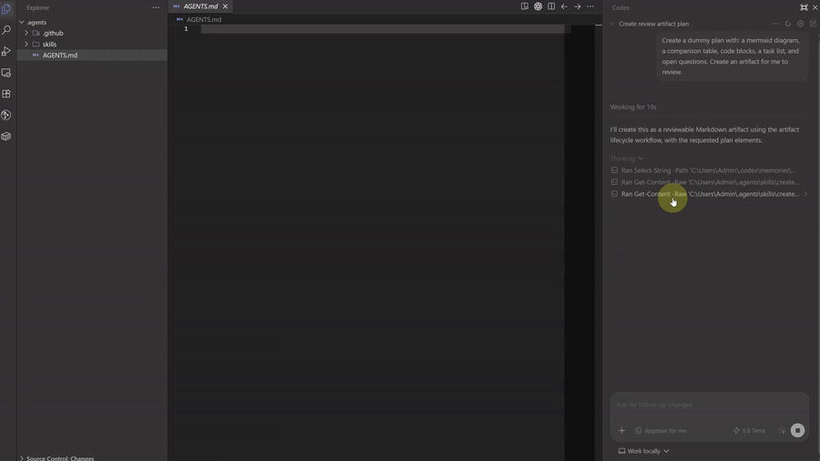
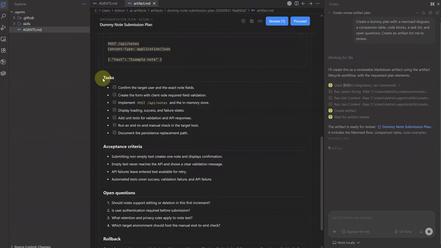
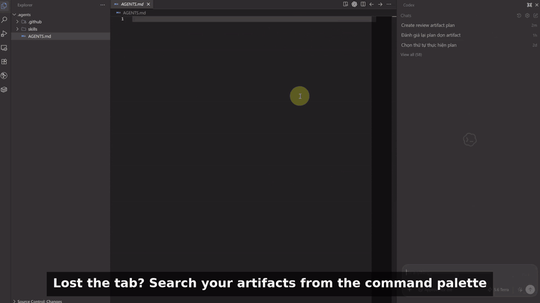

> This project was built through vibe coding with AI.

# AI Artifacts - Interactive Review & Multi-Agent Work Sessions

📦 [VS Code Marketplace](https://marketplace.visualstudio.com/items?itemName=huynguyen294.ai-artifacts) · 🌐 [Open VSX](https://open-vsx.org/extension/huynguyen294/ai-artifacts) · 🐙 [GitHub](https://github.com/huynguyen294/ai-artifacts)

**AI Artifacts** is an interactive artifact review editor that lets AI coding agents such as Cursor, Codex, Claude, GitHub Copilot, Cline, Windsurf, and Antigravity create planning artifacts, Markdown specs, and technical write-ups directly in your IDE. Add inline comments, request revisions, and approve plans for execution through MCP and agent skills.

**Multi-Agent Work Sessions** keep related artifacts and shared instructions together across agents and chats. Organize ongoing work, define rules and workflows, and connect another agent to continue with the session’s latest artifacts and instructions.

## Contents

- [How It Works](#how-it-works)
- [Requirements & compatibility](#requirements--compatibility)
- [Getting started](#getting-started)
- [Customizing the Review Skill](#customizing-the-review-skill)
- [Verification & troubleshooting](#verification--troubleshooting)
- [Features & Usage](#features--usage)
  - [Create & Review Artifacts](#create--review-artifacts)
  - [Search & Reconnect Artifacts](#search--reconnect-artifacts)
  - [Multi-Agent Work Sessions](#multi-agent-work-sessions)
  - [Organize Session Artifacts](#organize-session-artifacts)
  - [Shared Instructions](#shared-instructions)
- [Storage, behavior and security](#storage-behavior-and-security)
- [Compatibility and upgrades](#compatibility-and-upgrades)
- [Uninstalling and cleanup](#uninstalling-and-cleanup)
- [Development](#development)
- [Documentation](#documentation)

## How It Works

1. **Ask for an artifact** — Ask your AI agent to create a plan or write-up as an artifact. It opens in your IDE for review.
2. **Leave comments** — Select text and add feedback wherever you want changes or clarification.
3. **Choose what happens next:**
   - **Review** — Send your comments to the agent for revision.
   - **Proceed** — Approve the plan and let the agent execute it.
   - **Just save** — Save the document without executing the plan.
   - **Copy Markdown** — Copy the document’s Markdown to your clipboard.

**Create an artifact**



**Leave inline feedback**



**Pick it up in a new chat**



**Continue the same work across agents and chats**

Keep related artifacts and shared instructions in one Work Session, then connect another agent to continue.

## Requirements & compatibility

- VS Code 1.95.0 or newer (or compatible editors like Cursor, Windsurf, Antigravity, VSCodium).
- An AI Agent or extension supporting MCP / Skills (e.g. Codex extension, Cursor Agent, GitHub Copilot, Windsurf Cascade, Claude, Antigravity).
- Node.js available as `node` in `PATH`; the installed MCP integration is launched with this command.
- The extension host and MCP process must run as the same OS user and see the same user filesystem. Remote or split-host topologies are unsupported in v1.1.x.
- When building from source: Node.js `^20.19.0 || >=22.12.0` and npm.

### Compatibility & Supported Agents

AI Artifacts connects to your favorite AI coding agents using the Model Context Protocol (MCP) and shared agent skills:

| AI / Environment                     | Integration Type                               |
| :----------------------------------- | :--------------------------------------------- |
| **Cursor**                           | MCP Server (`mcp.json`) + Skill                |
| **Codex** (VS Code)                  | Native MCP (`config.toml`) + Skill             |
| **Claude (VS Code Extension / MCP)** | MCP Server (`claude.json`) + Skill             |
| **GitHub Copilot** (VS Code)         | MCP Server (`mcp.json`) + Skill                |
| **Cline** (VS Code Extension)        | MCP Server (`cline_mcp_settings.json`) + Skill |
| **Antigravity**                      | MCP Server (`mcp_config.json`) + Skills        |
| **Windsurf**                         | MCP Server (`mcp_config.json`)                 |

## Getting started

### 1. Install the extension

- **From Marketplace / Open VSX:** Search for `AI Artifacts` in the Extensions view (`Ctrl+Shift+X` / `Cmd+Shift+X`) and click **Install**.
- **From a VSIX file:** Download the `.vsix` file from [GitHub Releases](https://github.com/huynguyen294/ai-artifacts/releases) and run the commands below, replacing `path/to/ai-artifacts.vsix` with the downloaded file's path:
  ```powershell
  code --install-extension path/to/ai-artifacts.vsix
  # Or in Cursor:
  cursor --install-extension path/to/ai-artifacts.vsix
  ```

To build the VSIX yourself from source, follow [Development](#development) below.

### 2. Install the AI / MCP integration

When AI Artifacts activates for the first time without an existing `~/.ai-artifacts/managed/integration-version.json` file, it prompts once with **Run Installer** to open the installer picker cleanly without scanning client configs first. You can also open it at any time from the Command Palette:

1. Open the Command Palette (`Ctrl+Shift+P` on Windows/Linux or `Cmd+Shift+P` on macOS) and run **`AI Artifacts: Installer`**.
2. Select one or more AI clients using the checkboxes. Detected clients and clients saved by earlier manual installs are selected by default; adjust the selection before running. Each row shows `Detected` / `Saved` badges where applicable and its configuration path.
3. Click **OK**, click the **Run** button in the title bar, or press **Enter** to install all selected clients in one operation. Use the same command to reinstall or repair selected integrations.

For custom setup:

- Run **`AI Artifacts: Copy MCP Configuration JSON`** to copy the ready-to-use JSON configuration snippet directly to your clipboard to paste into any MCP-compatible editor.
- Run **`AI Artifacts: Copy create-review-artifact Skill Markdown`** to copy the full agent review skill instructions directly to your clipboard to paste into custom agent prompts, system instructions, or skill files.

<details>
<summary>Installed runtime and skill locations</summary>

```text
# Centralized runtime & skill assets:
~/.ai-artifacts/managed/runtime/ai-artifacts-review-mcp.mjs  # Centralized MCP runtime server
~/.ai-artifacts/managed/workspaces/                          # Live workspace heartbeat registry
~/.ai-artifacts/managed/integration-version.json             # Installed MCP/skill version receipt
~/.ai-artifacts/managed/installed-clients.json               # Saved manual client selection list
~/.agents/skills/create-review-artifact/                     # Shared review artifact skill & instructions
~/.agents/skills/work-session/                               # Shared work session skill & instructions
~/.claude/skills/create-review-artifact/                     # Claude Code review artifact skill
~/.claude/skills/work-session/                               # Claude Code work session skill
~/.gemini/config/mcp_config.json                             # Antigravity MCP server config
~/.gemini/config/skills/create-review-artifact/              # Antigravity review artifact skill
~/.gemini/config/skills/work-session/                        # Antigravity work session skill
```

</details>

The installer preserves all unrelated MCP configurations, custom skills, and workspace files.

### 3. Reload and verify the integration

After an install command succeeds for one or more clients, choose **Reload Window** in the completion notification (or reload manually) and restart any external AI clients to load the new tools and skill.

1. Click **Reload Window** on the notification, or run **Developer: Reload Window** from the Command Palette.
2. Restart your AI chat extension or external AI client.
3. Start a new chat.
4. Optional: Run **AI Artifacts: Verify All Integrations** from the Command Palette to check on-disk `Ready` status for shared assets and client configs.

> [!NOTE]
> **After an extension update:** On activation, AI Artifacts reads `~/.ai-artifacts/managed/integration-version.json` once. When no receipt file exists yet, it skips client detection and automatic upgrade and offers **Run Installer** (until clicked or already configured). When a receipt file exists, it automatically upgrades outdated managed assets and reconciles required client tool definitions for your saved and detected AI clients without prompting you to click a separate installer button. Successful, unchanged, and empty-target runs stay silent; VS Code displays a single error notification naming the failed client(s) and **AI Artifacts: Installer** only if automatic upgrade fails. Extension-only UI or documentation updates with current receipts leave installed files untouched. Whenever the managed MCP runtime, client definition, or skills change on disk, restart the affected AI client and start a new chat so it loads the updated tools and skills.

<details>
<summary>Runtime version and expected tools</summary>

The current source bundles numeric MCP version 12, review skill version 4, and work session skill version 1 (with `SKILL_VERSION = 4` bridge constant). The MCP catalog contains exactly six tools: `resolve_artifact_window`, `create_artifact`, `wait_for_artifact_review`, `inspect_artifact_review`, `advance_and_wait_for_artifact`, and `join_session`. Clients using an older tool catalog require reloading/upgrading (or running **AI Artifacts: Installer** and selecting the affected client) followed by a client restart and fresh chat to expose the current tools.

MCP version 12 is reserved for the unreleased Work Session feature and remains its release version across implementation stages. The current runtime supports schema-v2 Sessions and explicit migration from legacy v1 conversations. Session instructions are read from `instructions.md`; existing v2 metadata may still contain an optional inline `instructions` string, which is accepted but not used as the instructions source. New metadata writes omit that field. Updating a test runtime bundle still requires reinstalling the changed runtime even when its numeric version remains 12.

</details>

### Optional: Antigravity global rule

The AI Artifacts installer manages `~/.gemini/config/mcp_config.json` and both skills (`create-review-artifact` and `work-session`). Any global rule is **optional** and **user-managed**—AI Artifacts never reads, writes, checks, or removes your Antigravity rule files.

Choose **one** of the following options (do not duplicate both):

**Preferred — modular global rule file (`~/.gemini/config/rules/ai-artifacts.md`):** Create `~/.gemini/config/rules/ai-artifacts.md` and copy the exact content below:

```markdown
---
trigger: always_on
---

# Artifact Creation Policy

- For every explicit request to create an artifact, use the
  `create-review-artifact` skill through the `ai_artifacts` MCP server.
- Do not use Antigravity's built-in artifact creation workflow
  for these requests.
```

**Alternative — append to `~/.gemini/GEMINI.md`:** Append only the Markdown section starting from `# Artifact Creation Policy` (omit the first three `---` / `trigger: always_on` / `---` YAML frontmatter lines) to `~/.gemini/GEMINI.md`, keeping your existing rules intact.

## Customizing the Review Skill

The installer maintains independent copies of `create-review-artifact` for each detected skill target:

- `~/.agents/skills/create-review-artifact/SKILL.md` for Codex, Cursor, GitHub Copilot, Cline, and other clients that use the shared agent-skills directory.
- `~/.claude/skills/create-review-artifact/SKILL.md` for Claude Code. Its customization is preserved independently and is not copied from `.agents`.
- `~/.gemini/config/skills/create-review-artifact/SKILL.md` for Antigravity. Its customization is also preserved independently and is not copied from `.agents` or `.claude`.

Open any copy directly in your editor (replace `code` with `cursor` when appropriate):

```shell
code ~/.agents/skills/create-review-artifact/SKILL.md
code ~/.claude/skills/create-review-artifact/SKILL.md
code ~/.gemini/config/skills/create-review-artifact/SKILL.md
```

The installer preserves two supported customization regions across skill updates:

1. **Trigger — YAML `description:`**: Edit the `description:` field in the frontmatter to change when the host should activate the skill. A value that differs from the current or a previously released official description is treated as user customization and retained.
2. **Behavior — `USER CUSTOM RULES`**: Put custom behavior between the markers at the end of `SKILL.md`:

   ```markdown
   <!-- >>> USER CUSTOM RULES >>> -->

   Write artifacts in Vietnamese. Keep implementation plans component-oriented.

   <!-- <<< USER CUSTOM RULES <<< -->
   ```

   Rules in this block override conflicting default skill rules. You may fully customize behavior here, including document language, chat response language, plan layout, or workspace file conventions. They cannot override system or developer instructions enforced by the AI host.

The sibling `work-session` skill (`~/.agents/skills/work-session/`, `~/.claude/skills/work-session/`, and `~/.gemini/config/skills/work-session/`) is updated directly from official bundled assets without customization merging.

`Ready` means the packaged skill assets and client configuration are current after merging these supported customization regions. It does not prove that custom rules remain semantically compatible with the official artifact lifecycle, and it does not check user-managed client rules or MCP permission policies.

If the installer reports malformed YAML or custom-rule markers, it stops before replacing the installed skill. Back up the custom description and rules, then run **AI Artifacts: Copy create-review-artifact Skill Markdown** to obtain a clean official `SKILL.md`, or restore/reinstall the skill and add customizations back incrementally.

## Verification & troubleshooting

To ensure AI Artifacts is ready, verify the components and consult common troubleshooting steps if needed:

### 1. Automated check via command

Run **`AI Artifacts: Verify All Integrations`** from the Command Palette (`Ctrl+Shift+P` / `Cmd+Shift+P`):

- **Review skill / Work session skill (.agents):** Must report **Ready** (confirms the bundled `create-review-artifact` assets—after preserving supported customization regions—and `work-session` assets are current in `~/.agents/skills/`; it does not validate custom-rule semantics or client rule/permission policies).
- **Base (.vscode):** Must report **Ready** (confirms central MCP runtime server is deployed to `~/.ai-artifacts/managed/runtime/`).
- **Clients:** Shows detected configuration and managed skill status for each supported AI editor (including Claude and Antigravity). `Ready` confirms on-disk config and managed skill files, not whether optional user global rules or permission policies are active.

### 2. Agent customization check (or manual setup)

If the verify command reports `missing` (or you prefer manual setup), check directly in your Agent's **Customization / Settings** view:

- **MCP Server:** Confirm `ai_artifacts` is enabled with tools like `create_artifact` and `inspect_artifact_review`. If missing, run **`AI Artifacts: Copy MCP Configuration JSON`** from the Command Palette and paste the snippet into your agent's MCP settings.
- **Skills:** Confirm `create-review-artifact` is available (type `$create-review-artifact` in chat or check active skills). If missing, run **`AI Artifacts: Copy create-review-artifact Skill Markdown`** to copy the skill instructions directly to your clipboard, configure your agent to load skills from `~/.agents/skills/` (or `~/.gemini/config/skills/` in Antigravity), or copy `~/.agents/skills/create-review-artifact/` into your agent/workspace skills directory. If Antigravity defaults to its built-in workflow on untagged artifact prompts, see [Optional: Antigravity global rule](#optional-antigravity-global-rule).

> [!NOTE]
> **Prerequisites:** Requires **Node.js** in `PATH` to run the MCP server. Always reload the window and start a fresh chat turn after changing configurations.

> [!TIP]
> **Optional Antigravity MCP permission policy:** Antigravity MCP tool calls may require confirmation depending on your permission policy. If you trust the local `ai_artifacts` server and want to reduce repeated prompts across review rounds, you can optionally configure an Allow rule for `ai_artifacts` using the documented permission policy pattern `mcp(ai_artifacts/*)`—see [Antigravity MCP permissions](https://antigravity.google/docs/mcp#mcp-permissions-and-access-control). `mcp(ai_artifacts/*)` is a permission policy pattern, **not** a JSON field for `mcp_config.json` and not a shell command; do not add it to `mcp_config.json` or turn on global allow-all settings for unrelated servers. This is user-managed and optional—authorizing MCP calls does not replace **Review** or **Proceed** actions in AI Artifacts.

### 3. Common runtime errors & recovery

- **MCP tools are unavailable:** Run **AI Artifacts: Installer**, select the affected AI client, and confirm with **OK**, **Run**, or **Enter**. Restart your AI extension/editor and start a fresh chat (a chat that was already open cannot load tools installed afterward). Also verify that `node` is available in `PATH`.
- **`WINDOW_NOT_FOUND` / `WINDOW_SELECTION_REQUIRED`:** Ensure VS Code is running. When multiple windows exist and focus/affinity is ambiguous, select the matching window candidate and retry with the single-use selection token (`targetMode: "explicit-window"`).
- **Window selection expired or closed:** Retry creation or inspection without the expired token to refresh live window candidates. After creation, keep the exact artifact handle and retry `inspect_artifact_review` with reconnect intent.
- **A round token expired or the MCP restarted:** The existing content remains intact. Ask the AI agent to inspect the exact artifact path again to obtain a fresh token and reconnect.
- **A configuration conflict is reported:** Remove or rename the unmanaged `[mcp_servers.ai_artifacts]` entry in your configuration file, then run **AI Artifacts: Installer** again and select the affected client.

## Features & Usage

### Create & Review Artifacts

#### Ask your AI to create a review artifact

In your AI chat (Codex, Cursor, etc.), request a review artifact for your task:

```text
Create a review artifact for this API design.
Use $create-review-artifact to draft an implementation plan before writing code.
```

Asking for a plan or Markdown document without explicitly requesting an artifact does not activate the review lifecycle. Explicit requests to inspect saved feedback or reconnect a known artifact can resume an existing lifecycle.

#### Open the Artifact Review editor

The review editor opens automatically in the focused IDE window, or the only open window. If the target window is unclear, the agent asks you to choose one.

If it doesn't open, run **AI Artifacts: Open Artifact Review**. You can control automatic opening with `agentPlus.autoOpenArtifactReview`.

A file link in the agent's response is a regular file link, not a deep link, and may open `artifact.md` in the default Markdown text editor instead of the review editor. To reopen that artifact in the review editor, right-click `artifact.md` in Explorer, in the Markdown editor, or on its editor tab and choose **Open Artifact Review**. The command validates the artifact before opening it. The target may be unfocused; other windows ignore the event.

#### Review, annotate, and drive execution

Click a local file link in the review document to open it in the VS Code text editor. Use an absolute path (`D:/project/src/app.ts` or `/project/src/app.ts`) or a `file://` URL. Missing files and directories report an error; relative paths are not resolved. HTTP, HTTPS, and mail links continue to open externally.

1. **Highlight text:** Select any paragraph, heading, list item, quote, code block, or table cell.
2. **Add inline comments:** Type your feedback in the floating comment popover. Press `Enter` or click **Comment** to save your feedback.
3. **Browse feedback:** Open the **Comments (N)** drawer to jump between annotated passages.
4. **Submit your decision:**
   - **Review (Revise):** Sends your full batch comments and continuation instructions directly to the waiting AI, including after each advanced round. The agent answers questions in chat, updates the Markdown where changes were requested, and opens the next review round. If your comments only ask questions, the agent answers in chat and opens the next round without changing the document.
   - **Proceed:** Approves the artifact and concludes the review. For `plan` and `implementation-plan`, the agent starts carrying out the approved work immediately. For other artifact kinds, the agent acknowledges approval without automatically executing code.
   - **Just save:** Saves the Markdown to a designated workspace path without executing code.
   - **Copy Markdown:** Copies the document's Markdown to your clipboard without ending the review.

> [!TIP]
> **Send feedback from chat:** You can also save comments without clicking _Review_, then simply tell your AI in chat: _"Read the review"_ or _"Check the review comments"_. The AI will inspect the exact artifact, answer your notes, and advance the review round.

If you haven't saved any comments or submitted a decision for the current round, you can request a change directly in chat—for example, “add a rollout phase to this artifact.” The agent updates the document and opens the next review round.

For a direct update to an existing artifact as part of the chat's active Work Session, the agent commits the update and continues working by default. Ask explicitly to update and wait for review when you want it to pause. New artifacts always wait for review; standalone updates and processing saved review feedback keep their existing review flow. If an AI request is already waiting on that artifact, the update keeps it waiting and your next submission returns the updated round and feedback to that request. The agent can attach a waiter later when none is active and you request review.

### Search & Reconnect Artifacts

1. Run **AI Artifacts: Search Artifact** from the Command Palette.
2. Search by title and select an artifact to open it.
3. Click **Inspect artifact** in the review editor to copy the prompt for that exact artifact.
4. Paste the prompt into your AI chat to reconnect.

Inspect focuses on the selected artifact. If the chat is already connected to a Work Session, the agent also adds or refreshes that artifact in the active session. Ask explicitly to inspect it as a standalone artifact when you want to leave its session memberships unchanged.

### Multi-Agent Work Sessions

Use a Work Session for ongoing work that spans multiple artifacts, agents, or chats. A session keeps its artifacts and shared instructions together, so you can move from planning with one agent to implementation or review with another.

#### Start from an artifact

1. Open an artifact that does not yet belong to a session and click **Start a work session**.
2. Enter a name. The session is created with the default **Conversation** type, and the current artifact is added to **Working**.
3. The Session Manager opens and its Connect prompt is copied to your clipboard.
4. Paste the prompt into your AI chat. The agent uses the `work-session` skill to join the session and receive its instructions and artifact catalog.

If the artifact already belongs to sessions, use **Sessions** to open or choose one. Legacy conversations offer migration to Work Sessions before you use them as sessions; migrate an individual conversation there or use the migration entry in the Sessions sidebar.

#### Continue with another agent or chat

Open the session from the **Sessions** sidebar or an artifact’s **Sessions** button, click **Connect** in the Session Manager, and paste the prompt into the other AI chat. After joining successfully, that chat uses the same session’s artifacts and instructions. Each chat retains its own conversation history.

A chat has at most one active Work Session, while a session can be used by multiple agents and chats. Copying a prompt or opening the manager connects the chat only after the agent successfully joins through MCP. Joining another session replaces the chat’s active session after success.

Once connected, artifacts created or inspected in that chat are automatically added to the active session. You can request a standalone artifact for an individual task while keeping the session active for later requests. A chat without an active session can create and review standalone artifacts without starting a Work Session.

For related work, the Session skill reads the latest shared instructions and relevant artifact Markdown. When it needs to find a new artifact or get a session overview, it refreshes the catalog with `join_session`. Reading a reference document through its catalog path leaves its review lifecycle unchanged.

### Organize Session Artifacts

1. Open the **AI Artifacts** view container in the Activity Bar to access **Recent Artifacts** and **Sessions**.
2. In **Recent Artifacts**, use the filter to select an artifact kind or **Other** for custom kinds. Use **View all** to search beyond the recent list.
3. In the **Sessions** header, use **Add Session** to create an empty session, **Filter Sessions** to filter by session type, **Search Sessions** to find a session by name, or **Manage Session Types** to add, rename, or delete global session types.
4. Select a session to open the Session Manager. Rename it or change/quick-create its **Session Type** independently of artifact kinds.
5. Click **＋** beside **Working** to choose an existing artifact from a Quick Pick. The selected artifact is added to the end of Working; it can belong to more than one session.
6. Use artifact menus to move items between **Working**, **References**, and **Archived**, reorder them with **Move Up** / **Move Down**, or **Remove from session** without deleting the artifact itself.
7. Use the in-session filter bar to search artifacts by title or filter by artifact kind across all zones. Cards display title, kind badge, a 2-line description snippet, and updatedAt timestamp.
8. Use the More (`⋯`) menu in the Session Manager header to **Export** the session to a `.zip` archive containing `Instructions.md` and organized folders (`Working/`, `References/`, `Archived/`) with numbered Markdown files, or to **Archive** or **Delete** the session.

Working occupies the main column with a responsive grid layout. References and Archived appear in the collapsible side panel (fixed 2 columns), whose visibility is remembered separately for each session. The in-session Archived zone is a layout zone within the session; it differs from global artifact archiving. Global session archives are automatically pruned according to the shared `agentPlus.artifactRetentionDays` setting (default 90 days), measured from `session-ui-state.json.archivedAt`.

### Shared Instructions

Session Instructions hold rules, workflows, and other guidance for agents working in that session. For example, describe the module’s conventions, the preferred development workflow, or which design decisions agents should follow.

- Edit Markdown directly in the **Instructions** text area and click **Save**.
- Use **Open Markdown File** to edit the session’s `instructions.md` in your editor. You can also ask an agent to update that file explicitly.
- Closing or reloading the manager before clicking Save discards unsaved text. Changes saved to `instructions.md` outside the manager are reflected in the open Instructions field.

The `work-session` skill applies the latest instructions to related requests and uses the artifact catalog to find supporting plans, references, or other documents. Instructions are stored in `instructions.md` inside the session directory; the file is separate from session metadata and artifact review state.

## Storage, behavior and security

### Artifact storage and structure

The AI agent calls the MCP `create_artifact` tool, which generates an isolated schema-v6 review bundle in the global per-user collection:

```text
~/.ai-artifacts/artifacts/<server-generated-id>/
  artifact.json
  artifact.md
  comments.json
  review-submission.json  # Present after a decision is submitted
  artifact-connection.json # Optional schema-v1 target-window routing state
  artifact-ui-state.json   # Optional Pin/Archive state; archivedAt drives retention

~/.ai-artifacts/conversation-registry/<session-id>/
  conversation.json       # Schema-v2 Work Session metadata
  instructions.md         # Shared Markdown instructions; empty if absent
  layout.json             # Ordered Working, References, and Archived zones
  registered-artifacts/   # Independent artifact membership records
```

`artifact.json` records the schema-v6 manifest `{ schemaVersion: 6, kind, artifactId, title, createdAt, updatedAt, reviewRound, reviewSessionId }` without workspace ownership fields. Artifacts are owned by review sessions, not repository paths. Optional `artifact-connection.json` contains only UI-routing state (`windowInstanceId`, connection revision, open-request ID, source, and timestamp); it never replaces the manifest.

Work Sessions organize artifacts independently of their review lifecycles and AI chat histories. A standalone artifact needs no session registry entry, and an artifact can belong to multiple Work Sessions. Retention cleanup removes expired artifact references from session membership and layout while preserving empty v2 sessions.

### Automatic retention cleanup

> [!WARNING]
> **Automatic Retention Cleanup:** Each time the extension activates, AI Artifacts permanently deletes only globally archived artifacts whose `artifact-ui-state.json` `archivedAt` is at least the configured number of days old (default **90 days**). This setting is machine-scoped (`agentPlus.artifactRetentionDays`, minimum 1 day). Artifacts without the state file or without `archivedAt` are treated as unarchived and kept regardless of age; no migration is needed. Restore cancels automatic deletion eligibility, and archiving again starts a new retention period. Pin and `artifact.json.updatedAt` do not change this countdown; moving an artifact into a Session's Archived zone does not archive it globally. Artifacts are not recoverable after deletion. Before cleanup, restore them or save a copy with **Just save**, **Copy Markdown**, or manual export. Reinstall activation may delete archived artifacts whose retention expired during the extension's absence.

The retention setting also applies to globally archived Work Sessions, using `session-ui-state.json.archivedAt`. Session cleanup removes Session data and memberships while preserving shared artifacts; each artifact remains subject to its own Archive retention.

### Behavior and security

- **Safe Lifecycle:** Artifact data outlives transient MCP connections. Process restarts, waiter cancellations, or new chat turns never destroy unreviewed artifacts. Only globally archived artifacts are automatically deleted after their configured retention period, when the extension activates.
- **Session-Centric Artifact Ownership:** Artifacts belong to interactive review sessions in global storage, completely decoupled from repository directories.
- **Focused-First Window Routing:** The MCP server connects to the currently focused VS Code window by default, with explicit selection tokens when window focus is ambiguous. Non-target windows ignore connection events.
- **Transactional Updates:** Multi-round revisions are transactional; failed commits automatically roll back, including the Windows editor-lock fallback.
- **Local & Private:** Everything runs locally on your machine via stdio MCP. No code, Markdown, or telemetry is sent to an AI Artifacts server. Your configured AI client may still process content according to that client's own privacy policy.
- **Content Sanitization:** Rendered with CommonMark/GFM with syntax highlighting (Shiki) and diagram rendering (Mermaid). Unsafe raw HTML, scripts, and remote protocols are disabled.
- **Sensitive Local State:** `~/.ai-artifacts/` may contain source excerpts, specifications, comments, and decisions. On POSIX systems, managed artifact directories are tightened to owner-only `0700` and lifecycle files to `0600`; Windows uses the account and filesystem ACLs rather than claiming POSIX-mode guarantees.

## Compatibility and upgrades

- Version 1.1.0 supports only schema v6 stored under `~/.ai-artifacts/artifacts/`.
- The current integration uses numeric `MCP_VERSION = 12`, `CREATE_REVIEW_ARTIFACT_SKILL_VERSION = 4` (`SKILL_VERSION = 4`), and `WORK_SESSION_SKILL_VERSION = 1`. These are independent monotonic asset versions, not SemVer and not the extension package version.
- Successful manual client installation merges the client selection into `~/.ai-artifacts/managed/installed-clients.json`; successful manual uninstall removes only the selected client IDs from that list. Installed MCP runtime, shared `.agents` skills (`skills` and `sessionSkills`), Claude, and Antigravity skill versions are tracked independently in `~/.ai-artifacts/managed/integration-version.json`. An absent or mismatched receipt entry is stale.
- On extension activation, AI Artifacts reads `~/.ai-artifacts/managed/integration-version.json` once. When the version file is absent, it skips client detection and automatic upgrade and offers **Run Installer** once until clicked (re-offering on later activations if dismissed while still absent). When an existing valid or invalid receipt file is present, AI Artifacts runs an asynchronous automatic upgrade across the merged `saved ∪ detected` client set: it deploys stale shared assets once, commits receipts as steps complete, reconciles required client definitions (such as adding `join_session` to Codex's managed config), and updates stale Claude/Antigravity skills while keeping current files, customizations, and Antigravity rules/permissions untouched. Healthy updates, unchanged clients, and runs with no target clients stay silent.
- Automatic upgrade never auto-installs unconfigured clients or overwrites damaged skills when receipts are current. Use **AI Artifacts: Verify All Integrations** to inspect on-disk `Ready` status, and run **AI Artifacts: Installer** to add or repair clients. If reading the receipt file or running an automatic upgrade hits an error, VS Code shows a single error notification naming the failed client(s) (when applicable) and **AI Artifacts: Installer**, with a **View Installation Guide** action.
- Schema v3/v4/v5 and workspace-local `.ai-artifacts` or `.codex-artifacts` lifecycles are not opened, advanced, or migrated by v1.1.x. Existing files remain untouched on disk.
- This is a hard compatibility cutoff. A rollback to a 0.9.x extension also requires reinstalling the matching older runtime and skill; do not use a 0.9.x runtime with v1.1.x artifacts.
- Extension-only updates with current receipts leave already installed files untouched without warnings.
- Upgrades and manual reinstalls preserve a valid custom `description:` and `USER CUSTOM RULES` block. Malformed customization fails closed without replacing the existing skill; fix the reported target, then run **AI Artifacts: Installer** and select the affected client again.
- After an automatic upgrade or manual reinstall updates assets or client definitions on disk, restart the affected AI client and start a new chat so it loads the updated runtime, tool definitions, or skills (AI Artifacts does not restart external clients or live chats automatically).

## Uninstalling and cleanup

AI Artifacts provides two comprehensive ways to remove MCP configurations and runtime assets:

- **Automatic Cleanup upon Extension Uninstall:** When you uninstall the AI Artifacts extension from VS Code or Cursor (`Extensions -> Uninstall`), an automated lifecycle hook (`vscode:uninstall`) runs a standalone script that automatically removes the `ai_artifacts` MCP configuration from all detected AI clients and completely deletes managed runtime and skill assets (`~/.ai-artifacts/managed/`, legacy `~/.vscode/ai-artifacts/`, `~/.agents/skills/create-review-artifact/`, `~/.agents/skills/work-session/`, `~/.claude/skills/create-review-artifact/`, `~/.claude/skills/work-session/`, `~/.gemini/config/skills/create-review-artifact/`, and `~/.gemini/config/skills/work-session/`).
- **Manual Cleanup via Command Palette:** To disconnect integrations while keeping the extension active, run **`AI Artifacts: Uninstall`**, select the clients to remove using the checkboxes, then click **OK** or press **Enter**. No clients are selected by default. Each selected client has its managed configuration and client-specific skills removed independently; failures are summarized without stopping the remaining clients. Successful removal, including clients already not configured, removes their IDs from the saved client list. Shared runtime and skills are retained while any client still needs them or its usage cannot be determined. Shared cleanup runs once after the selected clients finish, only when no client remains dependent and no removal failed. Closing the picker or confirming an empty selection makes no changes. Restart affected AI clients after removal.

> [!IMPORTANT]
> **Artifact Data and User Rules Are Retained on Uninstall:** Neither uninstall method deletes user review data in `~/.ai-artifacts/artifacts/`, Work Sessions in `~/.ai-artifacts/conversation-registry/`, or user-managed global rules (`~/.gemini/config/rules/`, `~/.gemini/GEMINI.md`). Uninstall removes only managed client configuration, installed MCP runtime assets (`~/.ai-artifacts/managed/`), legacy `~/.vscode/ai-artifacts/`, and the managed skills. Delete the global artifact collection separately only when you intentionally want to erase review data.

## Development

Requirements: Node.js `^20.19.0 || >=22.12.0` and VS Code 1.95.0 or newer.

```powershell
npm ci
npm run check
npm test
npm run build
```

Press `F5` to launch an Extension Development Host. Package and install locally:

```powershell
npm run package
code --install-extension releases/ai-artifacts-1.1.4.vsix
```

## Documentation

- [Product philosophy](docs/PHILOSOPHY.md) — product intent, lifecycle semantics, and non-goals.
- [Architecture](docs/ARCHITECTURE.md) — system boundaries, ownership, workspace registry, and filesystem safety.
- [Components and responsibilities](docs/COMPONENTS.md) — detailed component and ownership map.
- [Project instructions](docs/INSTRUCTION.md) — contributor invariants, workflow, and validation requirements.
- [Artifact contract](skills/create-review-artifact/references/artifact-contract.md) — exact skill and MCP lifecycle contract.
- [Changelog](CHANGELOG.md) — release history.
- [Documentation change logs](docs/CHANGE_LOGS.md) — meaningful documentation and architecture decisions.
- [MIT License](LICENSE) — project license.
