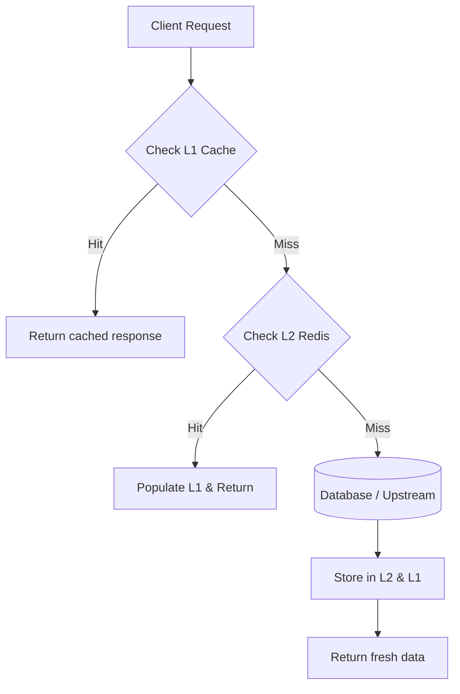

# Implementation Plan: Resilient Distributed Cache

This proposal outlines the implementation of a resilient, multi-tiered cache layer for the API gateway to reduce downstream latency and protect microservices from traffic surges.

## 1. Overview & Goals

The distributed cache cluster will use Redis as the primary memory store with an in-process LRU cache (L1) for hot keys. Key requirements include:
- Sub-millisecond read latency for L1 cache hits.
- Bounded memory footprint (max 256MB per instance for L1).
- Automatic cache stampede mitigation using mutex locks and probabilistic early expiration.

## 2. Architecture & Data Flow

The following diagram illustrates the lookup lifecycle across client requests, L1 memory, and L2 distributed cache:



## 3. Configuration & Code Example

Cache clients will initialize using the standard interface below:

```typescript
export interface CacheConfig {
  readonly l1TtlMs: number;
  readonly l2TtlMs: number;
  readonly maxL1Items: number;
  readonly keyPrefix: string;
}

export class DistributedCacheService {
  constructor(private readonly config: CacheConfig) {}

  async get<T>(key: string): Promise<T | null> {
    // 1. Try local memory
    const local = this.readL1(key);
    if (local !== undefined) return local as T;

    // 2. Fallback to cluster
    return this.fetchL2WithLock(key);
  }
}
```

```ts
type CreateNoteRequest = {
  text: string;
};

type CreateNoteResponse = {
  id: string;
  createdAt: string;
};

type ApiError = {
  code: "VALIDATION_ERROR" | "UNAVAILABLE";
  message: string;
};
```

## 4. Phase Breakdown

| Phase | Milestone | Expected Latency | Target Date |
| :--- | :--- | :--- | :--- |
| **Phase 1** | In-process L1 Cache with LRU eviction | < 0.2ms | 2026-11-01 |
| **Phase 2** | Redis Cluster L2 integration & telemetry | < 2.5ms | 2026-11-15 |
| **Phase 3** | Stampede prevention & chaos verification | < 1.0ms (P99) | 2026-11-30 |

## 5. Security & Risk Analysis

> Critical consideration: Sensitive PII must never be stored in L1 cache unencrypted. All session tokens stored in L2 must have mandatory TTLs bounded to at most 15 minutes.

- **Data Serialization**: Use MsgPack or Protobuf over raw JSON to reduce payload size by up to 40%.
- **Network Partitions**: In the event of Redis unreachable, system must fail open to database while logging circuit breaker alarms.

## 6. Implementation Checklist

### 1. Confirm product boundaries

- [ ] Confirm the target user, exact note fields, and whether submitted notes will be displayed elsewhere.
  - Decide whether this feature is create-only or also needs a list/detail view in the same delivery.
  - Freeze `text` as the only required field unless a stakeholder names another field before implementation starts.
  - Record the host app, route, and who will run the manual check.
  - **Done when:** the answers are written in the implementation notes and no extra fields are assumed.
- [x] Initial design review and architecture approval.
