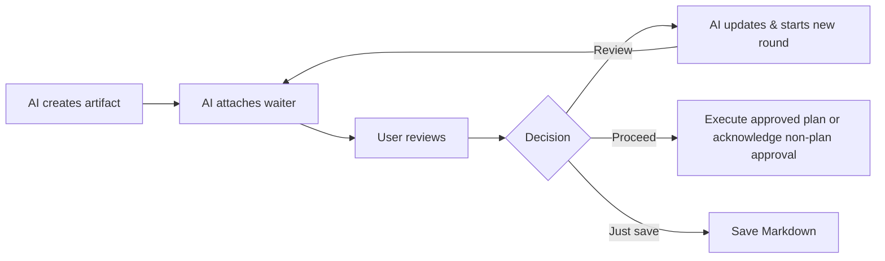

# Product Philosophy

## Artifacts are persistent review data; waiters are ephemeral connections

The core lifecycle rule is:

```text
artifact lifetime > waiter lifetime > chat-turn lifetime
```

An artifact represents a request awaiting human review and persists in the user's global AI Artifacts collection until the user deletes it or its global Archive retention expires. Only globally archived artifacts are subject to configured retention (`agentPlus.artifactRetentionDays`, default 90 days), measured from `artifact-ui-state.json.archivedAt`. An absent UI state file or absent `archivedAt` means unarchived: the artifact is kept regardless of age, without backfilling state or migrating data. Restore clears `archivedAt` and removes automatic deletion eligibility; archiving again starts a new retention period. Artifact reads and review-round advances do not reset this archive timestamp; `artifact.json.updatedAt` no longer determines retention. Artifacts belong to review sessions rather than repository paths, decoupling review lifecycles from workspace folder ownership. A waiter is merely a temporary connection between an active MCP request and an artifact identity, and can survive non-waiting round advances. Individual chat turns are shorter still.

Therefore, cancellations, takeovers, concluding a chat turn, or restarting the MCP server must never delete or terminate an artifact. They only clear in-memory waiters or active round tokens. The AI can inspect the exact known artifact handle, obtain a fresh token from validated persistent state, and reconnect later. However, an exact handle may become permanently missing after retention cleanup; in that case, the AI must not retry, scan for a replacement, or recreate the same artifact ID.

To preserve archived content beyond its retention window, restore the artifact or save a copy with **Just save**, **Copy Markdown**, or a manual export before cleanup.

## Two ways to interact with the same artifact

The default flow provides an intuitive, in-editor review experience:



The chat escape flow allows the user to save comments and say "read the review" without pressing the Review button. The previous waiter is safely cancelled; the AI inspects the exact artifact handle, reads the comments, and:

- Answers questions directly in chat.
- Revises the artifact if comments request changes.
- Both answers and edits if feedback is mixed.
- Clarifies in chat without consuming the round if feedback is ambiguous.

After processing, the AI starts the next round and attaches a new waiter. If feedback consisted solely of questions, the round advances while preserving the exact bytes and SHA of `artifact.md`. If no comments or submissions were saved, the AI reattaches to the current round without advancing, unless the user explicitly requested an artifact edit directly in chat (`intent: "explicit-chat-update"`), in which case the AI updates the Markdown and advances to the next round.

For an explicit chat update to an existing artifact as part of the active Work Session, the Session skill defaults to committing without waiting, unless the user asks to wait for review. The artifact still advances its round and consumes its exact-state token; `waited: false` confirms a commit rather than a review decision. The AI records the new round and continues the authorized work, obtaining a fresh token for any later update. An existing waiter stays attached without takeover; its next validated submission supplies the current round, comments, and matching token. The expected round is an attachment precondition, not a restriction for the lifetime of the waiter. Creation always waits for review, including within a Session, while standalone updates and saved-feedback processing retain their existing wait behavior. User-requested checklist/progress content may be updated in an existing Session artifact under this narrow exception; it does not trigger automatic artifact creation or add task-manager UI.

## Meaning of review decisions

1. **Review:** Submits a `revise` decision. The waiting tool returns the full validated comments and a `process-review-feedback` directive so the AI can process them immediately without inspecting just to retrieve comments. This contract is shared by the initial wait and every advanced round, independently of client or model. The AI processes batch comments using the same policy as the chat escape flow: answers questions directly in chat, updates `artifact.md` only when edits are requested, resets state, and begins the next round. Question-only feedback preserves Markdown bytes and SHA. No revision history or conversational responses are inserted into the artifact document itself.
2. **Proceed:** Concludes the current review round. For `plan` and `implementation-plan`, this authorizes immediate execution of the entire approved plan within the same turn; the MCP server returns an `execute-approved-plan` runtime directive, and the AI must not halt at confirmation, explain what it will do, or ask for execution authorization again. For other fixed or open kinds, the MCP returns `approved`: acknowledge approval and conclude review without automatic code execution. It does not automatically open another review round.
3. **Just save:** Concludes the current round, saves the Markdown as requested, and does not execute proposed work. It does not automatically open another review round.
4. **Copy Markdown:** Copies content locally to the clipboard without submitting a decision or mutating lifecycle state.

Proceed and Just save conclude the round without destroying the artifact. The user may explicitly request a reconnect later. Reconnect opens a fresh round; it does not re-execute the previous Proceed or Just save action.

## Exact handles, no speculative artifact guessing

The AI must use the exact `artifactDirectory` returned when creating the artifact or retained from an interrupted waiter in the same conversation. It must never select the "newest artifact", scan the workspace to guess, or infer an artifact from the current working directory. If the context does not contain a single unique handle, the AI must ask the user for the artifact path.

This safety invariant takes precedence over convenience: binding to the wrong artifact could attach comments, document content, and execution authorization to the wrong conversation.

## Curated feature announcements (What's New & Tips)

AI Artifacts treats release announcements (**What's New & Tips**) separately from the exhaustive release changelog and from MCP/skill integration management:

- **Curated over exhaustive:** **What's New** presents high-level feature highlights and preview/release guides rather than every implementation detail in `CHANGELOG.md`; **Tips** focuses on practical workflows without turning the extension into an intrusive onboarding wizard.
- **Upgrade-only, silent for new users:** Fresh installs without notification history or a pre-existing integration receipt stay silent; there is no welcome/Tips popup or standalone Tips command. Missing notification state alone does not mean a new user: an existing `valid` or `invalid` integration receipt captured before activation install/upgrade identifies a legacy integration user who may receive the exact current opt-in announcement on first tracked activation. The integration receipt does not reveal the previous extension SemVer.
- **Exact-version opt-in, no catch-up:** After bootstrap, notifications require a higher stable `X.Y.Z` runtime version with an exact shared release entry setting `notify: true`. The `1.2.0` preview content currently opts in for notification testing. Intermediate skipped versions are never backfilled, and reloads, downgrades, dismissals, UI errors, or manual views via **AI Artifacts: What's New** never re-arm or replay a popup.
- **At-most-once within local global storage:** Claim ownership is persisted atomically before invoking VS Code's notification API (`notificationClaimed` records the pre-UI claim, not confirmed read status). Notification state and execution remain separate from **Run Installer** onboarding and automatic integration upgrades; bootstrap alone consumes their shared pre-mutation receipt snapshot. Existing baselines and version receipts are not reclassified when a new user subsequently runs Installer.

## Product intent

AI Artifacts provides a dedicated review layer for AI-generated Markdown. It enables users to read, annotate, and drive the feedback loop without turning the extension into a task manager or a second chat interface. Conversational interaction belongs in AI chat; the webview provides document review and Work Session organization: shared Instructions, artifact zones, and navigation across agents and chats.

The artifact skill triggers only when the user explicitly requests creating or updating an artifact, reading saved feedback, reconnecting an existing lifecycle, or authoring AI comments with or without submitting Review. AI-authored feedback has two actions: comment only, or generate comments and submit them as `revise`; it is separate from processing saved user feedback. The document type alone is never an auto-trigger condition. The separate Work Session skill handles explicit Session connection or continuation of related work with an already active Session.

## Current implementation status

The current implementation uses artifact schema v6, connection schema v1, Work Session registry schema v2 with legacy v1 migration, numeric MCP version 12, and numeric skill version 4 (`CREATE_REVIEW_ARTIFACT_SKILL_VERSION = 4`, `WORK_SESSION_SKILL_VERSION = 1`, `SKILL_VERSION = 4`). MCP 12 is reserved for the unreleased Work Session feature; its implementation stages do not each require a numeric MCP bump. Every lifecycle is stored beneath the per-user `~/.ai-artifacts/artifacts/` collection. `artifact.json` remains the source of truth for artifact identity without repository path ownership; optional `artifact-connection.json` records only the current UI-routing request. Schemas v3/v4/v5 and workspace-local artifact directories are outside the live protocol and are not migrated.

Session instructions use `instructions.md` as their only effective source. Existing schema-v2 metadata may retain an optional inline `instructions` string without invalidating the Session. Readers accept but do not use that string as fallback, and new metadata writes omit it. Listing or opening a Session does not migrate or rewrite its stored instructions.

Artifact protocol compatibility and installed integration freshness are separate concerns. `MCP_VERSION`, `CREATE_REVIEW_ARTIFACT_SKILL_VERSION`, and `WORK_SESSION_SKILL_VERSION` are independent monotonic counters, not SemVer and not aliases for the extension package version. `SKILL_VERSION` aliases only the artifact skill counter. Manual install commands record selected clients in `~/.ai-artifacts/managed/installed-clients.json`, while installed MCP and skill versions for `.agents`, `.claude`, and Antigravity (`.gemini/config`) are recorded independently (`mcpVersion`, `skills`, and `sessionSkills`) in `~/.ai-artifacts/managed/integration-version.json` as steps succeed (without implying post-install read-back verification); absent, invalid, or mismatched entries are stale. Missing `integration-version.json` marks first-time users for onboarding (`Run Installer` once until clicked, without running client detection or automatic upgrade). When an existing receipt file is present (`valid` or `invalid`), activation runs silent automatic upgrades for saved or detected clients across stale assets and required definition updates without prompting on success, unchanged runs, or empty targets; an error notification citing **`AI Artifacts: Installer`** appears only on failure. Manual install commands confirm operational completion and offer **`Reload Window`** alongside guidance to restart external AI clients and start a fresh chat. **`Ready`** readiness semantics belong strictly to manual **`AI Artifacts: Verify All Integrations`**.

Artifact skill updates preserve only the two declared customization points: a non-official YAML `description:` and the contents of the `USER CUSTOM RULES` block. The `.agents`, `.claude`, and Antigravity (`.gemini/config`) targets remain independent. The installer merges those values into the packaged skill before swapping directories and fails closed without replacing the target when frontmatter or markers cannot be preserved safely. The Work Session skill is replaced with official assets without customization merging. In **`AI Artifacts: Verify All Integrations`**, a `Ready` result proves on-disk asset synchronization and expected config state, not semantic compatibility of arbitrary custom rules with the official lifecycle.

A conversation often produces multiple related artifacts over time (for example, architecture designs, phased implementation plans, test checklists). AI Artifacts introduces the conversation registry (`~/.ai-artifacts/conversation-registry/<artifactConversationId>/`) to group these artifacts together for quick visual switching in the Work Sessions manager and sidebar. Work Sessions also share Instructions and categorized artifact context across agents and chats through `join_session`; they do not share another chat's transcript or couple separate artifact lifecycles or waiters. Artifacts remain independently reviewable, including standalone artifacts without memberships. Session navigation does not alter `artifact-connection.json`; explicit artifact reconnect retains its routing contract. Each chat keeps at most one active Session, adopts changes only after success, and never infers it from memberships. Related requests read current Instructions and artifact paths on demand; latest/current-overview requests refresh the catalog first. New non-null Session results replace the catalog without discarding separate review handles.

The `agentPlus.artifactRetentionDays` machine-scoped setting (default 90 days, minimum 1) controls retention after global Archive for both artifacts and Work Sessions, using each item's own `archivedAt` timestamp. Deleting a Session preserves its artifacts. When the extension host activates, a best-effort asynchronous cleanup enumerates validated schema-v6 artifacts and deletes candidates only when `now >= archivedAt + retentionDays`. It re-reads the manifest and Archive state before atomically renaming each expired candidate to managed cleanup staging (`~/.ai-artifacts/managed/cleanup/`) for permanent deletion. Missing UI state or `archivedAt` preserves the artifact; malformed or unreadable state is skipped. Pin does not exempt archived artifacts, and the in-session Archived layout zone does not enable global cleanup. Cleanup also prunes stale or unreferenced conversation registry entries and removes empty legacy v1 conversation directories while preserving empty v2 Work Sessions. Migration from v1 is explicit through the single/bulk UI; MCP access to v1 stops with `CONVERSATION_MIGRATION_REQUIRED`. Cleanup does not block activation, does not require a global lock (per-artifact atomic rename resolves multi-window races), and skips legacy, malformed, or linked entries. Active waiters terminate with `ARTIFACT_NOT_FOUND` when their artifact is deleted. Uninstall does not run retention cleanup; reinstall followed by activation may delete archived artifacts whose retention period expired during the extension's absence.

Window routing defaults to the currently focused live VS Code window (or sole live window), matching user mental models without requiring workspace resolution rituals. Generic reconnect routing additionally respects advisory artifact-window affinity when matching stored connection state and present in the registry. When multiple windows exist and focus/affinity is ambiguous, creation or inspection requests explicit candidate selection (`WINDOW_SELECTION_REQUIRED`), returning opaque single-use selection tokens. Focus is a ranking hint, not identity, authorization, or a requirement for opening the target. Selection tokens bind an exact window instance. After creation, all lifecycle operations use the exact global artifact handle.

Create and explicit reconnect atomically commit schema-v1 connection state containing a window instance ID, monotonically increasing connection revision, unique open-request ID, source, and timestamp. The extension window whose stable instance ID matches the request may open the editor even when unfocused; every other window ignores it. Wait and advance preserve routing state and cannot silently rebind an artifact. Reconnect may select another live window but never changes lifecycle identity, Markdown, comments, submission, review round, or a prior Proceed/Just save action.

The artifact skill requires five artifact tools, supports fixed or open kinds, verifies tool availability once per chat lifecycle, and manages exact handle-to-round mappings. The separate Work Session skill requires `join_session` for entry and refresh; the server catalog exposes six tools in total. Approval of plans directs immediate execution via `execute-approved-plan`, while non-plan approvals emit `approved` for chat acknowledgment without code execution. Reconnect, saved-comment inspection, and explicit chat updates follow an explicit decision table with fail-closed safety. Lifecycle errors supply structured recovery metadata so agents preserve handles and avoid duplicate commits. Round tokens remain in-memory, single-use, and state-bound with a one-hour expiration.

Artifact Markdown, comments, and decisions may contain sensitive project information. Local-only transport does not make the files non-sensitive: POSIX runtime paths are restricted to owner-only directory/file modes, users remain responsible for their account and Windows filesystem ACLs, and uninstall deliberately retains user review data in `~/.ai-artifacts/artifacts/` to prevent data loss.
