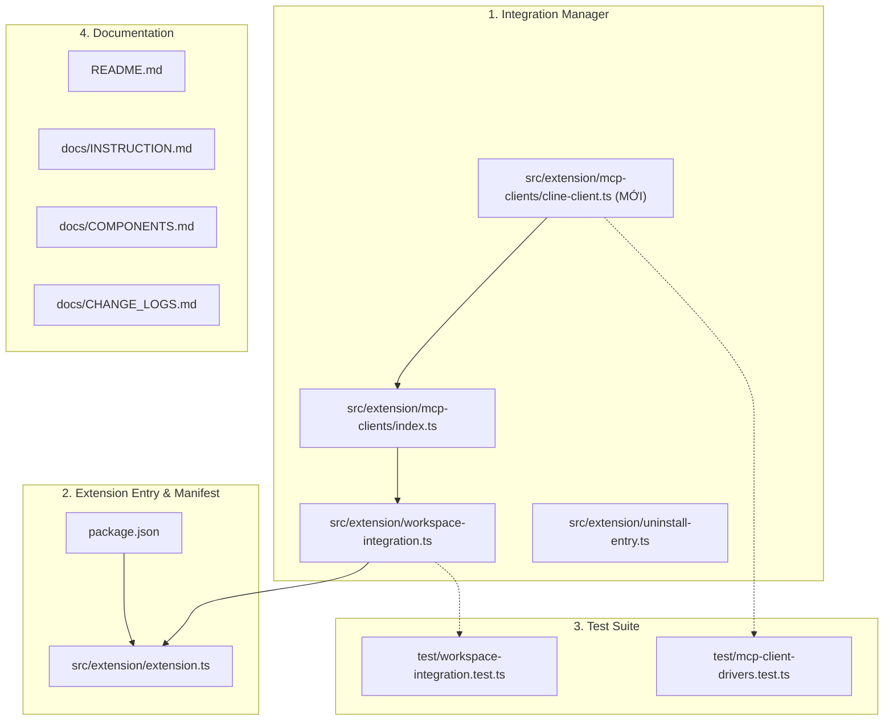

# Kế hoạch triển khai: Thêm Installer & Uninstaller cho Cline MCP Client

## 1. Mục tiêu & Nguyên tắc thiết kế (Core Constraints)

- **Mục tiêu**: Bổ sung bộ cài đặt và gỡ bỏ cấu hình MCP tự động cho client **Cline** (VS Code extension / Standalone CLI) vào extension AI Artifacts.
- **Nguyên tắc kỹ thuật**:
  1. **Strictly Additive**: Thiết kế thuần bổ sung, tuyệt đối không sửa đổi cấu trúc JSON helper (`json-mcp-helper.ts`) hoặc phá vỡ các client driver hiện hữu (`copilot`, `cursor`, `codex`, `claude`, `windsurf`).
  2. **Tách biệt Phase Quản lý Client (Phase Isolation)**: Việc đấu nối Cline vào danh sách quản lý chung (`getAllClientDrivers`, `installAllDetectedIntegrations`, `uninstallAllDetectedIntegrations`) được cô lập thành một phase riêng biệt để kiểm soát rủi ro và test kỹ hồi quy.
  3. **Không ảnh hưởng công việc dở dang (Uncommitted Isolation)**: Giữ nguyên toàn bộ các thay đổi chưa commit trên nhánh `feat/improve-reviewapp` (đặc biệt là `SKILL.md` và các test contract liên quan).

---

## 2. Bản đồ Component & Files chịu tác động

---

## 3. Các Phase triển khai chi tiết

### Phase 1: Tạo Driver Độc lập & Unit Tests (Isolated Driver Layer)

> [!NOTE]
> Phase này hoàn toàn độc lập, không chạm vào bất kỳ file hệ thống nào đang chạy để đảm bảo an toàn 100%.

- **Thực hiện**:
  1. Tạo file mới: [cline-client.ts](file:///d:/workspace/my-projects/ai-artifacts/src/extension/mcp-clients/cline-client.ts):
     - Định nghĩa `ClineClientDriver` implement `McpClientDriver`.
     - `id: "cline"`, `name: "Cline"`.
     - Đường dẫn cấu hình:
       - Mặc định: `path.join(getVsCodeUserDirectory(), "globalStorage", "saoudrizwan.claude-dev", "settings", "cline_mcp_settings.json")`.
       - Hỗ trợ biến môi trường `process.env.CLINE_MCP_SETTINGS_PATH` (khi chạy CLI/custom) và nhận `customConfigPath` qua constructor.
     - Cơ chế nhận diện (`isDetected()`):
       - Kiểm tra `this.configPath` tồn tại, HOẶC
       - Thư mục globalStorage `.../globalStorage/saoudrizwan.claude-dev` tồn tại, HOẶC
       - Thư mục CLI `~/.cline` tồn tại.
     - Sử dụng trực tiếp `upsertJsonMcpServer` và `removeJsonMcpServer` với container key `"mcpServers"`.
  2. Viết Unit Test độc lập trong [test/mcp-client-drivers.test.ts](file:///d:/workspace/my-projects/ai-artifacts/test/mcp-client-drivers.test.ts):
     - Kiểm tra `ClineClientDriver.install` tạo đúng file `cline_mcp_settings.json` với entry `mcpServers.ai_artifacts`.
     - Kiểm tra `ClineClientDriver.check` phản hồi chính xác trạng thái `ready` / `missing`.
     - Kiểm tra `ClineClientDriver.uninstall` gỡ bỏ sạch sẽ server `ai_artifacts` và giữ nguyên các key/server khác.
- **Tiêu chí hoàn thành (Gate 1)**:
  - Unit tests cho `ClineClientDriver` pass 100% trong môi trường thư mục tạm (`tempHome`).

---

### Phase 2: Tích hợp Quản lý Client (Client Management Integration - Phase riêng biệt)

> [!IMPORTANT]
> Đây là phase can thiệp vào luồng điều phối chung của toàn bộ các clients. Cần xử lý cẩn trọng để giữ nguyên độ ổn định của 5 clients hiện tại.

- **Thực hiện**:
  1. Cập nhật [src/extension/mcp-clients/index.ts](file:///d:/workspace/my-projects/ai-artifacts/src/extension/mcp-clients/index.ts):
     - Export `ClineClientDriver` và hàm helper `getClineSettingsPath`.
     - Mở rộng hàm `getAllClientDrivers(copilotConfigPath?: string, clineConfigPath?: string): McpClientDriver[]` để bổ sung instance `new ClineClientDriver(clineConfigPath)`. Giữ chữ ký tương thích ngược hoàn toàn.
  2. Cập nhật [src/extension/workspace-integration.ts](file:///d:/workspace/my-projects/ai-artifacts/src/extension/workspace-integration.ts):
     - Thêm hàm `getClineConfigPath(context?: vscode.ExtensionContext): string` để dynamic resolve từ `context.globalStorageUri` (tương thích khi chạy trên VS Code Insiders / forks).
     - Thêm 2 hàm độc lập:
       - `installClineIntegration(context: vscode.ExtensionContext): Promise<void>`
       - `uninstallClineIntegration(context?: vscode.ExtensionContext): Promise<boolean>`
     - Đấu nối vào các luồng quản lý tập trung:
       - `installAllDetectedIntegrations`: nạp `clineConfigPath` vào `getAllClientDrivers`.
       - `uninstallAllDetectedIntegrations`: nạp `clineConfigPath` vào `getAllClientDrivers`.
       - `checkAllIntegrations`: nạp `clineConfigPath` vào `getAllClientDrivers`.
  3. Cập nhật [src/extension/uninstall-entry.ts](file:///d:/workspace/my-projects/ai-artifacts/src/extension/uninstall-entry.ts):
     - Đảm bảo script gỡ bỏ độc lập nhận diện và gỡ cài đặt Cline khi được gọi.
  4. Cập nhật bài test tích hợp [test/workspace-integration.test.ts](file:///d:/workspace/my-projects/ai-artifacts/test/workspace-integration.test.ts):
     - Bổ sung cấu hình mẫu cho Cline vào fixture test (`targetDir/.../cline_mcp_settings.json`).
     - Cập nhật assertion danh sách client được phát hiện và cài đặt (từ 5 lên 6 clients: Copilot, Cursor, Codex, Claude, Windsurf, Cline).
     - Kiểm tra trạng thái verify (`ready` / `outdated`) và quy trình gỡ bỏ sạch sẽ toàn bộ các clients.
- **Tiêu chí hoàn thành (Gate 2)**:
  - File `test/workspace-integration.test.ts` chạy pass toàn diện, không có bất kỳ xung đột nào giữa các client drivers.

---

### Phase 3: Đăng ký Command & Entry Extension Host (VS Code Entry Layer)

- **Thực hiện**:
  1. Cập nhật [package.json](file:///d:/workspace/my-projects/ai-artifacts/package.json):
     - Thêm vào `activationEvents`:
       - `"onCommand:agentPlus.installClineIntegration"`
       - `"onCommand:agentPlus.uninstallClineIntegration"`
     - Thêm vào `contributes.commands`:
       - `{"command": "agentPlus.installClineIntegration", "title": "AI Artifacts: Install Integration for Cline"}`
       - `{"command": "agentPlus.uninstallClineIntegration", "title": "AI Artifacts: Uninstall Integration for Cline"}`
  2. Cập nhật [src/extension/extension.ts](file:///d:/workspace/my-projects/ai-artifacts/src/extension/extension.ts):
     - Import `installClineIntegration` và `uninstallClineIntegration`.
     - Đăng ký handlers cho 2 commands trên vào `context.subscriptions`.
     - Hiển thị thông báo `showInformationMessage` kèm chỉ dẫn khởi động lại Cline / reload window để kích hoạt.
- **Tiêu chí hoàn thành (Gate 3)**:
  - `npm run check` (TypeScript type check) thành công không có lỗi.

---

### Phase 4: Tài liệu & Ghi nhận Thay đổi (Documentation & Changelog)

- **Thực hiện**:
  1. Cập nhật [README.md](file:///d:/workspace/my-projects/ai-artifacts/README.md):
     - Bổ sung dòng **Cline** vào bảng các AI Agent / Editor được hỗ trợ.
     - Bổ sung lệnh `AI Artifacts: Install Integration for Cline` vào mục hướng dẫn thiết lập.
  2. Cập nhật [docs/INSTRUCTION.md](file:///d:/workspace/my-projects/ai-artifacts/docs/INSTRUCTION.md) & [docs/COMPONENTS.md](file:///d:/workspace/my-projects/ai-artifacts/docs/COMPONENTS.md):
     - Cập nhật ownership map và danh mục driver hỗ trợ từ 5 lên 6 clients.
  3. Ghi nhận nhật ký vào [docs/CHANGE_LOGS.md](file:///d:/workspace/my-projects/ai-artifacts/docs/CHANGE_LOGS.md):
     - Ghi nhận chi tiết việc bổ sung driver, lệnh VS Code và cập nhật test suite.
- **Tiêu chí hoàn thành (Gate 4)**:
  - Toàn bộ tài liệu chuẩn xác, nhất quán với mã nguồn.

---

## 4. Báo cáo vấn đề ngoài phạm vi (Out-of-scope Findings)

> [!WARNING]
> **Hiện trạng trên nhánh `feat/improve-reviewapp`**:
> Khi chạy test ban đầu, có 2 bài test đang fail:
>
> 1. `test/artifact-link-contract.test.ts`
> 2. `test/skill-contract.test.ts`
>
> **Nguyên nhân**: Do file [skills/create-review-artifact/SKILL.md](file:///d:/workspace/my-projects/ai-artifacts/skills/create-review-artifact/SKILL.md) đang có thay đổi uncommitted về câu chữ mô tả `artifactLink` (được sửa thành _"opens artifact.md in a plain Markdown/text editor..._") nhưng test contract chưa cập nhật chuỗi assert tương ứng.
>
> **Cam kết**: Quá trình triển khai Cline installer sẽ **tuyệt đối không chạm vào các file này**, giữ nguyên trạng thái uncommitted của Chú.
