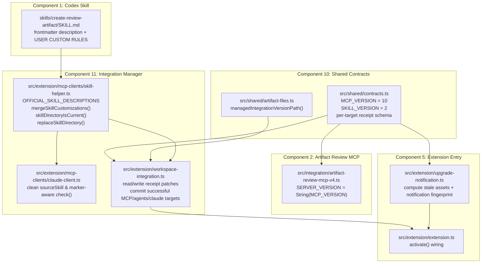

# Implementation Plan: Skill Customization & Independent MCP/Skill Versioning

## 1. Mục tiêu & Các Quyết định Thiết kế Đã Chốt

### 1.1. Mục tiêu
1. **Skill Customization (`description:` trực tiếp & khối `USER CUSTOM RULES`):** Cho phép người dùng tùy biến điều kiện kích hoạt (sửa trực tiếp `description:` trên YAML frontmatter) và tùy biến hành vi thực thi (viết trong khối `USER CUSTOM RULES` ở cuối `SKILL.md`) mà không phát sinh thêm lượt đọc file (`read_file`) lúc runtime, đồng thời tự động được bảo toàn qua các lần cập nhật / chạy lại Installer.
2. **Independent Versioning cho MCP Runtime & Skill (`~/.ai-artifacts/managed/integration-version.json`):** Quản lý version độc lập kiểu số nguyên (`number`) cho MCP Runtime và Skill để chỉ hiển thị thông báo nhắc Reinstall khi MCP hoặc Skill thực sự thay đổi version, thay vì thông báo ở mọi bản cập nhật giao diện/docs của extension.

### 1.2. Các Quyết định Sản phẩm & Kiến trúc Đã Khóa
- **Baseline:** Tách biệt hoàn toàn với đợt cập nhật Marketplace SEO / `README.md` ở `handoff-1.md` (không thêm `homepage`/`bugs` vào `package.json` trong phạm vi plan này).
- **Cơ chế Customization trong `SKILL.md` (chỉ dùng duy nhất 1 khối Marker ở cuối file):**
  1. **Tùy biến Trigger (`description:` tại YAML Frontmatter đầu file — không dùng marker riêng):**
     - Người dùng muốn đổi điều kiện kích hoạt skill thì sửa trực tiếp dòng `description:` ở phần YAML frontmatter của `SKILL.md`.
     - Trong `src/extension/mcp-clients/skill-helper.ts`, lưu catalog append-only các câu description mặc định đã từng release (`OFFICIAL_SKILL_DESCRIPTIONS`). `test/skill-contract.test.ts` khóa toàn bộ catalog lịch sử bằng expected fixture tường minh, không chỉ kiểm tra description hiện tại có nằm trong danh sách.
     - Khi chạy Reinstall / Upgrade trên một thư mục đích (`.agents` hoặc `.claude`): description hợp lệ thuộc catalog official hoặc rỗng/không tồn tại được nâng lên description mới nhất của `source/SKILL.md`; description hợp lệ khác catalog được coi là custom và giữ nguyên raw YAML entry của user.
     - Nếu frontmatter/`description:` có dữ liệu nhưng malformed đến mức không thể xác định chắc chắn giá trị cần preserve, installer fail-closed trước khi swap, giữ nguyên target và báo rõ file/lỗi để user sửa rồi tự chạy lại command installer.
  2. **Tùy biến Hành vi (`<!-- >>> USER CUSTOM RULES >>> -->` ... `<!-- <<< USER CUSTOM RULES <<< -->` ở cuối file):**
     - Mặc định để **rỗng**.
     - Nội dung bên trong có quyền **override (ghi đè)** các quy tắc mặc định của skill gốc khi xảy ra xung đột. Không áp đặt rào chắn cấm đoán trong prompt vì user sở hữu file skill cục bộ và tự chịu trách nhiệm với phần override của mình.
- **Cơ chế Cài đặt lại Skill (Snapshot Customize → Merge vào Staged Skill → Atomic Whole-Directory Replace):**
  - Giữ nguyên cơ chế **replace toàn bộ thư mục theo staging atomic** của `replaceSkillDirectory(source, target)` thay vì sửa lẻ từng file tại chỗ, nhằm bảo toàn tính transactional/rollback và tự động dọn sạch các file dư thừa của phiên bản cũ (đúng theo contract kiểm thử tại `test/workspace-integration.test.ts`).
  - Cụ thể: Validate source và snapshot customize (`description:` đã custom + nội dung `USER CUSTOM RULES`) từ `target/SKILL.md` hiện tại → copy toàn bộ thư mục skill mới sang thư mục tạm `stagedSkill` → gắn snapshot customize và validate `stagedSkill/SKILL.md` → thực hiện `fs.rename` hoán đổi nguyên thư mục `stagedSkill` vào `target` (rollback về `previousSkill` nếu lỗi).
  - Target không có cả hai marker được coi là bản legacy và migrate với custom block rỗng. Chỉ có một marker, marker lặp/sai thứ tự hoặc customization không thể extract xác định là lỗi nghiêm trọng: dừng installer, không thay đổi target.
- **Tách biệt hoàn toàn trách nhiệm giữa `.agents` và `.claude` (Mỗi lệnh làm đúng 1 việc):**
  - `~/.agents/skills/create-review-artifact/SKILL.md` và `~/.claude/skills/create-review-artifact/SKILL.md` độc lập hoàn toàn, không đồng bộ chéo.
  - Máy dùng cả Cursor và Claude nếu chạy lệnh lẻ thì chạy 2 lệnh riêng (`Install Integration for Cursor` cập nhật `.agents`, `Install Integration for Claude` cập nhật `.claude`), hoặc chạy `Install All Detected Integrations` để cập nhật tất cả client được phát hiện. Mỗi lần gọi `replaceSkillDirectory` ở vị trí nào chỉ đối chiếu và giữ lại customize của đúng vị trí đó.
- **Không thêm Command mới vào Command Palette:** Không sinh thêm lệnh mở file skill để giữ gọn danh sách commands hiện tại; hướng dẫn rõ đường dẫn và lệnh mở nhanh trong `README.md`.
- **Giữ nguyên hành vi lệnh `AI Artifacts: Copy create-review-artifact Skill Markdown`:** Luôn copy bản `SKILL.md` gốc sạch đóng gói trong extension (không kèm nội dung customize). Ghi rõ trong `README.md` lệnh này dùng cho cài đặt thủ công (manual setup), hoặc để xem / khôi phục lại nội dung skill mặc định khi user muốn bỏ customize hay khi customize dẫn đến lỗi.
- **Hướng dẫn `README.md` tinh gọn (không làm bộ Presets mẫu):** Giải thích rõ cách sửa `description:` cho trigger và khối `USER CUSTOM RULES` cho hành vi, gợi ý ngắn một số khía cạnh user có thể tự tùy biến (trigger tự động/thủ công, ngôn ngữ phản hồi, cấu trúc đề mục plan, quy ước lưu file...) và cách khôi phục về mặc định.
- **Quy ước Số nguyên cho Versioning (`number`, không SemVer):**
  - `MCP_VERSION = 10`; MCP handshake dùng `String(MCP_VERSION)` (`"10"`). Đây là version number để so sánh/deploy, không phải semantic compatibility contract.
  - `SKILL_VERSION = 2`; `.agents` và `.claude` cùng so sánh với một bundled skill version này, không có version line riêng theo client.
  - `~/.ai-artifacts/managed/integration-version.json` lưu receipt đã cài: `mcpVersion` chung và `skills.agents` / `skills.claude` riêng theo target. Receipt target chỉ được cập nhật sau khi target đó cài và verify thành công.
  - Không có manifest, field receipt bị thiếu hoặc manifest invalid đều được coi là chưa cài/current cho asset tương ứng và cần chạy installer; không ép về baseline giả `{ mcpVersion: 1, skillVersion: 1 }`. Manifest invalid dùng cùng UX “cần install” và ghi diagnostic.
  - Mỗi thay đổi MCP runtime hoặc Skill cần user đồng bộ lại sẽ tăng version tương ứng thêm `+1`; extension-only/UI/docs change không bắt buộc tăng hai version này.

---

## 2. Các Nguyên tắc & Invariants Kỹ thuật

1. **Idempotence giữa Install và Verify (`target === merge(source, target)`):**
   - Một hàm thuần (pure function) duy nhất `mergeSkillCustomizations(sourceMarkdown, existingTargetMarkdown)` chịu trách nhiệm quyết định giữ hay nâng cấp `description:` ở YAML frontmatter và ghép nội dung khối `USER CUSTOM RULES`.
   - Sau khi `replaceSkillDirectory()` chạy xong, hàm kiểm tra `skillDirectoryIsCurrent()` bắt buộc trả về `true` (`Ready`).
   - Khi user sửa trực tiếp trên Windows làm đổi line-ending sang `CRLF` (`\r\n`), sửa `description:` hợp lệ hoặc thêm nội dung vào `USER CUSTOM RULES`, `skillDirectoryIsCurrent()` vẫn nhận diện là `Ready`.
   - Nếu phần thân ngoài `USER CUSTOM RULES` (và ngoài dòng `description:`) bị sửa đổi, hoặc có bản cập nhật `SKILL.md` mới từ extension (bao gồm trường hợp `description` mặc định mới thay đổi trong khi `target` đang dùng `description` mặc định cũ), `skillDirectoryIsCurrent()` trả về `false` (`Outdated`).
2. **Ràng buộc Append-only cho `OFFICIAL_SKILL_DESCRIPTIONS`:**
   - `test/skill-contract.test.ts` so sánh catalog với fixture literal chứa toàn bộ official descriptions đã release và kiểm tra description hiện tại là entry mới nhất/hợp lệ. Release mới chỉ được append, không xóa giá trị lịch sử.
3. **Fail-Closed có Giới hạn & Bảo toàn Atomic Swap:**
   - Source phải có frontmatter hợp lệ và đúng một cặp marker. Target có cả hai marker absent được coi là legacy; đúng một cặp marker được preserve; chỉ một marker, marker lặp/sai thứ tự hoặc frontmatter có dữ liệu nhưng không thể parse/extract xác định thì installer dừng với lỗi hành động được.
   - Target malformed không bị sửa byte nào. Mọi thao tác merge/validate diễn ra trên dữ liệu đọc và `stagedSkill/SKILL.md` trước lần `fs.rename` đầu tiên; rollback hiện hữu tiếp tục xử lý lỗi I/O trong bước swap.
4. **Quản lý Receipt Version trong `managed/`:**
   - File `~/.ai-artifacts/managed/integration-version.json` thuộc vùng tài nguyên do extension quản lý (`managed/`), ghi bằng atomic write với mode `0o600` (`OWNER_ONLY_FILE_MODE`). Receipt MCP, `.agents` và `.claude` có thể được commit độc lập sau thành công; partial failure không đánh dấu target chưa hoàn tất là current.
   - `cleanupBaseMcpServer()` xóa manifest cùng managed assets khi uninstall mà không chạm tới `~/.ai-artifacts/artifacts/`.

---

## 3. Bản đồ Phạm vi Ảnh hưởng theo Components (`docs/COMPONENTS.md`)

### 3.1. Phân loại Components Sửa đổi vs. Giữ nguyên

| Component (theo `docs/COMPONENTS.md`) | Trạng thái | Tóm tắt tác động |
| :--- | :--- | :--- |
| **1. Codex skill** | **SỬA ĐỔI** | Bổ sung mục `## User Custom Rules` với cặp marker rỗng; khóa catalog historical official descriptions theo nguyên tắc append-only. |
| **2. Artifact Review MCP** | **SỬA ĐỔI (nhẹ)** | Dùng numeric `MCP_VERSION` từ `src/shared/contracts.ts`; handshake xuất `String(MCP_VERSION)` và không mang nghĩa SemVer. |
| **3. Workspace Registry** | Giữ nguyên | Không can thiệp. |
| **4. Artifact file protocol** | Giữ nguyên | Không thay đổi schema-v6, connection schema-v1 hay conversation registry. |
| **5. VS Code extension entry** | **SỬA ĐỔI** | Cập nhật notification/wiring để so sánh bundled versions với receipt MCP, `.agents`, `.claude`; notification fingerprint bao gồm đúng tập asset đang stale. |
| **6. Artifact Review Provider** | Giữ nguyên | Không can thiệp. |
| **7. Artifact Store** | Giữ nguyên | Không can thiệp. |
| **8. Review Webview** | Giữ nguyên | Không can thiệp. |
| **9. Markdown review pipeline** | Giữ nguyên | Không can thiệp. |
| **10. Shared contracts and validation** | **SỬA ĐỔI** | Khai báo `MCP_VERSION = 10`, `SKILL_VERSION = 2`, schema receipt theo target và path helper `managedIntegrationVersionPath`; không có legacy baseline giả. |
| **11. Integration manager** | **SỬA ĐỔI** | Snapshot/merge customization với fail-closed có giới hạn; verify skill; commit receipt MCP/`.agents`/`.claude` sau thành công và giữ đúng partial-failure state. |
| **Documentation & Release Contract** | **SỬA ĐỔI** | Cập nhật `README.md`, `docs/PHILOSOPHY.md`, `docs/ARCHITECTURE.md`, `docs/COMPONENTS.md`, `docs/INSTRUCTION.md`, `docs/CHANGE_LOGS.md`, `CHANGELOG.md` và `test/release-contract.test.ts`. |

### 3.2. Sơ đồ Tương tác giữa các Module Sửa đổi



---

## 4. Thiết kế Chi tiết theo Từng Component

### 4.1. Component 1 — Codex Skill (`skills/create-review-artifact/`)

**Files sửa đổi:**
- `skills/create-review-artifact/SKILL.md`
- `test/skill-contract.test.ts`

**Chi tiết thay đổi:**
1. Tại cuối file `skills/create-review-artifact/SKILL.md`, bổ sung mục `## User Custom Rules`:
   ```markdown
   ## User Custom Rules

   Instructions inside the `USER CUSTOM RULES` block below override the default rules in this skill when they conflict. Keep custom rules inside the markers so they are preserved across skill updates and reinstalls.

   <!-- >>> USER CUSTOM RULES >>> -->
   <!-- <<< USER CUSTOM RULES <<< -->
   ```
2. Cập nhật `test/skill-contract.test.ts`:
   - Kiểm tra `SKILL.md` chứa đúng 1 cặp marker `USER CUSTOM RULES` mặc định rỗng và nêu rõ quyền override.
   - Khóa `OFFICIAL_SKILL_DESCRIPTIONS` bằng expected fixture literal chứa toàn bộ descriptions đã release; catalog chỉ được append, không xóa entry lịch sử.
   - Kiểm tra giá trị `description:` hiện hành trong `SKILL.md` là official value hợp lệ.
   - Đảm bảo toàn bộ các assertions hiện hữu tiếp tục pass.

---

### 4.2. Component 10 — Shared Contracts and Validation (`src/shared/`)

**Files sửa đổi:**
- `src/shared/artifact-files.ts`
- `src/shared/contracts.ts`
- `test/artifact-contracts.test.ts`

**Chi tiết thay đổi:**
1. Trong `src/shared/artifact-files.ts`:
   - Khai báo `export const MANAGED_INTEGRATION_VERSION_FILE = "integration-version.json";`
   - Bổ sung hàm `managedIntegrationVersionPath(options: GlobalArtifactsRootOptions = {}): string` trả về `path.join(managedAssetsRoot(options), MANAGED_INTEGRATION_VERSION_FILE)` (`~/.ai-artifacts/managed/integration-version.json`).
2. Trong `src/shared/contracts.ts`:
   - Khai báo hằng số version:
     ```ts
     export const MCP_VERSION = 10 as const;
     export const SKILL_VERSION = 2 as const;
     export const INTEGRATION_VERSION_SCHEMA_VERSION = 1 as const;
     ```
   - Khai báo Zod schema cho receipt có thể được commit từng phần:
     ```ts
     export const installedSkillVersionsSchema = z.object({
       agents: z.number().int().positive().optional(),
       claude: z.number().int().positive().optional(),
     }).strict();

     export const integrationVersionManifestSchema = z.object({
       schemaVersion: z.literal(INTEGRATION_VERSION_SCHEMA_VERSION),
       mcpVersion: z.number().int().positive().optional(),
       skills: installedSkillVersionsSchema,
       updatedAt: z.string().datetime(),
     }).strict();

     export type IntegrationVersionManifest = z.infer<typeof integrationVersionManifestSchema>;
     ```
3. Trong `test/artifact-contracts.test.ts`:
   - Test manifest hợp lệ với receipt MCP/`.agents`/`.claude` đầy đủ hoặc từng phần; từ chối số `<= 0`, số thực, chuỗi và trường lạ.
   - Test `managedIntegrationVersionPath` trả về đúng path trong managed root.

---

### 4.3. Component 2 — Artifact Review MCP (`src/integration/`)

**Files sửa đổi:**
- `src/integration/artifact-review-mcp-v4.ts`

**Chi tiết thay đổi:**
- Import `MCP_VERSION` từ `../shared/contracts`.
- Thay dòng `const SERVER_VERSION = "10.0.0";` bằng:
  ```ts
  const SERVER_VERSION = String(MCP_VERSION);
  ```
- Giữ nguyên logic xử lý tools; handshake quảng bá numeric version dưới dạng chuỗi (`"10"`), không có SemVer contract.

---

### 4.4. Component 11 — Integration Manager (`src/extension/mcp-clients/` & `src/extension/workspace-integration.ts`)

**Files sửa đổi:**
- `src/extension/mcp-clients/skill-helper.ts`
- `src/extension/mcp-clients/claude-client.ts`
- `src/extension/workspace-integration.ts`
- `test/workspace-integration.test.ts`
- `test/mcp-client-drivers.test.ts`

**Chi tiết thay đổi:**

1. **Trong `src/extension/mcp-clients/skill-helper.ts`:**
   - Khai báo marker và catalog descriptions theo thứ tự release (oldest → newest):
     ```ts
     export const USER_CUSTOM_RULES_BEGIN = "<!-- >>> USER CUSTOM RULES >>> -->";
     export const USER_CUSTOM_RULES_END = "<!-- <<< USER CUSTOM RULES <<< -->";

     export const OFFICIAL_SKILL_DESCRIPTIONS: readonly string[] = [
       "Create or update a reviewable Markdown artifact and wait for the user's decision in the same Codex turn. Use only when the user explicitly asks to create or update an artifact.",
       "Create, update, inspect, or reconnect an explicitly requested reviewable Markdown artifact and coordinate its review rounds.",
     ];
     ```
   - Parser trả về trạng thái phân biệt thay vì gộp missing và malformed:
     - Description: `absent | valid(rawEntry, normalizedValue) | malformed(reason)`.
     - Custom block: `absent | valid(content) | malformed(reason)`.
   - Quy tắc merge:
     - Source bắt buộc có frontmatter hợp lệ, `name: create-review-artifact`, description hợp lệ và đúng một cặp marker; source invalid thì abort.
     - Target description `valid` và không thuộc official catalog → preserve nguyên `rawEntry`; official/absent/rỗng → dùng source description; `malformed` có dữ liệu không thể extract xác định → throw lỗi hành động được.
     - Target custom block `valid` → preserve nguyên content (kể cả rỗng); `absent` cả hai marker → migrate legacy bằng block rỗng; `malformed` (một marker, lặp hoặc sai thứ tự) → throw.
   - `sameSkillMarkdown()` dùng cùng merge contract để so sánh sau chuẩn hóa CRLF; target malformed trả `false` (`Outdated`) thay vì coi là current. `skillDirectoryIsCurrent()` tiếp tục dùng byte comparison cho các asset ngoài `SKILL.md`.
   - `replaceSkillDirectory()` giữ atomic whole-directory replacement nhưng đổi thứ tự an toàn:
     1. Đọc source/target và tính merged markdown; nếu malformed thì throw trước khi target bị rename.
     2. Copy source vào `stagedSkill`, ghi merged `SKILL.md` và validate staged result.
     3. Chỉ sau đó mới rename target → previous, staged → target; giữ nguyên rollback I/O hiện hữu.
     4. Lỗi nêu rõ target path, nguyên nhân và yêu cầu user sửa rồi chạy lại command installer; target cũ giữ nguyên.

2. **Trong `src/extension/mcp-clients/claude-client.ts`:**
   - Getter `sourceSkill` ưu tiên asset đóng gói gốc trước fallback `~/.agents`, để Claude không lấy customization của `.agents` làm source.
   - `check(mcpScriptPath)` giữ kiểm tra MCP/skill missing; khi source tồn tại, dùng `skillDirectoryIsCurrent()` và trả `outdated` nếu `.claude` không khớp merged expectation.

3. **Trong `src/extension/workspace-integration.ts`:**
   - Cập nhật `skillAssetsAreCurrent(paths)` dùng `skillDirectoryIsCurrent()`.
   - Thêm read/write receipt helpers cho `integration-version.json`:
     - Missing manifest → installed state rỗng.
     - Invalid manifest → installed state rỗng và diagnostic; lần install thành công tiếp theo ghi lại manifest hợp lệ.
     - Atomic patch giữ receipt hợp lệ cũ và chỉ cập nhật asset vừa install/verify thành công.
   - `setupBaseMcpServer()` sau khi runtime và `.agents` skill đã cài/verify thành công, commit `{ mcpVersion: MCP_VERSION, skills.agents: SKILL_VERSION }`.
   - `installClaudeIntegration()` chỉ commit `skills.claude = SKILL_VERSION` sau khi `ClaudeClientDriver.install()` và `check()` thành công.
   - `installAllDetectedIntegrations()` commit Claude receipt sau Claude success; nếu target/client sau đó fail, các receipt đã thành công được giữ và target chưa hoàn tất không bị đánh dấu current.
   - Các command cài lẻ vẫn giữ trách nhiệm hiện tại: nhóm Codex/Cursor/Copilot/Windsurf/Cline dùng shared `.agents`; Claude có thêm `.claude`. Cả hai target cùng so sánh với một `SKILL_VERSION` thuộc app.

4. **Cập nhật Tests (`test/workspace-integration.test.ts` & `test/mcp-client-drivers.test.ts`):**
   - Preserve custom description và `USER CUSTOM RULES` qua reinstall, vẫn xóa file obsolete nhờ whole-directory replacement.
   - Official description cũ được nâng lên current; custom description một dòng/quoted/folded được giữ; CRLF vẫn verify `Ready`.
   - Target legacy không marker migrate với block rỗng. Một marker, marker lặp/sai thứ tự hoặc frontmatter có dữ liệu nhưng không thể parse làm installer fail trước swap và target giữ nguyên byte.
   - `.agents` và `.claude` không lây customization; Claude stale được `check()` báo `outdated`.
   - Manifest hỗ trợ state MCP/agents current nhưng Claude stale/missing; Claude install fail không cập nhật Claude receipt; install thành công chỉ patch đúng receipt.
   - `uninstallAllDetectedIntegrations` xóa manifest cùng managed assets và giữ nguyên user artifacts.

---

### 4.5. Component 5 — VS Code Extension Entry & Upgrade Notification (`src/extension/`)

**Files sửa đổi:**
- `src/extension/upgrade-notification.ts`
- `src/extension/extension.ts`
- `test/upgrade-notification.test.ts`

**Chi tiết thay đổi:**

1. **Trong `src/extension/upgrade-notification.ts`:**
   - Khai báo khóa mới cho `globalState`:
     ```ts
     export const LAST_NOTIFIED_INTEGRATION_STATE_KEY =
       "upgradeNotification.lastNotifiedIntegrationState";
     ```
   - Dùng notification fingerprint tối thiểu:
     ```ts
     type StaleIntegrationAsset = "mcp" | "skill:agents" | "skill:claude";

     type IntegrationNotificationState = {
       mcpVersion: number;
       skillVersion: number;
       staleAssets: StaleIntegrationAsset[];
     };
     ```
   - `maybeShowUpgradeNotification(deps)` nhận bundled `{ mcpVersion: MCP_VERSION, skillVersion: SKILL_VERSION }`, installed receipts và danh sách skill target cần xét (`agents` luôn dùng cho shared integrations; thêm `claude` khi Claude được detect).
   - Tính `staleAssets` theo receipt:
     - `mcp` stale khi receipt khác `MCP_VERSION` hoặc không tồn tại.
     - `skill:agents` / `skill:claude` stale khi receipt target tương ứng khác `SKILL_VERSION` hoặc không tồn tại.
     - Missing/invalid manifest tạo installed state rỗng, vì vậy hiện notification yêu cầu chạy installer; invalid state đồng thời ghi diagnostic.
   - Nếu `staleAssets` rỗng: không hiện popup và đồng bộ notification state hiện tại.
   - Nếu fingerprint `{ bundled versions, staleAssets }` trùng `globalState`: không lặp popup khi user chọn `Later` hoặc khi extension-only version thay đổi.
   - Nếu fingerprint khác: persist fingerprint trước rồi hiển thị `Run Installer`, `View Installation Guide`, `Later`. `Run Installer` tiếp tục gọi `Install All Detected Integrations`.
   - Message nêu đúng asset đang stale, khẳng định customization được preserve và yêu cầu restart AI client sau khi installer thành công.

2. **Trong `src/extension/extension.ts`:**
   - Import `MCP_VERSION`, `SKILL_VERSION`, receipt reader và helper xác định target cần xét.
   - Nối installed receipts, bundled versions và detected targets vào `maybeShowUpgradeNotification()` trong `activate()`.

3. **Trong `test/upgrade-notification.test.ts`:**
   - Kiểm thử các contract trực tiếp:
     - Missing/invalid manifest → stale MCP + các skill target cần xét, hiện notification; invalid state ghi diagnostic.
     - MCP và mọi target cần xét current → không hiện popup.
     - `.agents` current nhưng detected Claude stale/missing → fingerprint chỉ còn `skill:claude` và vẫn hiện notification.
     - `Later` suppress đúng fingerprint; partial install làm stale set thay đổi nên target còn thiếu không bị che khuất.
     - Tăng `MCP_VERSION` hoặc `SKILL_VERSION` tạo fingerprint mới; extension-only version change không tạo popup mới.
     - Lỗi đọc/ghi state hoặc hiển thị thông báo không làm gãy `activate()`.

---

### 4.6. Documentation & Release Contract (`README.md`, `docs/`, `CHANGELOG.md`)

**Files sửa đổi:**
- `README.md`
- `docs/PHILOSOPHY.md`
- `docs/ARCHITECTURE.md`
- `docs/COMPONENTS.md`
- `docs/INSTRUCTION.md`
- `docs/CHANGE_LOGS.md`
- `CHANGELOG.md`
- `test/release-contract.test.ts`

**Chi tiết thay đổi:**
1. **`README.md`:**
   - Thêm mục **Customizing the Review Skill** (cập nhật cả mục lục `Contents`):
     - Nêu rõ vị trí file skill đã cài đặt: `~/.agents/skills/create-review-artifact/SKILL.md` (cho Cursor, Codex, GitHub Copilot, Cline) và `~/.claude/skills/create-review-artifact/SKILL.md` (dành riêng độc lập cho Claude), kèm lệnh mở nhanh trên editor.
     - Giải thích ngắn gọn 2 vùng được bảo toàn qua các lần update:
       - **Trigger (`description:` trên YAML frontmatter):** User có thể sửa trực tiếp trường `description:` ở đầu file nếu muốn thay đổi điều kiện kích hoạt (ví dụ tự động kích hoạt khi lập plan); bộ cài sẽ giữ nguyên nếu khác với description mặc định.
       - **Behavior (`USER CUSTOM RULES` ở cuối file):** Nội dung bên trong cặp marker `<!-- >>> USER CUSTOM RULES >>> -->` ghi đè hành vi mặc định của skill; gợi ý ngắn các hạng mục có thể tùy biến (ngôn ngữ viết tài liệu/trả lời chat, bố cục các phần của plan, quy ước thư mục lưu file...).
     - Nêu rõ custom block cho phép full customization nhưng extension chỉ bảo đảm asset được preserve/sync; trạng thái `Ready` không chứng minh custom behavior còn tương thích với lifecycle chính thức và custom rules không thể vượt system/developer instructions của AI host.
     - Hướng dẫn xem bản gốc / khôi phục khi lỗi: sao lưu custom block nếu cần, chạy **`AI Artifacts: Copy create-review-artifact Skill Markdown`** để lấy bản skill mặc định sạch hoặc restore/reinstall, rồi thêm lại customization từng phần để xác định rule gây lỗi.
   - Cập nhật danh sách `Installed runtime and skill locations` bổ sung `~/.ai-artifacts/managed/integration-version.json`.
   - Cập nhật **Getting started** và **Compatibility and upgrades**: chỉ cần reinstall khi numeric `MCP_VERSION` hoặc `SKILL_VERSION` thay đổi; installer giữ customization hợp lệ và fail-closed với customization malformed nghiêm trọng.
2. **`docs/PHILOSOPHY.md`, `docs/ARCHITECTURE.md`, `docs/COMPONENTS.md`, `docs/INSTRUCTION.md`:**
   - Thay contract “reinstall sau mọi extension upgrade” bằng numeric MCP/Skill versioning; nêu rõ các version này không theo SemVer.
   - Đồng bộ receipt MCP + `.agents` + `.claude`, missing/invalid state cần install, và snapshot/merge fail-closed của Integration Manager.
3. **`docs/CHANGE_LOGS.md` & `CHANGELOG.md`:**
   - Ghi nhận đầy đủ thay đổi kiến trúc / hành vi mới theo đúng quy tắc của repository.
4. **`test/release-contract.test.ts`:**
   - Đảm bảo mọi kiểm tra hợp đồng tài liệu (bao gồm kiểm tra chuỗi trong `README.md` và `docs/`) tương thích hoàn toàn với nội dung mới.

---

## 5. Thứ tự Triển khai & Quy trình Kiểm chứng (Execution & Validation)

### Thứ tự thực hiện đề xuất
1. **Bước 1 (Shared & MCP):** Cập nhật `src/shared/artifact-files.ts`, `src/shared/contracts.ts`, `src/integration/artifact-review-mcp-v4.ts` và `test/artifact-contracts.test.ts`.
2. **Bước 2 (Skill & Integration Manager):** Cập nhật `skills/create-review-artifact/SKILL.md`, `src/extension/mcp-clients/skill-helper.ts`, `src/extension/mcp-clients/claude-client.ts`, `src/extension/workspace-integration.ts` cùng các bộ test `test/skill-contract.test.ts`, `test/workspace-integration.test.ts`, `test/mcp-client-drivers.test.ts`.
3. **Bước 3 (Upgrade Notification & Extension Wiring):** Cập nhật `src/extension/upgrade-notification.ts`, `src/extension/extension.ts` và `test/upgrade-notification.test.ts`.
4. **Bước 4 (Documentation & Release Contract):** Cập nhật `README.md`, `docs/PHILOSOPHY.md`, `docs/ARCHITECTURE.md`, `docs/COMPONENTS.md`, `docs/INSTRUCTION.md`, `docs/CHANGE_LOGS.md`, `CHANGELOG.md` và `test/release-contract.test.ts`.

### Quy trình kiểm chứng bắt buộc
Chạy toàn bộ từ thư mục gốc `d:\workspace\my-projects\ai-artifacts`:

```powershell
npm.cmd run check
npm.cmd test
npm.cmd run build
```

---

## 6. Tiêu chí Hoàn thành (Definition of Done)

- [ ] `SKILL.md` chỉ có duy nhất 1 khối marker `USER CUSTOM RULES` mặc định rỗng; test khóa catalog official descriptions lịch sử theo nguyên tắc append-only.
- [ ] `replaceSkillDirectory()` preserve customization hợp lệ và migrate target legacy; marker/frontmatter malformed nghiêm trọng fail trước swap, báo lỗi hành động được và giữ nguyên target.
- [ ] Các lệnh cài lẻ giữ nguyên phạm vi đơn trách nhiệm (`.agents` và `.claude` tách biệt hoàn toàn); `Verify All Integrations` báo `Ready` khi user customize hợp lệ (kể cả CRLF trên Windows) và báo `Outdated` chính xác khi phần lõi ngoài vùng custom thay đổi ở cả `.agents` và `.claude`.
- [ ] `integration-version.json` lưu numeric `mcpVersion` và receipt `skills.agents` / `skills.claude`; receipt chỉ commit sau target success, biểu diễn đúng partial-failure state và bị dọn cùng managed assets khi uninstall.
- [ ] Missing/invalid receipt hiện notification cần installer; popup fingerprint theo đúng stale assets, không che khuất Claude stale khi `.agents` current và không lặp ở extension-only/UI/docs update.
- [ ] MCP handshake dùng `String(MCP_VERSION)`; MCP/SKILL versions là số tăng dần để so sánh, không phải SemVer.
- [ ] README có hướng dẫn full customization và restore skill gốc; `docs/PHILOSOPHY.md`, các docs bị ảnh hưởng và changelog đồng bộ contract mới.
- [ ] `npm.cmd run check`, `npm.cmd test`, `npm.cmd run build` pass.
