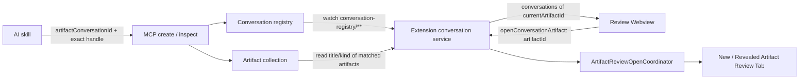

# Artifacts in Conversations — Phân tích và quyết định đã chốt

## Trạng thái tài liệu

- Đây là source of truth cho implementation plan của tính năng **Artifacts in Conversations**.
- Tài liệu ghi lại các quyết định sản phẩm và kiến trúc đã được chốt; chưa mô tả tính năng đã được triển khai.
- Implementation plan bên dưới tham chiếu trực tiếp các quyết định này.
- Kiến trúc hiện tại vẫn là schema v6, MCP server 9.0.0 và đúng năm tool. Mọi thay đổi contract/schema/version phải được xử lý rõ theo các phase trong implementation plan.

## 1. Mục tiêu

Biến Artifact Viewer thành một ứng dụng review có thể điều hướng giữa các artifact thuộc những logical conversation mà **artifact đang mở có tham gia**.

Người dùng có thể:

- Mở sidebar **Conversation Artifacts** ở bên trái, đối diện với Comments sidebar ở bên phải.
- Xem danh sách các conversation mà artifact hiện tại đang mở (`currentArtifactId`) có tham gia dưới dạng multi-open accordion.
- Các conversation được sắp xếp theo **ngày đăng ký của artifact hiện tại vào conversation nào gần đây nhất** (`currentArtifactRegisteredAt` giảm dần).
- Mở từng conversation để xem toàn bộ các artifact đã được tạo/đăng ký trong conversation đó.
- Nhận biết rõ artifact đang mở trong danh sách.
- Nhấn vào một artifact khác trong conversation để mở artifact đó trong tab mới (hoặc reveal tab đã mở) bằng Artifact Review custom editor hiện tại.
- Xem một artifact xuất hiện trong nhiều conversation khi artifact đó đã được đăng ký vào nhiều conversation.

Tính năng không biến Artifact Viewer thành chat UI, không lưu message history của AI client và không phụ thuộc ID nội bộ của Codex, Cursor, Claude Code, Windsurf hoặc Copilot.

## 2. Thuật ngữ đã chốt

### `artifactConversationId`

`artifactConversationId` là ID logic (UUID) do AI Artifacts MCP sở hữu và sinh ra. Nó không phải chat ID thật của AI client.

Tên này phải được dùng trong contract và implementation để tránh ngụ ý rằng extension có thể đọc hoặc suy ra ID conversation nội bộ của AI client.

### `conversationName`

`conversationName` là tên hiển thị cho một logical artifact conversation.

- Đây là metadata tùy chọn.
- AI có thể gửi tên khi tạo conversation mới.
- Nếu không có tên, MCP dùng `title` của artifact đầu tiên được đăng ký vào conversation làm tên mặc định.
- Việc đổi tên thủ công có thể được bổ sung sau; không phải điều kiện để triển khai phiên bản đầu tiên.

### Quan hệ nhiều-nhiều

Quan hệ giữa conversation và artifact là many-to-many:

```text
Một conversation  → nhiều artifact
Một artifact      → nhiều conversation
```

Việc một artifact được đăng ký vào conversation mới không làm thay đổi identity, review session, review round hoặc nội dung Markdown của artifact đó.

## 3. Quyết định về AI/MCP contract

### Không yêu cầu AI cung cấp chat ID

AI client không được giả định là có hoặc expose một chat/conversation ID ổn định. MCP không được suy ra conversation từ cwd, workspace, artifact mới nhất, VS Code window hoặc process hiện tại.

### Không thêm tool tạo conversation riêng

Không thêm `create_conversation` hoặc tool tương đương. Một tool call riêng sẽ tăng round-trip và làm chậm đường tạo artifact đầu tiên mà không mang lại giá trị cần thiết.

Conversation được tạo và cập nhật trực tiếp tại các hàm MCP thao tác với cặp `(artifact, conversation)` là `create_artifact` và `inspect_artifact_review`:

```text
1. Tạo artifact đầu tiên trong đoạn chat:
   AI -> create_artifact không có artifactConversationId
   MCP -> sinh artifactConversationId mới, tạo conversation và đăng ký artifact
   MCP -> trả artifactConversationId cùng kết quả create

2. Tạo artifact tiếp theo trong cùng logical conversation:
   AI -> create_artifact có artifactConversationId đã nhận
   MCP -> đăng ký artifact mới vào conversation đã có
   MCP -> trả lại artifactConversationId trong kết quả

3. Inspect/kết nối một artifact đã tồn tại từ một đoạn chat khác (chưa có ID):
   AI -> inspect_artifact_review không có artifactConversationId
   MCP -> sinh artifactConversationId mới cho đoạn chat mới, tạo conversation và đăng ký artifact đó
   MCP -> trả artifactConversationId mới trong kết quả inspect

4. Inspect/kết nối một artifact đã tồn tại trong đoạn chat đã có ID:
   AI -> inspect_artifact_review có artifactConversationId hiện hành
   MCP -> đăng ký/cập nhật registeredAt của artifact vào conversation hiện hành
   MCP -> trả lại artifactConversationId trong kết quả inspect
```

### Input dự kiến của `create_artifact` và `inspect_artifact_review`

```ts
type ArtifactConversationInput = {
  artifactConversationId?: string;
  conversationName?: string;
};
```

Quy tắc:

- Không có `artifactConversationId`: MCP sinh UUID mới, tạo conversation mới và đăng ký artifact.
- Có `artifactConversationId`: MCP validate conversation tồn tại rồi đăng ký/cập nhật `registeredAt` cho artifact trong conversation đó.
- `conversationName` chỉ là metadata tùy chọn khi tạo conversation mới, không phải điều kiện tạo artifact.
- ID không hợp lệ hoặc không tồn tại phải fail closed; không tự tạo conversation với ID do AI gửi và không chọn conversation gần nhất.

### Đăng ký artifact đã tồn tại

Khi một artifact đã tồn tại được `inspect_artifact_review` (từ đoạn chat mới chưa có ID hoặc đoạn chat đã có `artifactConversationId`), việc đăng ký membership:

- Không tạo artifact mới.
- Không đổi `artifactId` hoặc `reviewSessionId`.
- Không advance review round.
- Không cập nhật `artifact.json.updatedAt` vì không có thay đổi nội dung review.
- Không ghi conversation data vào `artifact-connection.json`; file đó tiếp tục chỉ sở hữu UI-routing state.

## 4. Cơ chế giữ `artifactConversationId` theo phiên chat

Hai lớp giữ ID trong cùng phiên chat và cơ chế cấp ID mới khi sang đoạn chat khác:

1. **Skill cache:** skill giữ `activeArtifactConversationId` của đoạn chat hiện tại cùng mapping exact `artifactDirectory -> { reviewRound, windowInstanceId, artifactConversationId }`.
2. **Tool-result echo:** các lifecycle result liên quan (`create_artifact`, `inspect_artifact_review`, `wait_for_artifact_review`, `advance_and_wait_for_artifact`) echo lại `artifactConversationId` khi có để AI liên tục giữ context.
3. **Sang đoạn chat khác (New chat session):** AI không mất ID trong cùng đoạn chat; còn khi người dùng inspect một artifact từ một đoạn chat khác (chưa có `artifactConversationId`), `inspect_artifact_review` ưu tiên cấp luôn một `artifactConversationId` mới cho đoạn chat đó (hoặc gắn vào `artifactConversationId` hiện có của đoạn chat mới). Nhờ vậy không cần quét ngược lịch sử conversation cũ trả về cho AI.

Không được dùng tìm kiếm theo title, thời gian mới nhất hoặc cwd để tự đoán một conversation.

## 5. Conversation registry

### Trách nhiệm

Thêm một component riêng, tên khuyến nghị là `ConversationArtifactRegistry`.

Nó không thay thế `ArtifactStore`:

```text
ArtifactStore
  - Sở hữu việc đọc/ghi lifecycle của một artifact cụ thể.
  - Markdown, manifest, comments và submission.

ConversationArtifactRegistry
  - Sở hữu quan hệ conversation-artifact.
  - Tạo conversation và đăng ký/cập nhật membership tại create_artifact & inspect_artifact_review.
  - Liệt kê các conversations mà currentArtifactId đang mở có tham gia và danh sách artifacts trong từng conversation đó.
  - Dọn dẹp memberships/conversations khi artifact không còn tồn tại.
```

### Truy vấn chính theo Artifact đang mở

Registry hỗ trợ trực tiếp truy vấn phục vụ Sidebar của artifact hiện tại:

```text
currentArtifactId -> conversations chứa currentArtifactId (sort theo currentArtifact.registeredAt giảm dần) -> artifactIds trong mỗi conversation đó
```

Không yêu cầu AI gửi toàn bộ artifact dictionary. Không scan toàn bộ artifact collection mỗi lần mở sidebar.

Registry chỉ lưu identity/reference và `registeredAt`. `title` và `kind` được đọc từ manifest `artifact.json` đã validate, không sao chép thành nguồn dữ liệu thứ hai.

### Lưu trữ filesystem đề xuất

Một layout filesystem-native phù hợp với kiến trúc hiện tại, tránh nhầm lẫn với thư mục lưu trữ `artifacts/` gốc:

```text
~/.ai-artifacts/
  artifacts/
    <artifact-id>/
      artifact.json
      artifact.md
      comments.json
      review-submission.json
      artifact-connection.json

  conversation-registry/
    <artifact-conversation-uuid>/
      conversation.json
      registered-artifacts/
        <artifact-id>.json
```

Mỗi membership trong `registered-artifacts/` là một file riêng thay vì một global JSON array lớn. Mục tiêu là:

- Registration idempotent và cập nhật được `registeredAt` của đúng cặp `(conversation, artifact)`.
- Tránh lost update từ read-modify-write khi nhiều MCP process hoạt động.
- Khi đang mở `currentArtifactId`, chỉ cần kiểm tra sự tồn tại của `<conv-uuid>/registered-artifacts/<currentArtifactId>.json` để lọc ngay các conversations mà `currentArtifactId` có tham gia, bỏ qua toàn bộ các conversations khác mà không cần đọc sâu.
- Không làm hỏng toàn bộ index nếu một membership file bị lỗi.

Raw `artifactConversationId` không được dùng trực tiếp làm path nếu chưa validate. Directory key phải là UUID hợp lệ theo contract.

### Source of truth và validation

- Registry là source of truth cho membership conversation-artifact.
- `artifact.json` tiếp tục là source of truth cho artifact identity và lifecycle.
- `artifact-connection.json` tiếp tục chỉ là source of truth cho UI routing.
- Khi liệt kê hoặc mở một artifact từ registry, Extension Host phải revalidate directory containment, artifact ID binding, schema và managed paths.
- Registry không trao quyền mở một arbitrary path do AI cung cấp.

### Cơ chế Watcher và Dọn dẹp Artifact không còn tồn tại

- **Không cần watch các file `artifact.json` trong `~/.ai-artifacts/artifacts/`**:
  - Mọi thao tác gắn artifact vào conversation hoặc cập nhật metadata conversation đều đi qua các hàm MCP (`create_artifact`, `inspect_artifact_review`) và cập nhật thẳng vào `~/.ai-artifacts/conversation-registry/**`.
  - Bản thân `title` và `kind` của artifact là bất biến sau khi tạo.
  - Do đó Extension Host chỉ cần watch `~/.ai-artifacts/conversation-registry/**`.
- **Xử lý khi một artifact bị dọn dẹp (Retention) hoặc bị xóa trên đĩa**:
  1. **Khi đọc Sidebar (Reader):** Nếu một artifact trong conversation không còn tồn tại trong `~/.ai-artifacts/artifacts/<artifact-id>`, Reader chỉ cần bỏ qua (skip) không hiển thị lên UI (và có thể xóa lazy file `registered-artifacts/<artifact-id>.json` stale).
  2. **Khi nhấn mở từ Sidebar:** Nếu người dùng nhấn vào một artifact trên Sidebar mà artifact đó vừa bị xóa bằng tay trên đĩa (`ENOENT`), Extension Host báo lỗi và gọi refresh lại Sidebar ngay lập tức để ẩn item đã mất.
  3. **Khi chạy Retention (`artifact-retention.ts`):** Sau khi xóa các expired artifacts, Retention dọn luôn các membership `registered-artifacts/<artifact-id>.json` tương ứng trong `~/.ai-artifacts/conversation-registry/` và xóa các thư mục conversation không còn artifact nào hợp lệ để không đọng rác trên đĩa.
- Conversation registration không refresh artifact retention timestamp (`artifact.json.updatedAt`).

## 6. Sidebar Conversation Artifacts

### Vị trí

Conversation Artifacts là sidebar bên trái trong cùng Artifact Review Webview app. Comments tiếp tục là sidebar bên phải.

```text
+----------------------+---------------------------+------------------+
| Conversation         | Artifact document         | Comments         |
| Artifacts sidebar    |                           | sidebar          |
| (left)               |                           | (right)          |
+----------------------+---------------------------+------------------+
```

Sidebar không phải VS Code View hoặc một app/webview riêng.

### Accordion các conversation mà artifact hiện tại tham gia

Sidebar chỉ tải các conversation mà artifact đang mở (`currentArtifactId`) có tham gia, mỗi conversation là một accordion liệt kê toàn bộ artifact trong conversation đó:

```text
Conversation Artifacts

[-] Improve Artifact Viewer (3)
      UI analysis
    > Artifacts in conversations   [current]
      Implementation plan

[+] Refactor Review Flow (2)
```

Yêu cầu:

- Chỉ hiển thị những conversations có chứa artifact hiện tại đang mở.
- Các accordion conversations được **sort theo ngày đăng ký của artifact hiện tại vào conversation đó (`currentArtifactRegisteredAt` giảm dần)** — conversation nào mà artifact hiện tại được đăng ký gần đây nhất nằm trên cùng.
- Các artifacts bên trong mỗi conversation được sort theo `registeredAt` tăng dần (theo trình tự được đưa vào cuộc trò chuyện).
- Mỗi accordion header hiển thị `conversationName` và số artifact hợp lệ trong conversation đó.
- Có thể mở nhiều accordion cùng lúc (multi-open accordion); conversation đầu tiên (gần nhất) được mở mặc định.
- Artifact đang mở được highlight (`[current]`).
- Một artifact thuộc nhiều conversation sẽ hiển thị đầy đủ các conversation đó dưới dạng các accordion tương ứng.
- Không có mục `All registered artifacts`.

### Mở artifact từ sidebar

Khi click một artifact khác trong accordion:

1. Webview gửi typed message chứa `artifactId` đã được registry cung cấp, không gửi arbitrary filesystem path.
2. Extension Host resolve và revalidate target.
3. Dùng `ArtifactReviewOpenCoordinator`/`vscode.openWith` hiện tại để mở artifact đó trong tab mới (`preview: false`) hoặc reveal tab nếu đã mở sẵn.
4. Nếu artifact đích vừa bị xóa trên đĩa (`ENOENT`), báo lỗi và refresh lại Sidebar để loại bỏ item không còn tồn tại.

Phiên bản đầu tiên không thay thế document ở giữa bằng một virtual document khác bên trong cùng Webview instance.

### Loading và hiệu năng

- Artifact hiện tại phải render trước; conversation list được tải bất đồng bộ và không chặn open.
- Sidebar có loading/error/empty state riêng.
- Chỉ đọc chi tiết những conversations có chứa `currentArtifactId`, không chạy global artifact discovery trên mỗi tab.
- Chỉ watch `~/.ai-artifacts/conversation-registry/**`, không cần watch `~/.ai-artifacts/artifacts/*/artifact.json`.
- Webview không được truy cập filesystem trực tiếp.

### Responsive behavior

- Màn hình rộng: Conversation Artifacts và Comments có thể cùng mở nếu layout đủ chỗ.
- Màn hình hẹp: chỉ một sidebar overlay được mở tại một thời điểm.
- Focus trapping, keyboard navigation và ARIA semantics phải được đảm bảo.

## 7. Current-state constraints phải được giữ

- Existing exact-handle lifecycle vẫn là boundary cho wait, inspect, advance và reconnect.
- Conversation membership không thay thế `artifactDirectory` làm lifecycle handle.
- Artifact Viewer Webview không được đọc filesystem hoặc gọi process API trực tiếp.
- Một independent user request vẫn sở hữu một artifact ID/directory; conversation chỉ nhóm nhiều artifact, không gộp lifecycle.
- Comments/submission state vẫn thuộc từng artifact và từng review round.
- Không suy ra conversation từ title, repository, workspace hoặc VS Code window.

## 8. Failure behavior bắt buộc

- Unknown/malformed `artifactConversationId`: fail closed với structured error; không đoán hoặc tạo lại bằng ID do AI chọn.
- Duplicate registration: thành công idempotent, cập nhật `registeredAt` của membership đó và không tạo duplicate sidebar item trong cùng conversation.
- Missing artifact referenced by registry: skip item khi đọc (và dọn membership stale); nếu user click vào item vừa bị xóa thì không mở path không hợp lệ và tự refresh Sidebar.
- Registry write failure: không được báo registration thành công. Ghi conversation/membership phải hoàn tất trước khi commit `artifact-connection.json`.
- Partial/corrupt conversation entry: cô lập entry lỗi, không làm mất khả năng đọc các conversation hợp lệ khác.
- Multiple VS Code windows/MCP processes: không được dựa vào in-memory cache làm persistent source of truth.

## 9. Phạm vi không làm ở phiên bản đầu tiên

- Đồng bộ conversation với cloud hoặc giữa nhiều máy.
- Đọc chat history hoặc chat metadata nội bộ từ AI client.
- Một tool `create_conversation` riêng.
- Mục `All registered artifacts` trong Sidebar.
- Watch sự thay đổi của từng file `artifact.json` trong toàn bộ thư mục `artifacts/`.
- Gửi full artifact dictionary từ AI ở mỗi create/inspect.
- Biến Artifact Viewer thành task manager hoặc chat client.
- Suy luận semantic relationship giữa artifacts.
- Drag-and-drop để đổi membership, merge conversation hoặc conversation history/versioning.

## 10. Components dự kiến bị ảnh hưởng khi triển khai

### Shared contracts và filesystem safety

- Schema/version cho conversation registry và membership (`src/shared/contracts.ts`).
- Safe path derivation và validation cho `conversation-registry` root và `registered-artifacts` (`src/shared/artifact-files.ts`, `src/shared/conversation-artifact-registry.ts`).
- Typed Webview messages cho list/open/error/loading.

### MCP runtime và skill

- `create_artifact` và `inspect_artifact_review` sinh mới hoặc nhận `artifactConversationId`, cập nhật thẳng conversation metadata/membership (`src/integration/artifact-review-mcp-v4.ts`).
- Lifecycle results echo `artifactConversationId`.
- Skill giữ active `artifactConversationId` trong đoạn chat hiện tại và nhận ID mới khi inspect/create ở đoạn chat mới (`skills/create-review-artifact/SKILL.md`).

### Extension Host

- `ConversationArtifactRegistry` và `ConversationArtifactService`.
- Watcher trên `~/.ai-artifacts/conversation-registry/**` và gửi summaries của `currentArtifactId` sang Webview.
- Open action đi qua `ArtifactReviewOpenCoordinator` (mở tab mới, tự refresh Sidebar nếu artifact đích không còn tồn tại).
- Retention integration (`src/extension/artifact-retention.ts`) dọn memberships và conversations của các artifact đã bị xóa.

### Webview

- Nút mở Conversation Artifacts ở bên trái (`src/webview/ReviewApp.tsx`).
- Sidebar trái mới (`src/webview/ConversationArtifactsDrawer.tsx`).
- Multi-open accordion các conversations mà artifact hiện tại tham gia, sort theo `currentArtifactRegisteredAt` giảm dần.
- Current-artifact highlight, loading/error/empty states và responsive coordination với Comments drawer (giữ nguyên logic nội tại của `src/webview/CommentsDrawer.tsx`).

### Tests và docs

- Contract, registry safety, multi-process/idempotency, many-to-many membership, sorting, retention cleanup và Webview message/UI tests.
- Khi implementation được phê duyệt, cập nhật các canonical docs/contract/changelog bị ảnh hưởng theo repository instructions.

## 11. Acceptance criteria ở cấp thiết kế

Implementation plan chỉ được xem là bám đúng phân tích này khi:

1. Artifact đầu tiên tạo logical conversation ngay trong `create_artifact` mà không cần tool call riêng.
2. Inspect một artifact từ đoạn chat khác (không có `artifactConversationId`) sinh `artifactConversationId` mới và đăng ký artifact đó.
3. MCP sinh và trả `artifactConversationId`; AI client chat ID không được yêu cầu.
4. Các lần gọi tiếp theo trong cùng đoạn chat chỉ gửi lại `artifactConversationId` nhỏ, không gửi dictionary.
5. Một artifact có thể thuộc nhiều conversation.
6. Sidebar chỉ tải các conversations mà artifact đang mở tham gia, mỗi conversation là 1 accordion liệt kê toàn bộ artifacts trong conversation đó.
7. Các conversations trên Sidebar được sort theo ngày đăng ký gần nhất của artifact hiện tại vào từng conversation (`currentArtifactRegisteredAt` giảm dần).
8. Current artifact render không bị chặn bởi registry/sidebar loading.
9. Không cần watch các file `artifact.json`; mọi thay đổi conversation/membership được cập nhật thẳng tại các hàm MCP (`create_artifact`, `inspect_artifact_review`) và watch trên `conversation-registry/**`.
10. Artifact trong conversation không còn tồn tại sẽ được bỏ qua khi đọc và được dọn dẹp trong luồng Retention.
11. Nhấn vào artifact trên Sidebar sẽ mở artifact đó trong tab mới qua fail-closed validation và custom editor coordinator hiện tại.
12. Conversation registration không thay đổi review lifecycle hoặc retention timestamp (`artifact.json.updatedAt`).

---

# IMPLEMENTATION PLAN

# Kế hoạch triển khai: Artifacts in Conversations

> **Trạng thái:** Chờ review — chưa triển khai  
> **Nguồn quyết định:** `plans/improve-artifact-viewer-app/airtfacts-in-conversation.md`  
> **Baseline đã kiểm chứng:** AI Artifacts 1.0.2, artifact schema v6, connection schema v1, MCP 9.0.0, đúng 5 lifecycle tools  
> **Phạm vi tương thích:** Tạm thời không thiết kế mixed MCP/extension versions. Sau khi nâng cấp, người dùng vẫn phải chạy lại installer và restart AI client theo contract hiện tại.

---

## 1. Mục tiêu và kết quả mong đợi

Artifact Review sẽ có một sidebar **Conversation artifacts** ở bên trái, đối diện sidebar **Comments** bên phải. Sidebar mới hiển thị các logical conversation mà **artifact hiện tại đang mở có tham gia**, và trong mỗi conversation liệt kê toàn bộ các artifact đã được tạo/đăng ký trong cuộc trò chuyện đó.

Kết quả phiên bản đầu tiên:

- Artifact đầu tiên trong một AI chat tạo một `artifactConversationId` mới ngay trong call `create_artifact`; không có tool tạo conversation riêng.
- Những artifact tiếp theo trong cùng đoạn chat chỉ gửi lại UUID nhỏ này để tham gia cùng conversation.
- Khi `inspect_artifact_review` được gọi từ một đoạn chat khác (không gửi `artifactConversationId`), MCP tạo một logical conversation mới (`artifactConversationId` mới) và đăng ký artifact đó.
- Khi `inspect_artifact_review` được gọi kèm một `artifactConversationId` đã biết, MCP đăng ký/cập nhật `registeredAt` của artifact vào conversation hiện hành.
- Một artifact có thể thuộc nhiều conversation.
- Artifact cũ không được migrate; nếu chưa được đăng ký vào conversation nào thì mở sẽ thấy trạng thái conversation rỗng.
- Sidebar dùng multi-open accordion, chỉ hiển thị các conversations mà artifact hiện tại tham gia, sort theo ngày đăng ký của artifact hiện tại vào conversation gần đây nhất (`currentArtifactRegisteredAt` giảm dần).
- Click vào một artifact khác trong accordion đi qua validation và `ArtifactReviewOpenCoordinator` hiện tại để mở trong tab mới (`preview: false`); Webview không được mở arbitrary filesystem path.
- Artifact ở giữa phải render trước; conversation data tải bất đồng bộ và lỗi sidebar không được làm hỏng review document.
- Không cần watch các file `artifact.json`; chỉ cập nhật thẳng conversation metadata/membership tại các hàm MCP liên quan (`create_artifact`, `inspect_artifact_review`) và watch thư mục `~/.ai-artifacts/conversation-registry/**`.
- Nếu một artifact trong conversation không còn tồn tại thì tự động bỏ qua khi đọc, đồng thời tích hợp dọn dẹp stale memberships/conversations vào luồng Retention cleanup.

---

## 2. Đánh giá hiện trạng và mức tác động

### Hiện trạng đã kiểm chứng

- `artifact.json` là schema-v6 strict và đang sở hữu identity/lifecycle của một artifact (`title` và `kind` là bất biến sau khi tạo).
- `artifact-connection.json` chỉ sở hữu window routing.
- MCP tạo artifact, ghi lifecycle và commit connection trong `src/integration/artifact-review-mcp-v4.ts`.
- Extension Host đọc artifact bằng `ArtifactStore`, gửi `ReviewState` sang Webview và theo dõi các lifecycle file của artifact đang mở.
- `ReviewApp.tsx` là entry đang chạy; `src/webview/App.tsx` không phải entry hiện hành và không nên bị sửa nhầm.
- Comments hiện là drawer bên phải (`src/webview/CommentsDrawer.tsx`).
- `ArtifactReviewOpenCoordinator` đã cung cấp đường mở artifact có canonical-path validation và in-flight deduplication.
- Retention cleanup xóa artifact theo `artifact.json.updatedAt` trong `src/extension/artifact-retention.ts`.
- Markdown/Mermaid đã tách component identity ổn định. Conversation state phải được truyền riêng để không làm reload artifact state hoặc remount Mermaid.

### Mức tác động

| Thành phần                            |                        Mức tác động | Bản chất thay đổi                                                                       |
| ------------------------------------- | ----------------------------------: | --------------------------------------------------------------------------------------- |
| Shared contracts và filesystem safety |                          Trung bình | Thêm protocol conversation v1 độc lập; không đổi artifact schema v6                     |
| Persistent registry                   |                          Trung bình | Component mới, truy vấn theo `currentArtifactId`, multi-process, fail-closed            |
| MCP runtime                           |                          Trung bình | Cập nhật thẳng conversation metadata/membership tại `create` và `inspect`               |
| Extension Host                        |                          Trung bình | Query theo `currentArtifactId`, 1 watcher trên `conversation-registry/**`, safe open    |
| Webview                               |                          Trung bình | Sidebar trái (`ConversationArtifactsDrawer.tsx`), giữ nguyên `CommentsDrawer`           |
| Retention                             |                                Thấp | Bổ sung dọn memberships/conversations của các artifact đã bị xóa                        |
| Skill và installer payload            | Trung bình về contract, thấp về code | AI giữ và gửi `artifactConversationId` trong đoạn chat hiện tại                         |
| Review lifecycle hiện tại             |                                Thấp | Không đổi round, comments, submission, token hay exact handle                           |

**Độ khó tổng thể: 5/10.** Nhờ thiết kế truy vấn xoay quanh `currentArtifactId`, chỉ cập nhật conversation metadata trực tiếp tại `create_artifact` / `inspect_artifact_review`, không cần watch `artifacts/*/artifact.json` và không cần reverse lookup phức tạp cho AI, độ phức tạp và phạm vi ảnh hưởng lên ứng dụng đã giảm đi đáng kể.

---

## 3. Các quyết định kiến trúc đã chốt

### 3.1 Identity và AI context

`artifactConversationId` là UUID do MCP sinh. Nó không phải ID thật của AI chat.

Skill giữ context tối thiểu trong đoạn chat hiện tại:

```ts
type ArtifactConversationContext = {
  activeArtifactConversationId: string;
  artifacts: Record<
    string,
    {
      reviewRound: number;
      windowInstanceId: string;
      artifactConversationId: string;
    }
  >;
};
```

Dictionary là state phía AI để gọi tool chính xác; nó không được gửi nguyên khối cho MCP. Mỗi request chỉ gửi exact artifact handle và `artifactConversationId` (nếu đã có trong đoạn chat hiện tại).

Cơ chế vận hành:

1. Khi bắt đầu đoạn chat mới và gọi `create_artifact` hoặc `inspect_artifact_review` (chưa có `artifactConversationId`), MCP sinh `artifactConversationId` mới, tạo conversation và gắn artifact vào đó.
2. Kết quả `create_artifact`, `inspect_artifact_review`, `wait_for_artifact_review` và `advance_and_wait_for_artifact` echo lại `artifactConversationId` để AI giữ xuyên suốt đoạn chat.
3. Trong các lần gọi `create_artifact` hoặc `inspect_artifact_review` tiếp theo ở cùng đoạn chat, AI truyền lại `activeArtifactConversationId` đó.

### 3.2 Conversation registry là source of truth

Không thêm `conversationIds` vào `artifact.json`. Không thêm sidecar trong từng artifact.

```text
~/.ai-artifacts/
  artifacts/
    <artifact-id>/
      artifact.json
      artifact.md
      comments.json
      review-submission.json
      artifact-connection.json

  conversation-registry/
    <artifact-conversation-uuid>/
      conversation.json
      registered-artifacts/
        <artifact-id>.json
```

`conversation.json`:

```ts
{
  schemaVersion: 1;
  artifactConversationId: string; // UUID
  conversationName: string;       // 1..200 ký tự
  createdAt: string;              // ISO datetime
}
```

Membership file (`registered-artifacts/<artifact-id>.json`):

```ts
{
  schemaVersion: 1;
  artifactConversationId: string; // UUID
  artifactId: string;
  registeredAt: string;           // ISO datetime (dùng để sort)
}
```

Registry không copy `title`, `kind`, `reviewRound` hoặc artifact timestamps. Khi đọc danh sách artifacts của những conversations mà `currentArtifactId` tham gia, `title` và `kind` được đọc từ manifest `artifact.json` đã validate.

### 3.3 Semantics của `create_artifact` và `inspect_artifact_review`

| Request                                                 | Kết quả conversation                                                                                  |
| ------------------------------------------------------- | ----------------------------------------------------------------------------------------------------- |
| `create_artifact` không có `artifactConversationId`     | Sinh conversation mới; tên từ `conversationName` hoặc artifact `title`; đăng ký artifact mới          |
| `create_artifact` có `artifactConversationId`           | Validate conversation tồn tại rồi đăng ký artifact mới vào conversation đó                            |
| `inspect_artifact_review` không có `artifactConversationId` | Sinh conversation mới cho đoạn chat mới; tên từ `conversationName` hoặc artifact `title`; đăng ký artifact hiện có |
| `inspect_artifact_review` có `artifactConversationId`   | Validate conversation tồn tại rồi đăng ký/cập nhật `registeredAt` của artifact vào conversation đã có |
| ID malformed/unknown                                    | Fail closed; không tự tạo conversation mang ID do AI cung cấp                                         |
| Re-register cùng `(conversation, artifact)`             | Thành công idempotent; cập nhật `registeredAt` mới nhất; không có item trùng trong cùng accordion     |

Trong v1, `conversationName` chỉ được dùng khi tạo conversation mới. Nếu đã gửi ID của conversation tồn tại thì bỏ qua `conversationName`; việc rename là out of scope.

Registration không thay đổi:

- `artifactId` hoặc `reviewSessionId`;
- `reviewRound`;
- artifact Markdown/comments/submission;
- `artifact.json.updatedAt`;
- retention eligibility.

### 3.4 Thứ tự ghi tại MCP (`create_artifact` & `inspect_artifact_review`)

#### Create mới (`create_artifact`)

```text
Validate input
  -> resolve target window trước mutation
  -> validate existing conversation (nếu có ID) hoặc allocate UUID mới
  -> tạo artifact lifecycle, chưa ghi connection
  -> tạo/validate conversation.json và ghi registered-artifacts/<artifact-id>.json
  -> commit artifact-connection.json CUỐI CÙNG
  -> trả tool result kèm artifactConversationId
```

Nếu lỗi trước khi commit connection:

- Xóa exact artifact directory vừa tạo.
- Nếu có membership mồ côi do crash/lỗi giữa chừng, Reader sẽ tự động bỏ qua vì artifact không tồn tại và Retention sẽ dọn sạch. Tuyệt đối không báo `create_artifact` thành công nếu bước ghi conversation/membership lỗi.
- Connection được commit cuối cùng để extension không auto-open artifact trước khi membership sẵn sàng trên đĩa.

#### Inspect / Reconnect (`inspect_artifact_review`)

```text
Load/validate exact handle
  -> route preflight trước mutation (nếu intent === "reconnect")
  -> validate existing conversation (nếu có ID) hoặc tạo conversation mới (nếu không có ID)
  -> ghi/cập nhật registered-artifacts/<artifact-id>.json (cập nhật registeredAt)
  -> commit reconnect connection (nếu intent === "reconnect")
  -> trả tool result kèm artifactConversationId
```

### 3.5 Sidebar và data flow theo `currentArtifactId`



Webview chỉ nhận danh sách các conversations mà `currentArtifactId` có tham gia, đã được sort sẵn:

```ts
type ConversationArtifactItem = {
  artifactId: string;
  title: string;
  kind: string;
  registeredAt: string;
  isCurrent: boolean;
};

type ConversationArtifactGroup = {
  artifactConversationId: string;
  conversationName: string;
  currentArtifactRegisteredAt: string;
  artifacts: ConversationArtifactItem[];
};

type ConversationArtifactsViewState =
  | { status: "loading" }
  | {
      status: "ready";
      groups: ConversationArtifactGroup[];
      skippedCount: number;
    }
  | { status: "error"; message: string };
```

Quy tắc sort bắt buộc:

1. `groups` (danh sách các accordion conversations): Sort theo `currentArtifactRegisteredAt` **giảm dần** (conversation nào mà artifact hiện tại đăng ký gần đây nhất đứng đầu), tie-break bằng `artifactConversationId` tăng dần.
2. `artifacts` bên trong mỗi group: Sort theo `registeredAt` **tăng dần** (theo thứ tự thời gian artifact được đưa vào cuộc trò chuyện), tie-break bằng `artifactId` tăng dần.

---

## 4. Những phần cố ý không thay đổi

- Artifact schema vẫn là v6.
- Connection schema vẫn là v1 và không chứa conversation data.
- Vẫn đúng 5 MCP tools; không thêm `create_conversation`.
- Exact `artifactDirectory` vẫn là lifecycle handle cho wait/inspect/advance/reconnect.
- Comments, General feedback, submission và round-token behavior giữ nguyên.
- `CommentsDrawer.tsx` giữ nguyên cấu trúc nội tại để tránh regression.
- Artifact title search (`agentPlus.searchArtifact`) giữ nguyên.
- Không watch `~/.ai-artifacts/artifacts/*/artifact.json`.
- Không có mục `All registered artifacts` trong Sidebar.
- Không migration/backfill artifact cũ.
- Không cloud sync, rename UI, delete/merge conversation, drag-and-drop membership hoặc chat history.
- Không sửa trực tiếp installed runtime/skill dưới user home; chỉ sửa source và đóng gói lại qua installer.

---

## 5. Kế hoạch triển khai theo 9 Phases

Tất cả phase đang ở trạng thái **PENDING**. Không release một bản build ở trạng thái dở dang giữa các phase.

### Phase 1 — Khai báo conversation protocol và safe paths

**Mục tiêu:** tạo contract v1 độc lập cho conversation mà không đụng vào artifact schema v6.

**Files/components dự kiến:**

- `src/shared/contracts.ts`
- `src/shared/artifact-files.ts`
- `test/artifact-contracts.test.ts`
- `test/global-artifact-path.test.ts`

**Cách làm:**

1. Thêm `ARTIFACT_CONVERSATION_SCHEMA_VERSION = 1`.
2. Thêm strict Zod schemas cho `conversation.json`, membership `registered-artifacts/<artifact-id>.json`, `ConversationArtifactsViewState` và Webview messages (`conversationArtifactsState`, `openConversationArtifact`).
3. Dùng UUID bắt buộc cho `artifactConversationId`; `artifactId` tiếp tục dùng schema hiện tại.
4. Thêm `CONVERSATION_REGISTRY_DIRECTORY = "conversation-registry"`, `CONVERSATION_REGISTERED_ARTIFACTS_DIRECTORY = "registered-artifacts"`, file constants và `conversationRegistryRoot()`.
5. Tách rõ `conversation-registry` root là sibling của `artifacts/`, không nằm trong managed runtime và không nằm trong artifact directories.
6. Test absolute home, path normalization, malformed UUID, extra fields, invalid names và schema mismatch.
7. Test lại `artifactManifestSchema` không có field mới.

**Ảnh hưởng:** Shared contract và filesystem path helpers; chưa thay đổi hành vi runtime.

**Độ khó:** 3/10.  
**Độ ổn định dự kiến:** rất cao vì chỉ additive và testable thuần túy.

**Gate kết thúc phase:**

- Typecheck qua.
- Contract/path tests qua.
- Artifact manifest fixture cũ vẫn parse y nguyên.

---

### Phase 2 — Xây dựng `ConversationArtifactRegistry`

**Mục tiêu:** có persistent source of truth an toàn, idempotent, hỗ trợ truy vấn các conversations theo `currentArtifactId` và dọn dẹp stale entries.

**Files/components dự kiến:**

- `src/shared/conversation-artifact-registry.ts` (mới)
- `test/conversation-artifact-registry.test.ts` (mới)

**Public operations cần có:**

```ts
createConversationAndRegisterArtifact(...)
registerArtifactInConversation(...)
listConversationsForArtifact(currentArtifactId, options?)
cleanupStaleConversations(options?)
```

**Cách làm:**

1. Mọi path đều derive từ validated UUID/artifact ID; không nhận arbitrary path.
2. Canonical containment, direct-child validation và linked-path rejection tương đương artifact safety boundary.
3. POSIX directories/files dùng owner-only modes; Windows không tuyên bố POSIX guarantees.
4. Metadata `conversation.json` bất biến trong v1. Membership `registered-artifacts/<artifact-id>.json` dùng file riêng, ghi atomic (temp file + rename). Khi đăng ký lại một artifact vào conversation đã có, cập nhật `registeredAt` mới nhất.
5. `listConversationsForArtifact(currentArtifactId)`:
   - Enumerate các thư mục con hợp lệ trong `~/.ai-artifacts/conversation-registry/`.
   - Với mỗi conversation directory, kiểm tra trực tiếp file `registered-artifacts/<currentArtifactId>.json`. Nếu `ENOENT` thì bỏ qua ngay lập tức (không đọc `conversation.json` hay các membership khác của conversation đó).
   - Với các conversations có chứa `currentArtifactId`, đọc `conversation.json` và toàn bộ `registered-artifacts/*.json` của conversation đó.
   - Sort các conversations theo `currentArtifactRegisteredAt` giảm dần; sort các memberships trong từng conversation theo `registeredAt` tăng dần.
6. Reader cô lập từng conversation/membership lỗi và trả diagnostics thay vì làm hỏng toàn bộ registry.
7. Test concurrent registration, many-to-many, re-registration cập nhật `registeredAt` đổi thứ tự sort, partial/corrupt entry, symlink/junction, traversal và missing root.

**Ảnh hưởng:** Component persistence mới; chưa nối vào MCP/UI.

**Độ khó:** 6/10.  
**Độ ổn định dự kiến:** cao.

**Gate kết thúc phase:**

- Hai process/call đồng thời không tạo duplicate hoặc lost update.
- Chỉ những conversations chứa `currentArtifactId` mới được trả về và đúng thứ tự `currentArtifactRegisteredAt` giảm dần.
- Corrupt một membership không làm mất các conversation hợp lệ khác.
- Không thể thoát khỏi canonical conversation registry root.

---

### Phase 3 — Tích hợp MCP `create_artifact` và `inspect_artifact_review`

**Mục tiêu:** MCP tạo/cập nhật conversation trực tiếp ngay trong `create_artifact` và `inspect_artifact_review`, đồng thời echo `artifactConversationId` cho skill.

**Files/components dự kiến:**

- `src/integration/artifact-review-mcp-v4.ts`
- `test/review-wait-mcp.test.ts`

**Cách làm:**

1. Mở rộng strict input schema của `create_artifact` và `inspect_artifact_review` với:
   - `artifactConversationId?: UUID`
   - `conversationName?: string`
2. Trong `create_artifact`:
   - Preflight window trước mọi mutation.
   - Nếu có `artifactConversationId`: pre-validate conversation tồn tại trước khi tạo artifact.
   - Tạo artifact directory + manifest/markdown/comments, sau đó tạo/đăng ký conversation membership, rồi mới commit `artifact-connection.json` cuối cùng.
   - Nếu bước ghi conversation/membership lỗi: xóa artifact directory vừa tạo và trả lỗi fail-closed.
3. Trong `inspect_artifact_review`:
   - Sau khi validate exact artifact handle (và preflight window nếu `intent === "reconnect"`):
   - Nếu không có `artifactConversationId`: tạo conversation mới (lấy `conversationName` hoặc `context.manifest.title`) và đăng ký artifact hiện tại.
   - Nếu có `artifactConversationId`: validate conversation tồn tại và đăng ký/cập nhật `registeredAt` của artifact vào conversation đó.
   - Commit connection (nếu `intent === "reconnect"`) sau khi membership đã ghi xong.
4. Trả `artifactConversationId` và `conversationName` trong kết quả của `create_artifact` và `inspect_artifact_review` (và echo `artifactConversationId` nếu có trong lifecycle results).
5. Không bắt `wait_for_artifact_review` / `advance_and_wait_for_artifact` phải ghi registry và không thêm tool thứ sáu.
6. Bump MCP protocol version (`10.0.0`).

**Tests bắt buộc:**

- `create_artifact` không ID sinh conversation mới.
- `create_artifact` có ID gắn vào conversation đã có; ID không tồn tại/malformed bị từ chối trước khi tạo file.
- `inspect_artifact_review` không ID (từ đoạn chat khác) sinh conversation mới và gắn artifact đó vào.
- `inspect_artifact_review` có ID gắn/cập nhật `registeredAt` vào conversation đã có.
- Window-selection failure xảy ra trước mọi registry mutation.
- Registration không đổi `reviewRound` hoặc `artifact.json.updatedAt`.
- Tool list vẫn đúng 5 tools và `additionalProperties: false`.

**Ảnh hưởng:** MCP runtime và tool contract; không thay đổi review round mechanics.

**Độ khó:** 6/10.  
**Độ ổn định dự kiến:** cao.

**Gate kết thúc phase:**

- Không có response success nếu membership chưa được ghi.
- Không auto-open trước khi registry sẵn sàng.
- Existing lifecycle tests vẫn qua.

---

### Phase 4 — Extension conversation service, watcher và safe open

**Mục tiêu:** Extension Host đọc danh sách conversations của `currentArtifactId`, bỏ qua các artifact không còn tồn tại, chỉ watch `conversation-registry/**` và mở artifact đích trong tab mới an toàn.

**Files/components dự kiến:**

- `src/extension/conversation-artifact-service.ts` (mới)
- `src/extension/extension.ts`
- `src/extension/artifact-review-open.ts`
- `test/conversation-artifact-service.test.ts` (mới)
- `test/artifact-review-open.test.ts`

**Cách làm:**

1. Tạo `ConversationArtifactService` nhận `currentArtifactId`:
   - Gọi `listConversationsForArtifact(currentArtifactId)`.
   - Với mỗi membership trong các conversations trả về, derive canonical artifact path và gọi `validateArtifactReviewTarget` để lấy `title` và `kind` từ `artifact.json`.
   - Nếu artifact không còn tồn tại trên đĩa (`ENOENT`) hoặc không hợp lệ: **bỏ qua (skip)** không đưa vào danh sách hiển thị, tăng `skippedCount`, và gọi xóa lazy file membership `registered-artifacts/<artifact-id>.json` stale (best-effort).
   - Nếu một conversation sau khi lọc không còn artifact hợp lệ nào thì bỏ qua group đó.
2. Tạo 1 watcher dùng chung trên `~/.ai-artifacts/conversation-registry/**` (với debounce ~100ms) để phát tín hiệu refresh cho các panel đang mở. **Không tạo watcher trên `~/.ai-artifacts/artifacts/*/artifact.json`.**
3. Mở artifact từ Sidebar (`openConversationArtifact(artifactId)`):
   - Chỉ nhận `artifactId` đã validate, derive canonical path và mở qua `ArtifactReviewOpenCoordinator` với tùy chọn mở tab mới (`preview: false`).
   - Nếu khi mở phát hiện artifact đích không còn tồn tại trên đĩa (`ENOENT` do người dùng vừa xóa tay), thông báo lỗi và gọi refresh lại Sidebar ngay để ẩn item đã mất.
4. Service/registry error không được làm custom editor hoặc `ArtifactStore` lỗi theo.

**Ảnh hưởng:** Extension activation, conversation watcher và open coordinator.

**Độ khó:** 5/10.  
**Độ ổn định dự kiến:** cao.

**Gate kết thúc phase:**

- Chỉ đọc các conversations mà `currentArtifactId` tham gia.
- Artifact không còn tồn tại được bỏ qua an toàn khi đọc; click vào artifact vừa bị xóa tay tự động refresh lại Sidebar.
- Click item mở đúng Artifact Review tab mới, không thể mở path ngoài collection.

---

### Phase 5 — Typed provider transport và asynchronous loading

**Mục tiêu:** đưa conversation state của `currentArtifactId` vào Webview mà không chặn hoặc reload artifact chính.

**Files/components dự kiến:**

- `src/shared/contracts.ts`
- `src/extension/artifact-review-provider.ts`
- `src/extension/extension.ts`
- tests cho message parsing/provider transport

**Cách làm:**

1. Thêm typed messages:
   - Extension → Webview: `conversationArtifactsState`
   - Webview → Extension: `openConversationArtifact`
2. Giữ `ReviewState` riêng; không nhét conversation list vào state artifact hiện tại.
3. Khi nhận `ready`:
   - `await refresh()` để post `ReviewState` của document hiện tại trước;
   - sau đó post `conversationArtifactsState: { status: "loading" }`, gọi `conversationService.getConversationsForArtifact(store.artifactId)` bất đồng bộ và post `{ status: "ready", groups, skippedCount }` hoặc `{ status: "error", message }`.
4. Provider subscribe sự kiện từ `ConversationArtifactService` và chỉ refresh `conversationArtifactsState`; không gọi `ArtifactStore.load()` khi conversation membership thay đổi.
5. Khi nhận `openConversationArtifact`: gọi service mở artifact; nếu artifact đích đã bị xóa trên đĩa thì refresh lại `conversationArtifactsState` của panel hiện tại.
6. Dispose subscription đúng vòng đời panel.

**Ảnh hưởng:** Typed message boundary và provider; central Markdown review behavior giữ nguyên.

**Độ khó:** 5/10.  
**Độ ổn định dự kiến:** rất cao vì giữ hai state stream độc lập.

**Gate kết thúc phase:**

- Artifact chính vẫn hiển thị ngay cả khi registry chậm/corrupt.
- Conversation refresh không gọi lại `ArtifactStore.load()`.
- Không phát sinh Mermaid reload do conversation events.

---

### Phase 6 — Conversation sidebar, accordion và responsive accessibility

**Mục tiêu:** hoàn thiện sidebar trái hiển thị các accordion conversations của artifact hiện tại và phối hợp an toàn với Comments drawer bên phải.

**Files/components dự kiến:**

- `src/webview/ConversationArtifactsDrawer.tsx` (mới)
- `src/webview/ReviewApp.tsx`
- `src/webview/styles.css`
- `test/conversation-artifacts-drawer.test.tsx` (mới)

**Cách làm:**

1. Thêm nút **Conversation artifacts** ở thanh công cụ bên trái; nút **Comments** giữ nguyên ở phía đối diện.
2. Render trong `ConversationArtifactsDrawer.tsx`:
   - loading / error / empty state riêng;
   - danh sách các conversation accordions (đã được sort theo `currentArtifactRegisteredAt` giảm dần);
   - mỗi accordion header hiển thị `conversationName` và số lượng artifact hợp lệ trong conversation đó;
   - bên trong mỗi accordion liệt kê toàn bộ artifacts của conversation đó và highlight artifact đang mở (`isCurrent`, `aria-current="page"`).
3. Accordion dùng `Set<artifactConversationId>` để hỗ trợ mở nhiều nhóm cùng lúc; mặc định mở sẵn conversation đầu tiên (gần nhất) khi dữ liệu đến.
4. Giữ nguyên `src/webview/CommentsDrawer.tsx` để không gây regression cho luồng comment hiện tại; chỉ điều phối state đóng/mở tại `ReviewApp.tsx`:
   - Wide layout: hai sidebar trái/phải có thể mở đồng thời ở chế độ docked.
   - Narrow layout: mở một bên sẽ tự đóng bên kia; hỗ trợ backdrop, Escape, focus trap và focus return.
5. Giữ props identity ổn định để việc đóng/mở hoặc cập nhật sidebar trái không làm remount `MarkdownRenderer` / `MermaidBlock`.
6. Click vào artifact đang mở (`isCurrent`) không gửi lệnh mở lại; click vào artifact khác gửi `{ type: "openConversationArtifact", artifactId }`.

**Ảnh hưởng:** Review Webview layout và sidebar trái mới; `CommentsDrawer.tsx` không bị sửa logic nội tại.

**Độ khó:** 6/10.  
**Độ ổn định dự kiến:** cao.

**Gate kết thúc phase:**

- Sidebar hiển thị đúng các conversations của artifact hiện tại, đúng thứ tự sort và mở được nhiều accordion.
- Wide/narrow behavior hoạt động đúng.
- Mermaid không chớp khi mở/đóng hoặc refresh sidebar.

---

### Phase 7 — Tích hợp dọn dẹp Conversation vào Retention Cleanup

**Mục tiêu:** khi artifact hết hạn bị xóa bởi Retention (hoặc đã bị xóa trước đó), các membership và conversation rỗng trong `~/.ai-artifacts/conversation-registry/` cũng được dọn sạch để không đọng rác trên đĩa.

**Files/components dự kiến:**

- `src/extension/artifact-retention.ts`
- `src/shared/conversation-artifact-registry.ts`
- `test/artifact-retention.test.ts`
- `test/conversation-artifact-registry.test.ts`

**Cách làm:**

1. Trong `ConversationArtifactRegistry`, cài đặt `cleanupStaleConversations(options)`:
   - Duyệt qua các thư mục con trong `~/.ai-artifacts/conversation-registry/`.
   - Với mỗi membership `registered-artifacts/<artifact-id>.json`, kiểm tra sự tồn tại của `~/.ai-artifacts/artifacts/<artifact-id>/artifact.json`.
   - Nếu artifact không còn tồn tại (`ENOENT`), xóa file `registered-artifacts/<artifact-id>.json` đó.
   - Sau khi dọn các membership stale, nếu một conversation không còn bất kỳ membership hợp lệ nào, xóa luôn thư mục `<conv-uuid>` đó (atomic rename sang cleanup staging hoặc `fs.rm` an toàn).
2. Trong `executeArtifactRetentionCleanup` (`src/extension/artifact-retention.ts`), sau khi hoàn tất vòng lặp xóa các expired artifacts, gọi best-effort `cleanupStaleConversations()`.
3. Lỗi trong bước dọn conversation chỉ ghi log diagnostic và không làm ảnh hưởng tới kết quả xóa artifact hay quá trình kích hoạt extension.
4. Test retention với artifact thuộc 0/1/nhiều conversations, và trường hợp toàn bộ artifacts trong một conversation đều hết hạn (thư mục conversation được xóa sạch).

**Ảnh hưởng:** Retention post-delete step và registry cleanup; không đổi tiêu chí expiry của artifact.

**Độ khó:** 5/10.  
**Độ ổn định dự kiến:** rất cao.

**Gate kết thúc phase:**

- Artifact cleanup hiện tại vẫn fail-safe.
- Membership của deleted artifacts và các conversation rỗng được dọn sạch khi chạy retention.
- Registry cleanup lỗi không chặn extension activation.

---

### Phase 8 — Skill contract, canonical docs và release alignment

**Mục tiêu:** AI dùng đúng conversation contract và tài liệu không mâu thuẫn implementation.

**Files/components dự kiến:**

- `skills/create-review-artifact/SKILL.md`
- `skills/create-review-artifact/references/artifact-contract.md`
- `test/skill-contract.test.ts`
- `test/release-contract.test.ts`
- `README.md`
- `docs/INSTRUCTION.md`
- `docs/PHILOSOPHY.md`
- `docs/ARCHITECTURE.md`
- `docs/CHANGE_LOGS.md`
- `CHANGELOG.md`
- `package.json`/`package-lock.json` khi chốt release version

**Cách làm:**

1. Cập nhật Skill giữ `activeArtifactConversationId` trong đoạn chat hiện tại và truyền lại khi gọi `create_artifact` hoặc `inspect_artifact_review`.
2. Khi bắt đầu đoạn chat mới (chưa có `activeArtifactConversationId`), gọi `create_artifact` hoặc `inspect_artifact_review` không kèm ID để nhận `artifactConversationId` mới từ MCP và lưu vào bộ nhớ của đoạn chat đó.
3. Tool docs mô tả input/output mới nhưng giữ đúng 5 tools.
4. Cập nhật canonical docs về registry ownership, filesystem layout (`conversation-registry` / `registered-artifacts`), cơ chế lọc/sort theo `currentArtifactId`, chỉ watch `conversation-registry/**` và cơ chế dọn dẹp stale memberships.
5. Ghi `docs/CHANGE_LOGS.md` và `CHANGELOG.md` theo quy tắc repo.
6. Rebuild packaged MCP/skill từ source; không sửa global installed copy trực tiếp.

**Ảnh hưởng:** Agent behavior, installer payload, release metadata và canonical documentation.

**Độ khó:** 4/10.  
**Độ ổn định dự kiến:** cao.

**Gate kết thúc phase:**

- Source skill và MCP schema khớp hoàn toàn.
- Release/skill contract tests xác nhận version, tool count và schema layout mong đợi.

---

### Phase 9 — Full validation và release gate

**Mục tiêu:** chỉ kết luận hoàn thành sau automated checks và Extension Host verification tách biệt.

**Automated checks:**

```powershell
npm.cmd run check
npm.cmd test
npm.cmd run build
git diff --check
```

**Manual Extension Host scenarios:**

1. Create artifact đầu tiên: có conversation mới và sidebar load sau document.
2. Create artifact thứ hai với ID đã nhận: xuất hiện trong cùng accordion của conversation đó.
3. Inspect một artifact đã có từ một đoạn chat mới (không truyền ID): tạo conversation mới và gắn artifact đó vào; mở artifact đó lên thấy cả 2 conversations trên Sidebar, trong đó conversation vừa đăng ký gần nhất nằm trên cùng.
4. Inspect một artifact khác với ID của đoạn chat hiện tại: artifact đó được thêm vào cùng conversation hiện tại.
5. Mở artifact cũ thủ công chưa từng đăng ký vào conversation nào: empty state, không auto-create conversation.
6. Click một artifact khác trong accordion trên Sidebar: mở artifact đó trong tab mới; không mở arbitrary path.
7. Xóa tay một artifact trên đĩa rồi mở/refresh Sidebar (hoặc click vào item đó trên Sidebar): item đã xóa được bỏ qua và biến mất khỏi Sidebar mà không làm hỏng conversation.
8. Comments và Conversation sidebars cùng mở trên màn hình rộng; loại trừ nhau trên màn hình hẹp.
9. Thêm/xóa comment và cập nhật conversation không làm Mermaid chớp/remount.
10. Retention cleanup xóa các artifact hết hạn và dọn sạch luôn membership/conversation rỗng trên đĩa.

---

## 6. Dependency order và review checkpoints

```text
Phase 1 contracts & paths
   -> Phase 2 ConversationArtifactRegistry
      -> Phase 3 MCP create & inspect integration
      -> Phase 4 Extension service, conversation-registry watcher & safe open
         -> Phase 5 Provider transport & async loading
            -> Phase 6 Webview Sidebar UI
      -> Phase 7 Retention cleanup integration
         -> Phase 8 Skill/docs/release alignment
            -> Phase 9 Final validation
```

---

## 7. Rủi ro kỹ thuật và cách kiểm soát

1. **Lỗi ghi giữa chừng giữa artifact và conversation-registry roots:**
   - **Kiểm soát:** Luôn ghi conversation/membership trước khi commit `artifact-connection.json`; nếu bước ghi membership lỗi trong `create_artifact` thì xóa thư mục artifact vừa tạo và fail-closed. Reader luôn bỏ qua artifact không tồn tại và Retention dọn sạch các membership mồ côi.
2. **Artifact bị xóa bởi Retention hoặc xóa tay trên đĩa:**
   - **Kiểm soát:** Reader tự động skip các artifact không còn tồn tại khi load Sidebar; click vào item vừa bị xóa tay trên Sidebar sẽ báo lỗi và trigger refresh Sidebar ngay; Phase 7 dọn sạch các membership và conversation rỗng khi chạy Retention lúc kích hoạt extension.
3. **Nhiều cửa sổ / nhiều tab mở cùng lúc:**
   - **Kiểm soát:** Chỉ dùng 1 watcher trên `~/.ai-artifacts/conversation-registry/**` với debounce trên mỗi Extension Host; truy vấn lọc thẳng theo `<conv-uuid>/registered-artifacts/<currentArtifactId>.json` nên chi phí I/O cực nhỏ.
4. **Sidebar update gây rerender Mermaid:**
   - **Kiểm soát:** Tách `conversationArtifactsState` độc lập với `ReviewState`, không gọi lại `ArtifactStore.load()` và giữ nguyên `CommentsDrawer.tsx`.

---

## 8. Acceptance criteria cuối cùng

Feature chỉ hoàn tất khi:

1. Không cần AI-client chat ID hoặc tool tạo conversation riêng.
2. Missing `artifactConversationId` trên `create_artifact` hoặc `inspect_artifact_review` tạo UUID conversation mới do MCP sở hữu.
3. Existing `artifactConversationId` được validate fail-closed và cập nhật `registeredAt`.
4. AI chỉ truyền ID nhỏ, không gửi full artifact dictionary.
5. Sidebar chỉ hiển thị các conversations mà artifact hiện tại đang mở có tham gia, mỗi conversation là 1 accordion liệt kê toàn bộ artifacts trong conversation đó.
6. Các conversations trên Sidebar được sort theo ngày đăng ký của artifact hiện tại vào từng conversation (`currentArtifactRegisteredAt` giảm dần).
7. `artifact.json`, `artifact-connection.json` và review lifecycle hiện tại không bị thay đổi.
8. Artifact cũ không migration và manual open khi chưa thuộc conversation nào có empty state.
9. Không cần watch các file `artifact.json`; chỉ cập nhật conversation metadata tại các hàm MCP (`create_artifact`, `inspect_artifact_review`) và watch `~/.ai-artifacts/conversation-registry/**`.
10. Sidebar load sau document, lỗi độc lập và không scan toàn bộ artifact collection.
11. Click artifact khác trong accordion mở artifact đó trong tab mới qua exact validation/open coordinator.
12. Artifact không còn tồn tại trong conversation được bỏ qua khi đọc, tự refresh khi click trúng và được dọn sạch trong Retention cleanup (Phase 7).
13. Full automated suite và manual Extension Host matrix đều pass.
