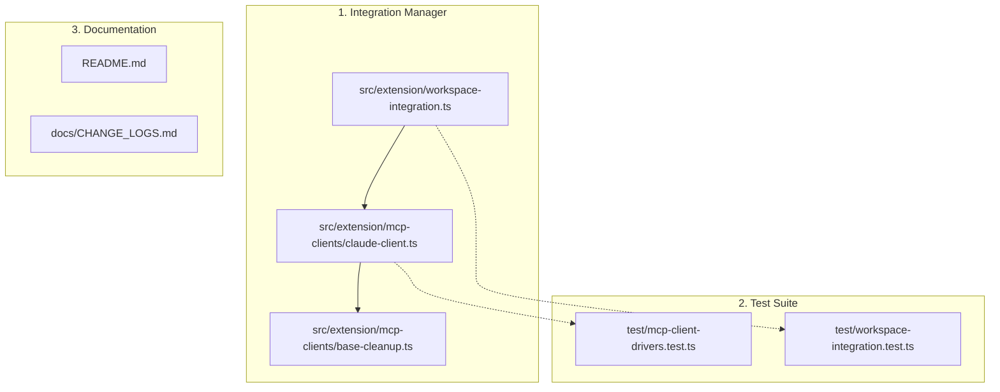

# Kế hoạch triển khai: Tự động cài đặt Skill cho Claude Code

## 1. Mục tiêu & Đánh giá độ khó

- **Mục tiêu**: Nâng cấp bộ cài đặt Claude (`ClaudeClientDriver`) để tự động triển khai và quản lý vòng đời của Agent Skill (`create-review-artifact`) vào thư mục Personal Skills của Claude Code:
  ```text
  ~/.claude/skills/create-review-artifact/
  ├── SKILL.md
  ├── references/
  │   └── artifact-contract.md
  └── agents/
      └── openai.yaml
  ```
- **Đánh giá độ khó**: **THẤP (2/5 điểm)**
  - **Khối lượng công việc**: ~3–4 files sửa đổi, không phát sinh logic kiến trúc mới.
  - **Thuận lợi**: Tái sử dụng được 100% hàm triển khai thư mục atomic sẵn có (`replaceSkillDirectory`) và nội dung thư mục skill `skills/create-review-artifact/`.
  - **Rủi ro**: Rất thấp. Thao tác trên thư mục con độc lập `~/.claude/skills/create-review-artifact/`, không tác động đến bất kỳ cấu hình hay skill nào khác của Claude Code.

---

## 2. Các nguyên tắc kỹ thuật cốt lõi (Invariants)

1. **Đồng bộ vòng đời (Lifecycle Synchronization)**:
   - **Cài đặt (`install`)**: Cấu hình MCP server trong `~/.claude.json` **đồng thời** deploy thư mục skill vào `~/.claude/skills/create-review-artifact/`.
   - **Gỡ bỏ (`uninstall`)**: Xóa cấu hình MCP khỏi `~/.claude.json` **đồng thời** xóa sạch thư mục skill con `~/.claude/skills/create-review-artifact/`.
   - **Dọn dẹp khi gỡ extension (`vscode:uninstall`)**: Hàm `cleanupBaseMcpServer` tự động dọn sạch thư mục skill của Claude nếu extension bị gỡ.
2. **Kiểm tra tính sẵn sàng 2 lớp (`check`)**:
   - Kiểm tra MCP server trong `~/.claude.json`.
   - Kiểm tra nội dung skill trong `~/.claude/skills/create-review-artifact/` (nếu thiếu hoặc file cũ -> báo `missing` hoặc `outdated`).
3. **Bảo toàn dữ liệu người dùng (Preserve Unrelated Assets)**:
   - Chỉ tạo hoặc xóa duy nhất thư mục con `create-review-artifact`.
   - Tuyệt đối không xóa hay thay đổi thư mục mẹ `~/.claude/skills/` và các skill cá nhân khác của người dùng.
4. **Không ảnh hưởng các client khác**:
   - Tiếp tục duy trì việc cài đặt skill vào `~/.agents/skills/create-review-artifact/` phục vụ cho Codex và các agent theo chuẩn `.agents`.

---

## 3. Bản đồ Component & Files chịu tác động



---

## 4. Chi tiết các Phase triển khai

### Phase 1: Nâng cấp `ClaudeClientDriver` & Đồng bộ Skill

- **Mục tiêu**: Bổ sung năng lực triển khai, gỡ bỏ và kiểm tra skill vào driver của Claude.
- **Các bước thực hiện**:
  1. Trong `src/extension/workspace-integration.ts`:
     - Xuất hàm helper `replaceSkillDirectory(source, target)` hoặc trích xuất thành helper dùng chung để `ClaudeClientDriver` có thể gọi trực tiếp.
     - Định nghĩa đường dẫn `sourceSkill` có thể truy cập được từ context hoặc driver.
  2. Trong `src/extension/mcp-clients/claude-client.ts`:
     - Thêm property / helper xác định đường dẫn skill của Claude:
       ```ts
       get skillPath(): string {
         return path.join(os.homedir(), ".claude", "skills", "create-review-artifact");
       }
       ```
     - Nhận `sourceSkillPath?: string` và `customSkillPath?: string` (phục vụ cách ly trong test).
     - Trong `install(mcpScriptPath, sourceSkillPath)`:
       - Cấu hình JSON vào `~/.claude.json`.
       - Deploy thư mục skill sang `this.skillPath` bằng atomic rename/replace.
     - Trong `uninstall()`:
       - Gỡ server khỏi `~/.claude.json`.
       - Xóa đệ quy thư mục `this.skillPath` (nếu tồn tại).
     - Trong `check(mcpScriptPath)`:
       - Kiểm tra MCP server trong JSON.
       - Kiểm tra sự tồn tại của `SKILL.md` trong `this.skillPath`.

---

### Phase 2: Dọn dẹp Tập trung & Cập nhật Test Suite

- **Mục tiêu**: Đảm bảo uninstaller tự động và bộ test tích hợp kiểm thử sạch sẽ cả 2 tài nguyên (MCP + Skill).
- **Các bước thực hiện**:
  1. Trong `src/extension/mcp-clients/base-cleanup.ts`:
     - Bổ sung lệnh xóa `path.join(userHome, ".claude", "skills", "create-review-artifact")` vào hàm `cleanupBaseMcpServer()`.
  2. Cập nhật `test/mcp-client-drivers.test.ts`:
     - Bổ sung bài test xác thực: khi `claudeDriver.install()` chạy, cả `.claude.json` và `.claude/skills/create-review-artifact/SKILL.md` đều được tạo ra.
     - Xác thực: khi `claudeDriver.uninstall()` chạy, cả cấu hình MCP lẫn thư mục skill đều được xóa sạch, trong khi các skill khác trong `.claude/skills/` vẫn được giữ nguyên.
  3. Cập nhật `test/workspace-integration.test.ts`:
     - Mock thư mục `targetDir/.claude/skills/keep-me/SKILL.md` trong fixture test.
     - Xác thực quá trình `installAllDetectedIntegrations` và `uninstallAllDetectedIntegrations` dọn dẹp chính xác skill `create-review-artifact` của Claude mà không ảnh hưởng tới `keep-me`.

---

### Phase 3: Cập nhật Tài liệu & Kiểm thử hồi quy toàn diện

- **Mục tiêu**: Đồng bộ tài liệu hướng dẫn và nghiệm thu sản phẩm.
- **Các bước thực hiện**:
  1. Cập nhật `README.md`:
     - Trong phần hướng dẫn Claude: Bỏ lưu ý người dùng Claude phải copy thủ công skill; khẳng định Claude Code được tự động cài đặt cả MCP server và Skill.
  2. Ghi nhận nhật ký kỹ thuật vào `docs/CHANGE_LOGS.md`:
     - Ghi nhận việc bổ sung auto-deploy skill cho Claude Code.
  3. Chạy toàn bộ quy trình kiểm thử:
     - `npm run check` (Type check).
     - `npm test` (Full test suite 32 files).
     - `npm run build` (Bundle tất cả targets).

---

## 5. Tiêu chí hoàn thành (Definition of Done)

- [x] `ClaudeClientDriver.install()` triển khai đầy đủ cả MCP config và thư mục skill.
- [x] `ClaudeClientDriver.uninstall()` và `cleanupBaseMcpServer()` xóa sạch skill của AI Artifacts, không để lại file thừa.
- [x] Các skill khác trong `~/.claude/skills/` được bảo toàn nguyên vẹn.
- [x] 100% test suite chạy pass (bao gồm unit test và integration test).
- [x] Tài liệu `README.md` và `docs/CHANGE_LOGS.md` phản ánh chính xác hành vi tự động mới.
