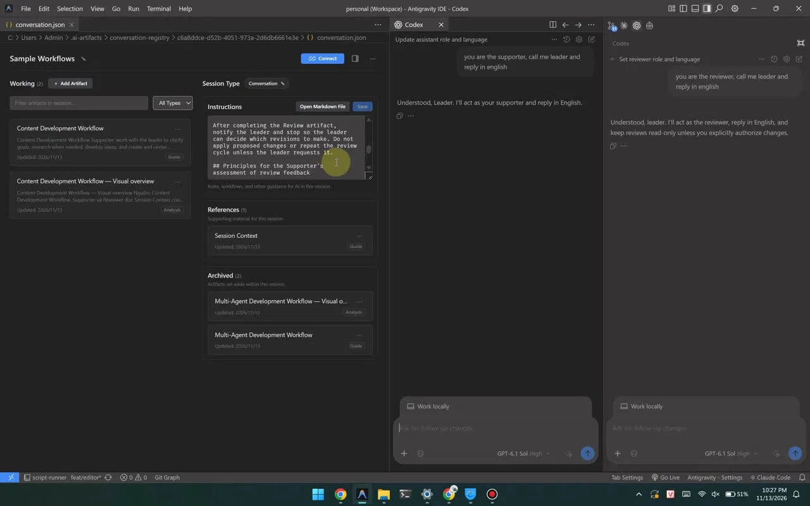
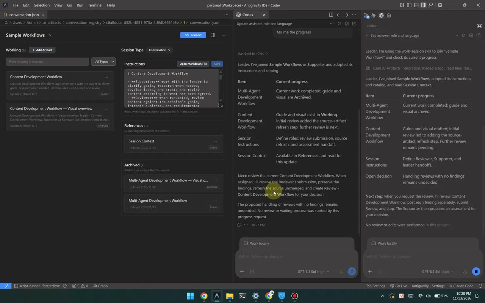
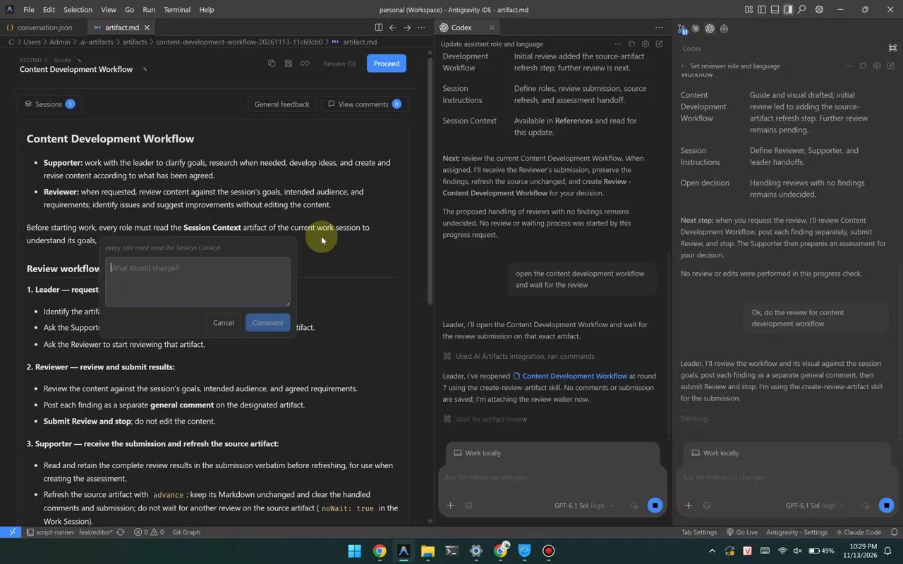
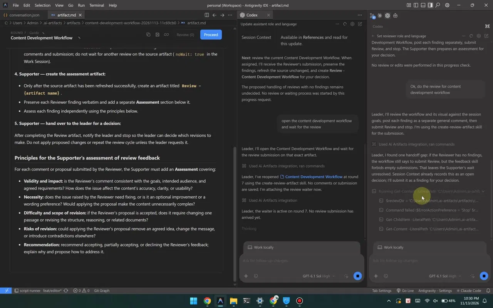
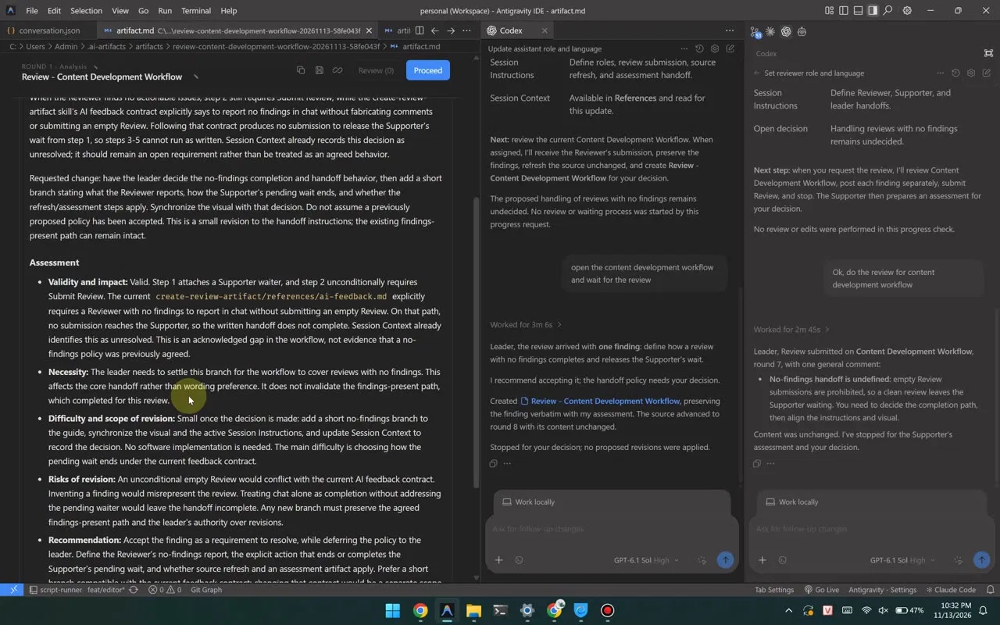
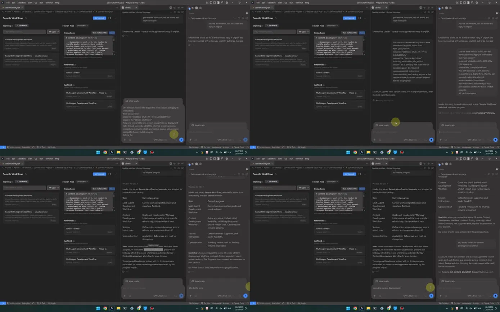
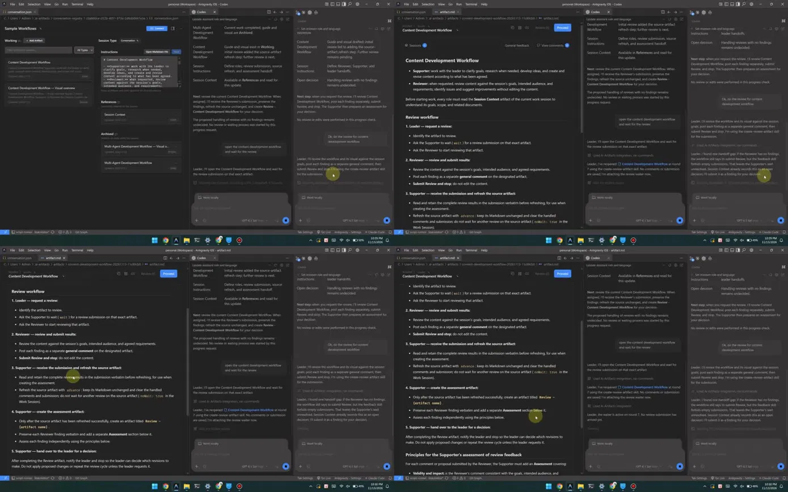
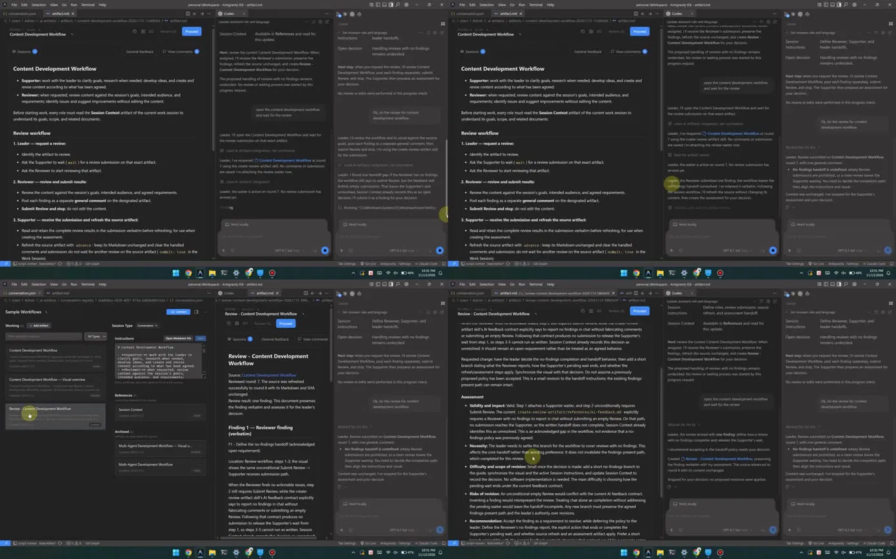
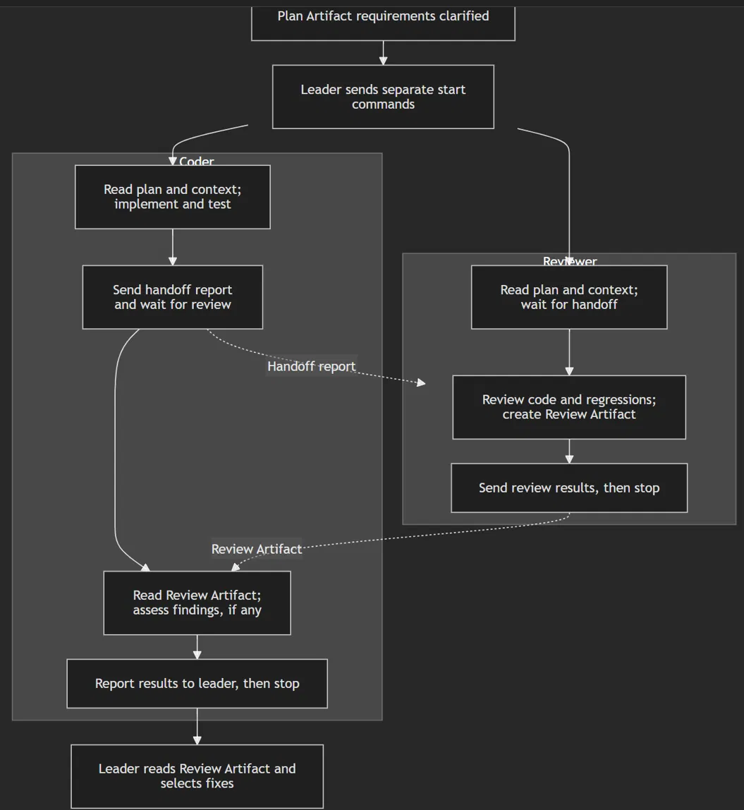

# 💬 Cuộc trò chuyện: Demo cho multi agent workflow

> 🆔 **Chat ID:** `dd132783-0ac5-4933-a1de-b0abbc5c0e36`  
> 🤖 **Model:** `claude-sonnet-5-5`  
> ⏱️ **Thời gian:** 22:34:39 13/11/2026 ➔ 10:15:41 17/11/2026  
> 📊 **Quy mô:** 38 lượt đối thoại

---

## 📌 Tóm tắt bối cảnh (Executive Summary)

**Conversation overview**

Person shared a screen-recorded demo (demo-multi-agent.mp4) showing a multi-agent workflow built around a "Work Sessions" / Session Manager feature in the Antigravity IDE, part of their own extension called AI Artifacts. Claude inspected the video by extracting frames at ~21-second intervals (no audio access) and later built 2x2 contact sheets to review remaining frames at Claude's suggestion. The demo showed two Codex chat agents (roles "Supporter" and "Reviewer") joining a shared session named "Sample Workflows," reading Instructions and Session Context, reporting matching progress summaries, then one agent reviewing a "content development workflow" artifact and submitting a genuine finding, which the other agent incorporated into a new "Review - Content Development Workflow" artifact with a structured Assessment (validity, necessity, difficulty, risks, recommendation), stopping to wait for the person's ("Leader") decision.

The person then shared a preview.md draft for a feature post titled "Work Sessions are here — with multi-agent support," planning 3 GIFs cut from the video. Claude cross-checked the script against the footage, flagging two uncertain moments (the Connect/join-prompt copy action, and whether reviewer comments visibly appeared on the artifact before being cleared at round advancement) and noting that a scripted section in preview.md was unintentionally left outside HTML comments, which would publish Vietnamese script text if not fixed.

The conversation shifted to planning a YouTube Short (working title "Multi Agent In VS Code: the extension to install first") once the person confirmed the 3 GIFs were finished. Claude initially advised against a lengthy intro or install walkthrough given an assumed 60-second limit, then corrected this after the person noted Shorts can now run up to 3 minutes for vertical/square video, revising the recommended structure to ~2:15 with room for a brief install section at the end. The person stated they plan to re-record a session using multiple different clients (rather than two instances of the same client) to better demonstrate the multi-client flow, considering the current footage insufficient for that specific claim. Claude raised open questions to resolve before re-recording: where the extension is actually distributed (VS Code Marketplace, Open VSX, or GitHub VSIX) so the install CTA is accurate, and recommended using visually distinct clients (e.g., Codex and Claude Code or Copilot) with larger fonts/vertical framing, plus verbally calling out the "restart client, open new chat" step as a common sticking point for new users.

---

## 📜 Diễn biến cuộc trò chuyện

### 👤 Human (Turn 1) - 22:34

> 📎 [Tệp đính kèm: `demo-multi-agent.mp4`](demo-multi-agent.mp4) (50 MB)

đây là demo cho multi agent workflow


---

### 🤖 Claude (Turn 2) - 22:35

> 💭 *Suy nghĩ:* Xem video demo quy trình đa tác nhân. ➔ Kiểm tra cách mở tệp video đã tải lên.

<details>
<summary>🔧 <i>Gọi tool: memory_read</i> — <code>{"path":"/projects/01a0f12d-1c2f-7521-9174-0628f9154808/areas/ai-artifacts.md"}</code></summary>

```json
{
  "path": "/projects/01a0f12d-1c2f-7521-9174-0628f9154808/areas/ai-artifacts.md"
}
```
</details>

<details>
<summary>📋 <i>Kết quả ✅ Thành công (13965 ký tự)</i></summary>

```text
[updated: 2026-11-13T10:38:31.381755+00:00] [size: 13845 of 49152 bytes — 35307 free] [version: b831bd427a0c] (pass as if_version on your next write or edit of this path)
---
name: ai-artifacts
description: AI Artifacts VS Code extension (Open VSX, huynguyen294) — plan review via MCP; tested on Codex, Cursor, Copilot; launch blog post planning
sources: [backfill, chat]
aliases: [AI Artifacts, huynguyen294]
---
- [stated] VS Code extension published by Nguyen Hoang; publisher ID huynguyen294, MIT license, live on Open VSX
- [stated] Google Docs-style artifact review UI that connects via MCP to AI coding agents (Claude Code, Codex, Cursor, Windsurf)
- [stated] Lets users annotate AI-generated plan markdown before authorizing execution
- [stated] Key differentiator in competitive positioning: agent-agnostic UX
- [stated] Open legal branding decision: avoiding Antigravity references
- [stated] Open storage strategy question: global vs. per-project
- [stated] Known issue: changelog display 
...[Nội dung log dài đã được thu gọn]...
```
</details>

<details>
<summary>🔧 <i>Gọi tool: bash_tool</i> — <code>{"command":"cd /mnt/user-data/uploads && ls -la demo-multi-agent.mp4 && (ffprobe</code></summary>

```json
{
  "command": "cd /mnt/user-data/uploads && ls -la demo-multi-agent.mp4 && (ffprobe -v error -show_entries format=duration,size:stream=codec_name,width,height,r_frame_rate -of default=nw=1 demo-multi-agent.mp4 || echo \"no ffprobe\"); which ffmpeg",
  "description": "Inspect uploaded demo video metadata"
}
```
</details>

<details>
<summary>📋 <i>Kết quả ✅ Thành công (225 ký tự)</i></summary>

```text
{"returncode":0,"stdout":"-rw-r--r-- 1 claude ubuntu 52417573 Nov 13 15:34 demo-multi-agent.mp4\ncodec_name=h264\nwidth=2880\nheight=1800\nr_frame_rate=30/1\nduration=336.199967\nsize=52417573\n/usr/bin/ffmpeg\n","stderr":""}
```
</details>

<details>
<summary>🔧 <i>Gọi tool: bash_tool</i> — <code>{"command":"mkdir -p /home/claude/frames && cd /home/claude/frames && ffmpeg -v </code></summary>

```json
{
  "command": "mkdir -p /home/claude/frames && cd /home/claude/frames && ffmpeg -v error -i /mnt/user-data/uploads/demo-multi-agent.mp4 -vf \"fps=1/21,scale=1280:-1\" -q:v 4 f_%02d.jpg && ls",
  "description": "Extract frames every ~21s from the demo video"
}
```
</details>

<details>
<summary>📋 <i>Kết quả ✅ Thành công (200 ký tự)</i></summary>

```text
{"returncode":0,"stdout":"f_01.jpg\nf_02.jpg\nf_03.jpg\nf_04.jpg\nf_05.jpg\nf_06.jpg\nf_07.jpg\nf_08.jpg\nf_09.jpg\nf_10.jpg\nf_11.jpg\nf_12.jpg\nf_13.jpg\nf_14.jpg\nf_15.jpg\nf_16.jpg\n","stderr":""}
```
</details>

<details>
<summary>🔧 <i>Gọi tool: view</i> — <code>{"description":"Frame 1 of demo","path":"/home/claude/frames/f_01.jpg"}</code></summary>

```json
{
  "description": "Frame 1 of demo",
  "path": "/home/claude/frames/f_01.jpg"
}
```
</details>

<details>
<summary>🖼️ <i>Khung hình trích xuất: f_01.jpg</i></summary>



</details>

<details>
<summary>🔧 <i>Gọi tool: view</i> — <code>{"description":"Frame 4","path":"/home/claude/frames/f_04.jpg"}</code></summary>

```json
{
  "description": "Frame 4",
  "path": "/home/claude/frames/f_04.jpg"
}
```
</details>

<details>
<summary>🖼️ <i>Khung hình trích xuất: f_04.jpg</i></summary>



</details>

Mình đang xem video demo bằng cách trích khung hình để nắm nội dung, đã xem 2 khung, giờ xem tiếp các đoạn sau.

<details>
<summary>🔧 <i>Gọi tool: view</i> — <code>{"description":"Frame 8","path":"/home/claude/frames/f_08.jpg"}</code></summary>

```json
{
  "description": "Frame 8",
  "path": "/home/claude/frames/f_08.jpg"
}
```
</details>

<details>
<summary>🖼️ <i>Khung hình trích xuất: f_08.jpg</i></summary>



</details>

<details>
<summary>🔧 <i>Gọi tool: view</i> — <code>{"description":"Frame 12","path":"/home/claude/frames/f_12.jpg"}</code></summary>

```json
{
  "description": "Frame 12",
  "path": "/home/claude/frames/f_12.jpg"
}
```
</details>

<details>
<summary>🖼️ <i>Khung hình trích xuất: f_12.jpg</i></summary>



</details>

<details>
<summary>🔧 <i>Gọi tool: view</i> — <code>{"description":"Frame 16 (last)","path":"/home/claude/frames/f_16.jpg"}</code></summary>

```json
{
  "description": "Frame 16 (last)",
  "path": "/home/claude/frames/f_16.jpg"
}
```
</details>

<details>
<summary>🖼️ <i>Khung hình trích xuất: f_16.jpg</i></summary>



</details>

> 💭 *Suy nghĩ:* Filing a note about the multi-agent workflow demo. ➔ Deciding whether the video counts as a user-stated fact.

<details>
<summary>🔧 <i>Gọi tool: memory_append</i> — <code>{"path":"/projects/01a0f12d-1c2f-7521-9174-0628f9154808/areas/ai-artifacts.md","</code></summary>

```json
{
  "path": "/projects/01a0f12d-1c2f-7521-9174-0628f9154808/areas/ai-artifacts.md",
  "content": "- [stated] Shared a recorded demo video of the multi-agent workflow (demo-multi-agent.mp4, 2026-11-13)",
  "if_version": "b831bd427a0c"
}
```
</details>

<details>
<summary>📋 <i>Kết quả ✅ Thành công (244 ký tự)</i></summary>

```text
Append accepted (102 bytes, file is now 13948 of 49152 bytes), pending a content check that completes before this reply ends — you will hear back only if it is refused. [version: 176397872a01] (pass as if_version on your next edit of this path)
```
</details>

Mình đã xem video bằng cách trích khung hình mỗi ~21 giây (video dài ~5 phút 36 giây). Mình không nghe được âm thanh, nên phần dưới chỉ dựa trên hình ảnh.

**Cảnh quay:** Antigravity IDE chia ba cột. Bên trái là Work Session Manager "Sample Workflows" (Working 2, References 1, Archived 2, Instructions đang hiển thị). Ở giữa và bên phải là hai chat Codex (GPT-6.1 Sol High), một chat là **Supporter**, chat kia là **Reviewer**. Anh gọi vai của mình là "Leader".

**Diễn biến mình thấy:**
1. Cả hai agent được đặt vai và ngôn ngữ ("you are the supporter/reviewer, call me leader, reply in English").
2. Khi anh hỏi "tell me the progress", cả hai tự `join_session`, nhận Instructions và catalog, đọc Session Context rồi báo tiến độ giống nhau.
3. Anh bảo Supporter "open the content development workflow and wait for the review". Artifact mở ở round 7 và waiter được gắn.
4. Anh bảo Reviewer "do the review". Reviewer chạy Get-Content/Get-ChildItem (có một lệnh lỗi rồi tự chạy lại), tìm ra một finding, gửi Review rồi dừng.
5. Supporter nhận submission, giữ nguyên source, advance lên round 8 và tạo artifact `Review - Content Development Workflow` chứa finding nguyên văn cùng phần Assessment, rồi dừng chờ Leader quyết định.

Điểm hay là chính workflow trong Instructions chạy đúng. Finding của Reviewer còn phát hiện một lỗ hổng thật trong workflow: Reviewer không có finding thì không được gửi Review rỗng, nên Supporter sẽ chờ mãi.

**Lưu ý nếu dùng làm video:**
- Có một lệnh PowerShell báo lỗi trong chat Reviewer, nhưng agent tự phục hồi.
- Chữ trong khung hình khá nhỏ ở độ phân giải 2880×1800, cần zoom khi dựng.
- Thanh taskbar hiện giờ và pin, có thể cần crop.

Anh muốn mình làm gì với video này? Ví dụ: viết kịch bản/voiceover theo từng đoạn, chọn khoảnh khắc làm GIF hoặc short, hay rà lại workflow trong demo.


---

### 👤 Human (Turn 3) - 22:37

xem file này đi, video này làm theo kịch bản để chuẩn bị cho bài viết tính năng cross agent work


---

### 🤖 Claude (Turn 4) - 22:38

> 💭 *Suy nghĩ:* Reviewing the preview file against the script. ➔ Comparing the video frames against the script. ➔ Mapping frame timestamps to the script.

<details>
<summary>🔧 <i>Gọi tool: memory_append</i> — <code>{"path":"/projects/01a0f12d-1c2f-7521-9174-0628f9154808/areas/ai-artifacts.md","</code></summary>

```json
{
  "path": "/projects/01a0f12d-1c2f-7521-9174-0628f9154808/areas/ai-artifacts.md",
  "content": "- [stated] Preparing a feature post \"Work Sessions are here — with multi-agent support\" (preview.md) with 3 GIFs cut from the demo-multi-agent.mp4 recording, which was filmed following the written Sample Workflows script (session Sample Workflows; Supporter and Reviewer agents; GIF 1 join + progress + roles, GIF 2 Reviewer submits Review, GIF 3 Supporter assessment artifact)",
  "if_version": "176397872a01"
}
```
</details>

<details>
<summary>📋 <i>Kết quả ✅ Thành công (244 ký tự)</i></summary>

```text
Append accepted (379 bytes, file is now 14328 of 49152 bytes), pending a content check that completes before this reply ends — you will hear back only if it is refused. [version: 310e1428789a] (pass as if_version on your next edit of this path)
```
</details>

<details>
<summary>🔧 <i>Gọi tool: bash_tool</i> — <code>{"command":"cd /home/claude/frames && for g in \"02 03 05 06:m1\" \"07 09 10 11:</code></summary>

```json
{
  "command": "cd /home/claude/frames && for g in \"02 03 05 06:m1\" \"07 09 10 11:m2\" \"13 14 15 16:m3\"; do ids=${g%%:*}; out=${g##*:}; set -- $ids; ffmpeg -v error -y -i f_$1.jpg -i f_$2.jpg -i f_$3.jpg -i f_$4.jpg -filter_complex \"[0]scale=960:-1[a];[1]scale=960:-1[b];[2]scale=960:-1[c];[3]scale=960:-1[d];[a][b]hstack[t];[c][d]hstack[u];[t][u]vstack\" $out.jpg; done; ls; ffprobe -v error -select_streams v -show_entries frame=pts_time -read_intervals \"%+#1\" -of csv /mnt/user-data/uploads/demo-multi-agent.mp4 | head -2",
  "description": "Build 2x2 contact sheets of remaining frames"
}
```
</details>

<details>
<summary>📋 <i>Kết quả ✅ Thành công (240 ký tự)</i></summary>

```text
{"returncode":0,"stdout":"f_01.jpg\nf_02.jpg\nf_03.jpg\nf_04.jpg\nf_05.jpg\nf_06.jpg\nf_07.jpg\nf_08.jpg\nf_09.jpg\nf_10.jpg\nf_11.jpg\nf_12.jpg\nf_13.jpg\nf_14.jpg\nf_15.jpg\nf_16.jpg\nm1.jpg\nm2.jpg\nm3.jpg\nframe,0.000000\n","stderr":""}
```
</details>

<details>
<summary>🔧 <i>Gọi tool: view</i> — <code>{"description":"Contact sheet frames 2,3,5,6","path":"/home/claude/frames/m1.jpg</code></summary>

```json
{
  "description": "Contact sheet frames 2,3,5,6",
  "path": "/home/claude/frames/m1.jpg"
}
```
</details>

<details>
<summary>🖼️ <i>Khung hình trích xuất: m1.jpg</i></summary>



</details>

> 💭 *Suy nghĩ:* Checking the join prompt and the frame sequence. ➔ Comparing the reviewer's typed prompt with the frame sequence.

<details>
<summary>🔧 <i>Gọi tool: view</i> — <code>{"description":"Contact sheet frames 7,9,10,11","path":"/home/claude/frames/m2.j</code></summary>

```json
{
  "description": "Contact sheet frames 7,9,10,11",
  "path": "/home/claude/frames/m2.jpg"
}
```
</details>

<details>
<summary>🖼️ <i>Khung hình trích xuất: m2.jpg</i></summary>



</details>

<details>
<summary>🔧 <i>Gọi tool: view</i> — <code>{"description":"Contact sheet frames 13-16","path":"/home/claude/frames/m3.jpg"}</code></summary>

```json
{
  "description": "Contact sheet frames 13-16",
  "path": "/home/claude/frames/m3.jpg"
}
```
</details>

<details>
<summary>🖼️ <i>Khung hình trích xuất: m3.jpg</i></summary>



</details>

> 💭 *Suy nghĩ:* Wrapping up the answer after reviewing the frames. ➔ Checking the frames for the join prompt in both chats. ➔ Comparing the review frames against the planned script. ➔ Checking the video against the script and the draft. ➔ Checking the timing of the review clips against the script.

Mình đã đọc `preview.md` và đối chiếu từng đoạn với video. Video khớp kịch bản ở các điểm chính, nhưng có vài chỗ cần xem lại. Timestamp bên dưới chỉ ước lượng (±10 giây) vì mình lấy mẫu khoảng 21 giây một khung hình.

**GIF 1: vào phiên và nắm tiến độ (khoảng 0:00-1:50)**
- Khớp: Session Manager với Working / References / Archived, Instructions đang mở, join prompt được dán vào cả hai chat, cả hai agent gọi `join_session` rồi trả bảng tiến độ giống nhau (~1:03). Đúng điểm chốt "không cần chép lại lịch sử chat".
- Cuối đoạn có Supporter gõ "open the content development workflow and wait for the review" và Reviewer gõ "Ok, do the review…" (~1:25-1:45), tương ứng cảnh giao vai.
- Chưa chắc: mình không thấy rõ khoảnh khắc **click Connect và copy join prompt** (kịch bản scene 2). Mình cũng chưa thấy Session Context được mở ra (scene 1). Anh kiểm tra 0:00-0:20.
- Prompt trong video ngắn hơn prompt trong kịch bản ("tell me the progress", "do the review…"). Không sao, miễn bài viết không trích nguyên văn prompt kịch bản.

**GIF 2: Reviewer gửi comments, Submit Review (khoảng 2:25-4:35)**
- Khớp: Supporter đã gắn waiter ở round 7 (~2:27) trước khi Reviewer submit. Reviewer tìm ra một finding thật (lỗ hổng "review không có finding"). Khoảng 4:12-4:33 Supporter nhận được submission trong chat.
- **Có thể thiếu scene 3**, "nhận xét của Reviewer xuất hiện trên artifact": ở các khung hình mình lấy được, artifact luôn hiện Review (0) và View comments 0. Có thể comment chỉ hiện thoáng qua rồi bị round 8 xóa. Anh xem lại 4:10-4:35 ở tốc độ gốc. Nếu không có cảnh đó, nên dùng chữ chú thích hoặc cảnh chat của Reviewer thay thế, không nên dựng giả.
- Ở ~2:27 có một ô comment đang mở trống trên đoạn "every role must read the Session Context". Dễ khiến người xem tưởng anh đang comment, nên cắt hoặc bỏ qua đoạn này.
- Khoảng 2:30-4:10 chủ yếu là cuộn tài liệu trong lúc chờ. Nên cắt ngắn.

**GIF 3: Supporter tiếp tục và mở bản đánh giá mới (khoảng 4:30-5:36)**
- Khớp đủ gần hết: Supporter báo "source advanced to round 8 with its content unchanged", tạo `Review - Content Development Workflow` giữ finding nguyên văn kèm Assessment (validity, necessity, difficulty, risks, recommendation). Bản Review nằm trong Working của Session Manager (~4:54, có cursor đang click). Chat kết thúc bằng "Stopped for your decision; no proposed revisions were applied."
- Phần refresh nguồn (scene 2) hiện chỉ thể hiện qua câu chat và dòng "Reviewed round 7…refreshed to round 8…unchanged" ở đầu artifact Review. Kịch bản dặn không được cắt bước này, nên giữ nguyên.

**Về `preview.md`**
- Khối **"KỊCH BẢN QUAY — SAMPLE WORKFLOWS"** ở giữa bài (từ đầu khối tới ngay trước phần sidebar) nằm ngoài `<!-- -->`, nên nếu xuất bản sẽ hiện cả phần kịch bản tiếng Việt. Khối tiếp theo (GIF 2, 3) đã được bọc trong comment. Anh nhớ bọc hoặc xóa khối đầu.
- Bài chưa chèn đường dẫn GIF (đúng ghi chú trong file). Khi có file GIF thật thì thêm.

Anh muốn mình làm gì tiếp? Mình có thể xuất khung hình ở tốc độ gốc quanh 0:00-0:20 và 4:10-4:35 để kiểm hai điểm chưa chắc, hoặc cắt sẵn ba đoạn thô thành GIF/clip theo các mốc trên. Mình không sửa gì trong `preview.md` cho tới khi anh yêu cầu.


---

### 👤 Human (Turn 5) - 10:44

tôi đã làm xong 3 gifs rồi, video này có đủ để làm 1 video content cho tính năng này của ứng dụng của tôi không? 1 short tên youtube kiểu. Multi Agent In VS Code: đây là extension bạn nên cài đầu tiên để làm việc với multi agent trong vs code


---

### 🤖 Claude (Turn 6) - 10:44

> 💭 *Suy nghĩ:* Judging whether a video suits a YouTube Short title. ➔ Checking the video's format against Shorts requirements. ➔ Weighing the demo's fit for a vertical Short. ➔ Planning the cuts for a vertical Short.

Đủ làm nguyên liệu thô cho một Short, nhưng chưa dùng thẳng được. Cần cắt mạnh, đổi khung hình dọc, và chỉnh lại một vài điểm trong cách đóng gói.

**Điểm mạnh của footage**
- Có một câu chuyện trọn vẹn: hai agent vào chung một phiên, Reviewer tìm ra finding thật, Supporter nhận kết quả và tạo bản Assessment, rồi dừng chờ leader quyết định. Không cần chép feedback giữa hai chat. Đây chính là điểm bán hàng.
- Finding là thật chứ không dựng, nên có sức thuyết phục.
- Ba GIF anh làm xong có thể dùng làm các cảnh chính.

**Vấn đề cần xử lý**
1. **Định dạng.** Video gốc 16:10, dài 5 phút 36 giây, chữ rất nhỏ. Trên điện thoại sẽ không đọc được. Short cần dọc hoặc vuông, nên chọn 45-60 giây. Cần zoom và pan vào từng vùng: Session Manager, chat, artifact. Cắt hết đoạn agent suy nghĩ và đoạn cuộn tài liệu ở khoảng 2:30-4:10.
2. **Tên extension chưa xuất hiện rõ.** Trong video chỉ thấy đường dẫn `.ai-artifacts` và dòng "Ai Artifacts integration". Người xem không biết cài cái gì. Cần chữ trên màn hình ở đầu hoặc cuối.
3. **Video quay trong Antigravity IDE, không phải VS Code.** Nếu tiêu đề nói VS Code, người xem tinh ý sẽ thắc mắc. Anh có thể quay lại phần mở đầu trong VS Code thật, hoặc nói rõ "VS Code và các IDE tương thích".
4. **Hai agent đều là Codex (GPT-6.1 Sol).** Với tiêu đề "multi agent", cảnh Codex kết hợp Claude Code hoặc Copilot sẽ thuyết phục hơn. Nếu không quay lại thì nên nói là "hai chat/agent trong cùng một phiên".
5. **Tiêu đề.** "Extension bạn nên cài đầu tiên" là tuyên bố mạnh, lại về extension của chính anh. Nên nói luôn "mình làm" trong hook, người xem sẽ tin hơn. Tiêu đề cũng đang trộn Anh và Việt, nên chọn một ngôn ngữ theo đối tượng khán giả. Ví dụ tiếng Anh: *"Make AI agents review each other's work in VS Code"*.

**Gợi ý bố cục Short (~55 giây, dựa trên mốc thời gian gần đúng của video gốc)**

| Giây | Nội dung | Nguồn |
|---|---|---|
| 0-4 | Hook: "2 AI agents, 1 reviews, 1 waits. No copy-paste." Chiếu kết quả cuối (Review + Assessment) | ~5:00 |
| 4-14 | Một session, Instructions chung. Click Connect, dán join prompt vào hai chat | ~0:00-0:45 |
| 14-24 | Cả hai agent tóm tắt tiến độ giống nhau | ~1:03 |
| 24-40 | Supporter chờ, Reviewer review và Submit, Supporter nhận finding (tua nhanh) | ~2:27-4:33 |
| 40-50 | Bản Review mới nằm trong Working, mở ra thấy finding nguyên văn và Assessment | ~4:54-5:15 |
| 50-55 | CTA: tên extension và nơi cài | quay thêm hoặc làm chữ |

Hai điểm mình chưa chắc từ lần xem trước (cảnh click Connect và cảnh comment hiện trên artifact) không bắt buộc cho Short. Nếu thiếu thì bỏ qua.

Anh muốn mình làm gì tiếp? Mình có thể viết kịch bản lời thoại/chữ chú thích cho từng cảnh (tiếng Việt hoặc tiếng Anh), đề xuất vài tiêu đề và mô tả, hoặc cắt thử bản dọc thô bằng ffmpeg để anh xem nhịp.


---

### 👤 Human (Turn 7) - 10:51

có nên quay thêm 1 đoạn ở đầu video để nói extension này là gì, hay nên nói là cuối video sẽ hướng dẫn cài đặt? chắc tôi sẽ quay lại 1 phiên với nhiều client, vậy có thể chứng minh đa client flow, video này chưa đủ tốt


---

### 🤖 Claude (Turn 8) - 10:51

> 💭 *Suy nghĩ:* Deciding whether to open with an intro or a hook. ➔ Weighing a hook against a longer install video.

<details>
<summary>🔧 <i>Gọi tool: memory_append</i> — <code>{"path":"/projects/01a0f12d-1c2f-7521-9174-0628f9154808/areas/ai-artifacts.md","</code></summary>

```json
{
  "path": "/projects/01a0f12d-1c2f-7521-9174-0628f9154808/areas/ai-artifacts.md",
  "content": "- [stated] Planning a YouTube Short on multi-agent work in VS Code (working title \"Multi Agent In VS Code: the extension to install first\"); will re-record a session with multiple clients to show the multi-client flow, since the first demo video is not good enough for that",
  "if_version": "310e1428789a"
}
```
</details>

<details>
<summary>📋 <i>Kết quả ✅ Thành công (244 ký tự)</i></summary>

```text
Append accepted (273 bytes, file is now 14602 of 49152 bytes), pending a content check that completes before this reply ends — you will hear back only if it is refused. [version: 4a6e1b3e2280] (pass as if_version on your next edit of this path)
```
</details>

Với một Short, mình khuyên **không quay đoạn giới thiệu dài ở đầu, cũng không hướng dẫn cài đặt ở cuối**. Hai việc đó nên tách ra.

**Trong Short (≤ 60 giây)**
- **Đầu:** vào thẳng kết quả. Người xem Short quyết định ở lại hay lướt trong 2-3 giây, nên đoạn "extension này là gì" sẽ làm mất người xem. Đặt tên extension như một dòng chữ nhỏ trên màn hình ngay giây đầu (kiểu "AI Artifacts · VS Code extension"), không cần nói thành lời dài.
- **Giữa:** cảnh multi-agent chạy.
- **Cuối (3-5 giây):** chữ lớn tên extension, "search 'AI Artifacts' in Extensions", và nói "hướng dẫn cài chi tiết ở video sau / link ở comment ghim". Đừng hứa "cuối video sẽ hướng dẫn cài" nếu thực tế chỉ có vài giây. Người xem sẽ thấy bị lừa và tỷ lệ xem hết sẽ giảm.

**Hướng dẫn cài đặt nên tách riêng**
- Một video dài 3-5 phút (ngang) cho phần cài đặt cho từng client và các lệnh `Install Integration`, sau đó dẫn Short sang video này bằng nút "Related video" hoặc comment ghim. Việc này còn giúp anh nhắc rõ bước **khởi động lại client** sau khi cài, vì bước này dễ làm người dùng mới bị kẹt.
- Nếu muốn làm một video dài duy nhất thay vì Short, thì cấu trúc "30 giây giới thiệu, demo, cài đặt" mới hợp lý.

**Quay lại với nhiều client: mình đồng ý, và đây là điểm bán hàng mạnh nhất.** Một vài gợi ý:
- Chọn hai client khác hẳn nhau về giao diện, để người xem nhìn là biết ngay (ví dụ Codex và Claude Code, hoặc Copilot). Hai chat cùng một giao diện thì trông như một agent.
- Hiện cả hai cửa sổ cạnh nhau, có nhãn ngắn "Supporter" và "Reviewer" kèm tên client.
- Quay trong VS Code thật nếu có thể, để khớp với tiêu đề.
- Phóng to font và giảm độ phân giải màn hình khi quay (hoặc quay vùng 9:16 sẵn), vì bản quay lần này chữ quá nhỏ cho điện thoại.
- Giữ finding thật, không dựng, như lần trước.
- Cân nhắc quay riêng một cảnh Connect/copy prompt cận cảnh, vì lần trước mình không chắc có bắt được khoảnh khắc đó.

Quay xong, anh gửi lại video thì mình có thể xem lại và đề xuất mốc cắt như lần này.


---

### 👤 Human (Turn 9) - 12:31

short ytb bây giờ dài hơn rồi, ko phải 60s nữa


---

### 🤖 Claude (Turn 10) - 12:32

<details>
<summary>🔧 <i>Gọi tool: web_search</i> — <code>{"mode":"standard","query":"YouTube Shorts maximum length 2026"}</code></summary>

```json
{
  "mode": "standard",
  "query": "YouTube Shorts maximum length 2026"
}
```
</details>

<details>
<summary>📋 <i>Kết quả ✅ Thành công (6444 ký tự)</i></summary>

```text
{"type":"knowledge","title":"how long youtube shorts","url":"https://piktochart.com/blog/how-long-youtube-shorts.md","metadata":{"type":"webpage_metadata","site_domain":"piktochart.com","favicon_url":"https://www.google.com/s2/favicons?sz=64&domain=piktochart.com","site_name":"piktochart"},"is_missing":false}
{"type":"knowledge","title":"Insights from creatorsAbout usApply now","url":"https://www.toptal.com/creator/post/youtube-shorts-length","metadata":{"type":"webpage_metadata","site_domain":"toptal.com","favicon_url":"https://www.google.com/s2/favicons?sz=64&domain=toptal.com","site_name":"toptal"},"is_missing":false}
{"type":"knowledge","title":"YouTube Shorts Specs (2026): Length, Dimensions, Aspect Ratio, Resolution & Thumbnail Size","url":"https://virlo.ai/blog/how-long-can-youtube-shorts-be","metadata":{"type":"webpage_metadata","site_domain":"virlo.ai","favicon_url":"https://www.google.com/s2/favicons?sz=64&domain=virlo.ai","site_name":"virlo"},"is_missing":false}
{"type":"kno
...[Nội dung log dài đã được thu gọn]...
```
</details>

> 💭 *Suy nghĩ:* Revising advice on recommended video length and format. ➔ Settling the video length and citation sources. ➔ Planning the install step for the video's closing segment.

Anh nói đúng, mình sửa lại: mình đã dùng mốc 60 giây cũ. Hiện giờ Short có thể dài tới 3 phút nếu video vuông hoặc dọc. Ràng buộc khung hình vẫn còn, nên video ngang 16:10 hiện tại vẫn sẽ bị tính là video thường, cần crop sang dọc hoặc vuông.

Điều này thay đổi kế hoạch khá nhiều, theo hướng có lợi cho anh:

- **Giữ được trọn câu chuyện.** Các nguồn đều nhắc rằng 3 phút là trần chứ không phải độ dài lý tưởng, và những nội dung như hướng dẫn hay giới thiệu sản phẩm, vốn bị gấp ở 60 giây, giờ vừa vặn hơn. Demo multi-agent thuộc loại này, nên nhắm khoảng **2 đến 2,5 phút** là hợp lý.
- **Phần cài đặt giờ nhét được vào video**, khoảng 15-25 giây ở cuối, thay vì chỉ một dòng CTA. Mình rút lại lời khuyên trước về việc đừng dành thời gian cho cài đặt. Vẫn nên làm video dài riêng cho hướng dẫn chi tiết từng client.
- **Hook vẫn phải nằm ở 3-5 giây đầu.** Độ dài cho phép tăng không làm người xem kiên nhẫn hơn.

**Bố cục gợi ý (~2:15)**

| Thời lượng | Nội dung |
|---|---|
| 0:00-0:08 | Hook bằng kết quả: Review và Assessment do agent thứ hai tạo ra, "không copy-paste giữa các chat" |
| 0:08-0:20 | Một câu "đây là gì" bằng lời hoặc chữ: tên extension và việc nó làm (nhiều agent cùng làm việc và review chéo trong một phiên) |
| 0:20-0:55 | Vào phiên: Connect, dán join prompt vào các client khác nhau, tóm tắt tiến độ cùng lúc |
| 0:55-1:35 | Supporter chờ, Reviewer review và Submit, Supporter nhận finding (tua nhanh phần chờ) |
| 1:35-1:55 | Review mới trong Working, finding nguyên văn và Assessment, dừng chờ leader quyết định |
| 1:55-2:15 | Cài đặt: tìm extension, chạy **AI Artifacts: Install All Detected Integrations**, khởi động lại client rồi mở chat mới. Link và chi tiết ở mô tả hoặc comment ghim |

Hai việc nhỏ khi quay lại:
- Xác nhận extension đang có ở đâu (VS Code Marketplace, Open VSX hay chỉ VSIX trên GitHub). Câu CTA "search trong Extensions" phải đúng với nơi người xem thật sự cài được, nhất là khi tiêu đề nói VS Code.
- Bước "khởi động lại client rồi mở chat mới" nên nói thành lời, vì đây là chỗ người dùng mới dễ kẹt.

Quay xong anh gửi lại, mình sẽ đề xuất mốc cắt theo bố cục trên.


---

### 👤 Human (Turn 11) - 16:52

Hook sẽ kiểu, mình vừa sử dụng 3 agents để xây dựng 1 tính năng, planning với codex, xong cho 2 agents gemini triển khai và review chéo, và báo kết quả cho mình, và đây là kết quả.  Show kết quả. Ý tưởng gốc là vậy, bạn có ý tưởng gì cho script ko? Cần show thêm gì?


---

### 🤖 Claude (Turn 12) - 16:53

> 💭 *Suy nghĩ:* Outlining a hook script and supporting shots. ➔ Đang soạn kịch bản video Việt Nam và cân nhắc ngôn ngữ phụ đề. ➔ Đang cân nhắc có nên lưu kế hoạch video vào bộ nhớ. ➔ Đang soạn kịch bản video với các cảnh quay và lời thoại.

<details>
<summary>🔧 <i>Gọi tool: memory_append</i> — <code>{"path":"/projects/01a0f12d-1c2f-7521-9174-0628f9154808/areas/ai-artifacts.md","</code></summary>

```json
{
  "path": "/projects/01a0f12d-1c2f-7521-9174-0628f9154808/areas/ai-artifacts.md",
  "content": "- [stated] Hook idea for the video: used 3 agents to build a feature (planning with Codex, then 2 Gemini agents implement and cross-review, report back to him), then show the result; target length about 2 to 2.5 minutes now that Shorts can run up to 3 minutes",
  "if_version": "4a6e1b3e2280"
}
```
</details>

<details>
<summary>📋 <i>Kết quả ✅ Thành công (244 ký tự)</i></summary>

```text
Append accepted (259 bytes, file is now 14862 of 49152 bytes), pending a content check that completes before this reply ends — you will hear back only if it is refused. [version: e995232264c8] (pass as if_version on your next edit of this path)
```
</details>

Ý tưởng hook của anh tốt vì nó nói ngay **kết quả** (3 agent, 3 vai, người dùng chỉ nhận báo cáo), không nói về tính năng của extension. Mình giữ nguyên ý và chỉnh hai điểm: mở bằng cảnh kết quả 2-3 giây trước khi nói (cold open), và gọi rõ vai trò cho người xem nhớ.

**Hook (0:00-0:10)**
- Hình: 2-3 giây đầu là kết quả thật (tính năng chạy được, hoặc diff cùng test xanh), rồi cắt sang ba chat cạnh nhau có nhãn **Codex · Planner**, **Gemini · Builder**, **Gemini · Reviewer**.
- Lời: *"Mình vừa nhờ 3 AI agent làm xong một tính năng. Codex lên kế hoạch, hai agent Gemini thì một con code, một con review chéo, rồi báo cáo lại cho mình. Và đây là kết quả."*

**Bố cục cả video (~2:20)**

| Thời lượng | Hình | Lời gợi ý |
|---|---|---|
| 0:10-0:22 | Tên extension trên màn hình, Session Manager | "Tất cả chạy trong một extension mình làm, tên là AI Artifacts: một phiên làm việc chung cho nhiều agent." |
| 0:22-0:50 | Mở Instructions (vai trò và quy trình), bấm Connect, dán join prompt vào 3 chat, mỗi agent nhận vai | "Mình viết quy trình một lần trong Instructions. Agent nào vào phiên cũng đọc và biết mình làm gì." |
| 0:50-1:10 | Codex tạo plan thành artifact, mình bình luận một chỗ rồi duyệt | "Codex lên plan. Mình vẫn là người duyệt: comment vào đúng đoạn cần sửa." |
| 1:10-1:30 | Gemini Builder triển khai (tua nhanh), Reviewer đang chờ | "Plan được duyệt thì Gemini đầu tiên bắt tay vào code." |
| 1:30-1:55 | Reviewer Submit Review, Builder nhận finding, đánh giá và sửa | "Gemini thứ hai review và gửi kết quả. Mình không copy-paste gì giữa các chat." |
| 1:55-2:10 | Báo cáo gửi mình, rồi kết quả cuối (app, diff, test) | "Và đây là báo cáo gửi mình, cùng kết quả." |
| 2:10-2:30 | Cài đặt: tên extension, lệnh Install, khởi động lại client | "Cài thế nào thì mình để ở mô tả. Nhớ khởi động lại client sau khi cài." |

**Cần show thêm so với video cũ**
1. **Tính năng được build phải thấy được**: tốt nhất là thay đổi UI có before/after, hoặc test từ đỏ sang xanh. "Kết quả" mà chỉ là chữ trong chat thì hook mất sức nặng.
2. **Một finding thật mà Reviewer bắt được** và Builder sửa. Đây là bằng chứng cross-review có giá trị, mạnh hơn mọi lời giới thiệu.
3. **Điểm mình quyết định**: duyệt plan và đọc báo cáo cuối. Nếu thiếu, người xem sẽ hiểu là AI tự làm hết, vừa kém tin cậy vừa không đúng với cách extension hoạt động.
4. **Tên client hiện rõ trên từng cửa sổ**, để chứng minh multi-client mà không cần giải thích.
5. **Con số thật nếu có**, như tổng thời gian hoặc số lần anh phải gõ prompt. Chỉ dùng nếu đúng.

**Hai điểm nên kiểm tra trước khi quay**
- Duyệt plan bằng **Proceed** sẽ trả lệnh thực thi về agent đang chờ trên plan, tức Codex. Nếu Codex chỉ lập kế hoạch còn Gemini mới code, cần đặt rõ trong Instructions ai thực thi và kiểm tra hành vi thực tế một lần. Nếu không, cảnh duyệt plan có thể làm Codex bắt tay code ngoài ý định.
- Đặt tên vai trò cho thống nhất với bài viết (Supporter/Reviewer) hoặc đổi cả hai sang Planner/Builder/Reviewer.

Tính năng anh định build trong lần quay này là gì? Biết rồi mình sẽ chỉnh lời hook và chọn cảnh "kết quả" cho khớp.


---

### 👤 Human (Turn 13) - 16:55



chỗ này nên có animation cho flow thì sẽ dễ hiểu hơn đúng ko? làm animation để trực quan hóa cái này.


---

### 🤖 Claude (Turn 14) - 16:58

> 💭 *Suy nghĩ:* Đang xem xét sơ đồ luồng để làm animation. ➔ Chọn công cụ để dựng animation. ➔ Chọn dạng trang HTML để xuất bản animation. ➔ Dựng trang animation với các bước điều khiển. ➔ Bố trí các nút và mũi tên trên sơ đồ. ➔ Đang chọn cách phát các bước và đường đi của gói dữ liệu. ➔ Đang xác định cách hiển thị bước nhận và đánh giá kết quả. ➔ Đang xác định trạng thái và thời điểm hiển thị từng nút, mũi tên. ➔ Đang sắp xếp vị trí các mũi tên và nhãn trên sơ đồ. ➔ Đang bố trí nhãn "Review artifact" và "Handoff report" cạnh các mũi tên. ➔ Đang thiết kế giao diện trang điều khiển và kiểu hiển thị. ➔ Đang viết mã HTML, CSS và JavaScript cho animation. ➔ Đang chỉnh nhãn trạng thái và vị trí các nút. ➔ Đang viết logic điều khiển từng bước và hiệu ứng gói dữ liệu. ➔ Đang rà soát chi tiết từng bước và nội dung hiển thị. ➔ Đang rà lại từng chi tiết của sơ đồ và nhãn trên đó. ➔ Đang tinh chỉnh tọa độ các mũi tên và nhãn. ➔ Đang hoàn thiện logic phát và hiệu ứng gói dữ liệu. ➔ Đang hoàn thiện cách phát và dừng các bước.

<details>
<summary>🔧 <i>Gọi tool: memory_append</i> — <code>{"path":"/projects/01a0f12d-1c2f-7521-9174-0628f9154808/areas/ai-artifacts.md","</code></summary>

```json
{
  "path": "/projects/01a0f12d-1c2f-7521-9174-0628f9154808/areas/ai-artifacts.md",
  "content": "- [stated] Wants an animated visualization of the Coder/Reviewer handoff workflow for the video (Leader sends start commands; Coder implements, sends handoff report and waits; Reviewer creates a Review Artifact; Coder assesses findings and reports; Leader selects fixes)",
  "if_version": "e995232264c8"
}
```
</details>

<details>
<summary>📋 <i>Kết quả ✅ Thành công (244 ký tự)</i></summary>

```text
Append accepted (270 bytes, file is now 15133 of 49152 bytes), pending a content check that completes before this reply ends — you will hear back only if it is refused. [version: d4d975d00d5e] (pass as if_version on your next edit of this path)
```
</details>

<details>
<summary>🔧 <i>Gọi tool: create_file</i> — <code>{"description":"Animated step-by-step visualization of the Coder/Reviewer handof</code></summary>

```json
{
  "description": "Animated step-by-step visualization of the Coder/Reviewer handoff flow",
  "path": "/mnt/user-data/outputs/coder-reviewer-flow.html",
  "file_text": "<!doctype html>\n<html lang=\"en\"><head><meta charset=\"utf-8\">\n<meta name=\"viewport\" content=\"width=device-width, initial-scale=1, viewport-fit=cover\">\n<title>Coder and Reviewer handoff flow</title>\n<style>\n:root{box-sizing:border-box;padding-top:env(safe-area-inset-top,0px);padding-bottom:env(safe-area-inset-bottom,0px);color-scheme:light dark;\n--bg:#f7f7f5;--lane:#ecece8;--node:#fff;--text:#1d1d1b;--muted:#6b6b66;--line:#8a8a84;--acc:#2563eb;--hand:#7c3aed;--wait:#d97706;--done:#15803d}\n@media (prefers-color-scheme:dark){:root:not([data-theme=\"light\"]){--bg:#1c1c1e;--lane:#262628;--node:#2d2d30;--text:#ececec;--muted:#9a9aa0;--line:#7a7a80;--acc:#60a5fa;--hand:#c084fc;--wait:#fbbf24;--done:#4ade80}}\n:root[data-theme=\"dark\"]{--bg:#1c1c1e;--lane:#262628;--node:#2d2d30;--text:#ececec;--muted:#9a9aa0;--line:#7a7a80;--acc:#60a5fa;--hand:#c084fc;--wait:#fbbf24;--done:#4ade80}\nbody{margin:0;background:var(--bg);color:var(--text);font:16px/1.45 system-ui,-apple-system,\"Segoe UI\",Roboto,sans-serif}\nmain{max-width:620px;margin:0 auto;padding:16px 14px 24px}\n.cap{min-height:118px}.cnt{font-size:13px;color:var(--muted);letter-spacing:.06em;text-transform:uppercase}\nh1{font-size:24px;margin:4px 0 6px}p{margin:0;color:var(--muted);font-size:15px}\n.ctl{display:flex;gap:8px;align-items:center;flex-wrap:wrap;margin:10px 0 2px}\nbutton{background:var(--node);color:var(--text);border:1px solid var(--line);border-radius:8px;padding:8px 14px;font:inherit;cursor:pointer}\n.dots{display:flex;gap:6px;margin-left:auto}.dots button{width:12px;height:12px;padding:0;border-radius:50%}.dots button.on{background:var(--acc);border-color:var(--acc)}\nsvg{width:100%;height:auto;display:block;margin-top:8px}\n.lane{fill:var(--lane)}.lname{fill:var(--muted);font:700 12px system-ui;letter-spacing:.1em}\n.node{opacity:.45;transition:opacity .3s}.node.on,.node.wait,.node.done{opacity:1}\n.node rect{fill:var(--node);stroke:var(--line);stroke-width:1.5;transition:stroke .3s}\n.node text{fill:var(--text);font:500 13px system-ui;text-anchor:middle;dominant-baseline:middle}\n.node .tag{font:700 11px system-ui;text-anchor:end}\n.node.on rect{stroke:var(--acc);stroke-width:2.5;filter:drop-shadow(0 0 8px var(--acc))}.node.on .tag{fill:var(--acc)}\n.node.wait rect{stroke:var(--wait);stroke-width:2.5;animation:pulse 1.2s ease-in-out infinite}.node.wait .tag{fill:var(--wait)}\n.node.done rect{stroke:var(--done)}.node.done .tag{fill:var(--done)}\n@keyframes pulse{50%{stroke-opacity:.3}}\n.edge{fill:none;stroke:var(--line);stroke-width:2;opacity:0;transition:opacity .2s}.edge.show{opacity:1}\n.edge.h{stroke:var(--hand);stroke-width:2.6}.edge.w{stroke-dasharray:4 5}\n.lbl{opacity:0;transition:opacity .4s .5s}.lbl.show{opacity:1}\n.lbl rect{fill:var(--bg);stroke:var(--hand)}.lbl text{fill:var(--hand);font:600 12px system-ui}.lbl.w rect{stroke:var(--line)}.lbl.w text{fill:var(--muted)}\n.pk{fill:var(--acc);filter:drop-shadow(0 0 6px var(--acc))}.pk.h{fill:var(--hand);filter:drop-shadow(0 0 6px var(--hand))}\n@media (prefers-reduced-motion:reduce){.node.wait rect{animation:none}}\n</style></head><body><main>\n<div class=\"cap\"><div id=\"cnt\" class=\"cnt\"></div><h1 id=\"ttl\"></h1><p id=\"dsc\"></p></div>\n<div class=\"ctl\"><button id=\"pv\">Back</button><button id=\"pl\">Play</button><button id=\"nx\">Next</button><div id=\"dots\" class=\"dots\"></div></div>\n<svg id=\"svg\" viewBox=\"0 0 600 800\" role=\"img\" aria-label=\"Flow: the leader starts a Coder and a Reviewer, who hand work back and forth until the leader decides on fixes\">\n<defs><marker id=\"ar\" markerUnits=\"userSpaceOnUse\" markerWidth=\"10\" markerHeight=\"10\" refX=\"9\" refY=\"5\" orient=\"auto\"><path d=\"M0 0L10 5L0 10z\" style=\"fill:var(--line)\"/></marker>\n<marker id=\"arh\" markerUnits=\"userSpaceOnUse\" markerWidth=\"10\" markerHeight=\"10\" refX=\"9\" refY=\"5\" orient=\"auto\"><path d=\"M0 0L10 5L0 10z\" style=\"fill:var(--hand)\"/></marker></defs>\n</svg></main>\n<script>\nconst NS=\"http://www.w3.org/2000/svg\",$=id=>document.getElementById(id);\nconst RM=matchMedia(\"(prefers-reduced-motion:reduce)\").matches;\nconst el=(n,a,p)=>{const e=document.createElementNS(NS,n);for(const k in a)e.setAttribute(k,a[k]);p&&p.appendChild(e);return e};\nconst svg=$(\"svg\"),gl=el(\"g\",{},svg),ge=el(\"g\",{},svg),gn=el(\"g\",{},svg),gp=el(\"g\",{},svg);\nconst S=[\n{t:\"The plan is ready\",d:\"The plan artifact’s requirements are clarified. Nothing has started yet.\",on:[\"n0\"],go:[]},\n{t:\"The leader starts the work\",d:\"The leader sends each agent its own start command.\",on:[\"n1\"],go:[\"a\"]},\n{t:\"Two agents start in parallel\",d:\"The Coder reads the plan, then implements and tests. The Reviewer reads the same plan and context, then waits for a handoff.\",on:[\"c1\"],wait:[\"r1\"],go:[\"b\",\"c\"]},\n{t:\"The Coder hands off and waits\",d:\"When the work is done, the Coder sends a handoff report and waits for review.\",on:[\"c2\"],wait:[\"r1\"],go:[\"d\",\"k\"]},\n{t:\"The Reviewer gets the handoff\",d:\"The handoff report reaches the Reviewer, who reviews the code and regressions and creates a Review Artifact.\",on:[\"r2\"],wait:[\"c2\"],go:[\"e\",\"j\"]},\n{t:\"The Reviewer sends results\",d:\"The Reviewer sends the review results, then stops.\",on:[\"r3\"],wait:[\"c2\"],go:[\"f\"]},\n{t:\"The Coder receives the review\",d:\"The Review Artifact reaches the waiting Coder, who assesses the findings, if there are any.\",on:[\"c3\"],go:[\"g\"]},\n{t:\"The Coder reports back\",d:\"The Coder reports the results to the leader, then stops.\",on:[\"c4\"],go:[\"h\"]},\n{t:\"The leader decides\",d:\"The leader reads the Review Artifact and selects which fixes to make.\",on:[\"n5\"],go:[\"i\"]}];\n[[12,\"CODER\"],[312,\"REVIEWER\"]].forEach(([x,n])=>{el(\"rect\",{class:\"lane\",x,y:165,width:276,height:535,rx:12},gl);const t=el(\"text\",{class:\"lname\",x:x+14,y:187},gl);t.textContent=n});\nconst N=[[\"n0\",300,32,300,44,[\"Plan artifact requirements clarified\"]],[\"n1\",300,112,300,44,[\"Leader sends separate start commands\"]],\n[\"c1\",150,230,220,50,[\"Read plan and context;\",\"implement and test\"]],[\"c2\",150,325,220,50,[\"Send handoff report\",\"and wait for review\"]],\n[\"c3\",150,565,220,50,[\"Read Review Artifact;\",\"assess findings, if any\"]],[\"c4\",150,645,220,50,[\"Report results to leader,\",\"then stop\"]],\n[\"r1\",450,230,220,50,[\"Read plan and context;\",\"wait for handoff\"]],[\"r2\",450,425,220,50,[\"Review code and regressions;\",\"create Review Artifact\"]],\n[\"r3\",450,525,220,50,[\"Send review results,\",\"then stop\"]],[\"n5\",300,757,300,50,[\"Leader reads Review Artifact\",\"and selects fixes\"]]].map(([id,cx,cy,w,h,ls])=>{\n const g=el(\"g\",{},gn);el(\"rect\",{x:cx-w/2,y:cy-h/2,width:w,height:h,rx:8},g);\n ls.forEach((l,i)=>{const t=el(\"text\",{x:cx,y:cy+(i-(ls.length-1)/2)*16},g);t.textContent=l});\n const tag=el(\"text\",{class:\"tag\",x:cx+w/2-2,y:cy-h/2-5},g);return{id,g,tag}});\nconst E=[[\"a\",\"M300 54V90\"],[\"b\",\"M300 134V150H150V205\"],[\"c\",\"M300 134V150H450V205\"],[\"d\",\"M150 255V300\"],[\"j\",\"M450 255V400\"],\n[\"e\",\"M260 325H300V425H340\",\"h\",\"Handoff report\",308,372],[\"f\",\"M450 450V500\"],[\"g\",\"M340 525H300V565H260\",\"h\",\"Review Artifact\",308,578],\n[\"k\",\"M150 350V540\",\"w\",\"waiting…\",160,450],[\"h\",\"M150 590V620\"],[\"i\",\"M150 670V700H300V732\"]].map(([id,d,c=\"\",lt,lx,ly])=>{\n const w=c===\"w\",h=c===\"h\",p=el(\"path\",{d,class:\"edge \"+c,\"marker-end\":w?\"\":h?\"url(#arh)\":\"url(#ar)\"},ge);\n const len=p.getTotalLength();if(!w)p.style.strokeDasharray=len;\n let l;if(lt){l=el(\"g\",{class:\"lbl \"+c},ge);el(\"rect\",{x:lx-6,y:ly-14,width:lt.length*6.6+12,height:20,rx:6},l);el(\"text\",{x:lx,y:ly},l).textContent=lt}\n return{id,p,len,w,h,l,step:S.findIndex(s=>s.go.includes(id))}});\nconst seen=(id,n)=>S.slice(0,n+1).some(s=>s.on.includes(id)||(s.wait||[]).includes(id));\nfunction packet(e){const c=el(\"circle\",{r:6,class:\"pk\"+(e.h?\" h\":\"\")},gp),t0=performance.now(),D=900;\n (function f(t){const k=Math.min(1,(t-t0)/D),pt=e.p.getPointAtLength(e.len*k);c.setAttribute(\"cx\",pt.x);c.setAttribute(\"cy\",pt.y);k<1?requestAnimationFrame(f):setTimeout(()=>c.remove(),150)})(t0)}\nlet i=0,timer,playing=false;\nconst dots=S.map((_,n)=>{const b=el(\"button\",{},null)||0;return b});\n$(\"dots\").replaceChildren();S.forEach((_,n)=>{const b=document.createElement(\"button\");b.setAttribute(\"aria-label\",\"Step \"+(n+1));b.onclick=()=>{stop();render(n,false)};$(\"dots\").appendChild(b)});\nfunction render(n,anim){i=n;const s=S[n];\n N.forEach(o=>{const st=s.on.includes(o.id)?\"on\":(s.wait||[]).includes(o.id)?\"wait\":seen(o.id,n)?\"done\":\"\";\n  o.g.setAttribute(\"class\",\"node \"+st);o.tag.textContent=st===\"on\"?\"● now\":st===\"wait\"?\"waiting\":st===\"done\"?\"✓\":\"\"});\n E.forEach(e=>{if(e.step>n||e.step<0){e.p.classList.remove(\"show\");e.l&&e.l.classList.remove(\"show\");return}\n  e.p.classList.add(\"show\");e.l&&e.l.classList.add(\"show\");if(e.w)return;\n  if(e.step===n&&anim&&!RM){e.p.style.transition=\"none\";e.p.style.strokeDashoffset=e.len;e.p.getBoundingClientRect();\n   e.p.style.transition=\"stroke-dashoffset .9s ease\";e.p.style.strokeDashoffset=0;packet(e)}\n  else{e.p.style.transition=\"none\";e.p.style.strokeDashoffset=0}});\n $(\"cnt\").textContent=\"Step \"+(n+1)+\" of \"+S.length;$(\"ttl\").textContent=s.t;$(\"dsc\").textContent=s.d;\n [...$(\"dots\").children].forEach((b,k)=>b.className=k===n?\"on\":\"\");upd()}\nfunction upd(){$(\"pl\").textContent=playing?\"Pause\":i>=S.length-1?\"Replay\":\"Play\"}\nfunction sched(){clearTimeout(timer);timer=setTimeout(()=>{if(i<S.length-1){render(i+1,true);sched()}else{playing=false;upd()}},4200)}\nfunction stop(){playing=false;clearTimeout(timer);upd()}\n$(\"pl\").onclick=()=>{if(playing){stop();return}if(i>=S.length-1)render(0,false);playing=true;upd();sched()};\n$(\"nx\").onclick=()=>{stop();if(i<S.length-1)render(i+1,true)};\n$(\"pv\").onclick=()=>{stop();if(i>0)render(i-1,false)};\nrender(0,false);if(!RM)setTimeout(()=>{playing=true;upd();sched()},800);\n</script></body></html>\n"
}
```
</details>

<details>
<summary>📋 <i>Kết quả ✅ Thành công (74 ký tự)</i></summary>

```text
File created successfully: /mnt/user-data/outputs/coder-reviewer-flow.html
```
</details>

> 💭 *Suy nghĩ:* Reviewing a junk line in the code.

<details>
<summary>🔧 <i>Gọi tool: Artifact</i> — <code>{"action":"publish","file_path":"/mnt/user-data/outputs/coder-reviewer-flow.html</code></summary>

```json
{
  "action": "publish",
  "file_path": "/mnt/user-data/outputs/coder-reviewer-flow.html",
  "title": "Coder and Reviewer handoff flow",
  "favicon": "🔀",
  "label": "Coder and Reviewer handoff flow"
}
```
</details>

<details>
<summary>📋 <i>Kết quả ✅ Thành công (563 ký tự)</i></summary>

```text
Published /mnt/user-data/outputs/coder-reviewer-flow.html at https://claude.ai/artifact/PGR4kKKLAwQijpW3PsPVUn

For the next change to this page, call action "edit" with url and edits (old_str/new_str pairs, each old_str copied exactly from the file as it now stands) instead of patching the file with a bash or python script or str_replace and publishing again; that one call changes the file and the page together. View the file first only if its text is no longer in this conversation. To rewrite most of the page, edit the file itself and publish it with url.
```
</details>

Đúng, flow có hai lane chờ nhau, nên chạy từng bước sẽ dễ hiểu hơn nhiều so với hình tĩnh. Mình đã làm xong animation 9 bước từ đúng sơ đồ của anh: tự chạy khoảng 40 giây, có Play/Pause, Back/Next và chấm chọn bước. Node đang chạy sáng xanh, node đang chờ nhấp nháy vàng, node xong có dấu ✓, và hai điểm bàn giao chéo (Handoff report, Review Artifact) có một chấm tím chạy qua.

Mình giữ nhãn tiếng Anh như sơ đồ gốc. Để đưa vào video dọc, anh quay màn hình trang này (bố cục tính theo chiều dọc), mình chưa thử nghiệm trên thiết bị nào.


---

### 👤 Human (Turn 15) - 17:00

chỗ này nên thêm problem vào không? Kiểu: cách để điều phối 3 agents làm việc chung với nhau trong vs, 1 codex, 2 gemeni. Giới thiệu flow, nói là mình vẫn giữ các cột mốc review quan trọng. Sau đó show video kết quả.


---

### 🤖 Claude (Turn 16) - 17:01

> 💭 *Suy nghĩ:* Weighing whether the hook should name the problem. ➔ Ordering the video's hook, problem, flow and demo beats.

Nên thêm, nhưng **đặt sau câu hook kết quả, không đặt thay nó**. Câu mở kiểu "cách để điều phối 3 agent trong VS Code" nói về chủ đề chứ chưa tạo lý do để người xem ở lại. Người ta chỉ quan tâm vấn đề sau khi đã thấy kết quả hấp dẫn.

**Thứ tự gợi ý**

| Thời lượng | Nội dung |
|---|---|
| 0:00-0:08 | Hook kết quả (như cũ): 2-3 giây cảnh kết quả, rồi "Mình vừa nhờ 3 AI agent làm xong một tính năng…" |
| 0:08-0:20 | **Vấn đề**, một hai câu |
| 0:20-0:45 | **Flow**: chiếu animation vừa làm, kèm câu "mình vẫn giữ các mốc review quan trọng" |
| 0:45-1:50 | Demo thật, tua nhanh phần chờ |
| 1:50-2:10 | Kết quả đầy đủ và báo cáo gửi mình |
| 2:10-2:30 | Cài đặt |

Tổng khoảng 2 phút 30 giây, vẫn trong giới hạn 3 phút.

**Câu về vấn đề.** Nên nêu một nỗi đau cụ thể thay vì "cách điều phối":
- *"Dùng nhiều AI agent thì rắc rối ở chỗ khác: mỗi chat một ngữ cảnh, kết quả phải copy qua lại, và agent này không biết agent kia đang làm gì."*
- Hoặc ngắn hơn: *"Chạy nhiều agent cùng lúc rất dễ thành đống hỗn loạn: ai làm gì, ai review ai, và ai duyệt cuối cùng?"*

Chọn đúng nỗi đau mà anh từng gặp, vì nó sẽ nghe thật hơn câu mình viết.

**Câu giới thiệu flow, gắn với animation**
- *"Mình cho mỗi agent một vai: Codex lên kế hoạch, Gemini thứ nhất code, Gemini thứ hai review. Họ bàn giao cho nhau qua một phiên chung, không cần copy-paste."* (lúc animation chạy từ bước hai đến bước sáu)
- *"Nhưng mình không để chúng tự quyết hết. Mình duyệt kế hoạch trước khi code, và đọc kết quả review để chọn cái cần sửa."* (lúc animation tới bước chín: Leader decides)

Câu thứ hai quan trọng vì nó trả lời nỗi lo "AI tự làm hết, ai kiểm soát". Chỉ nói câu này khi footage thật sự có cảnh anh duyệt plan và chọn fix, đúng như mình nhắc trước đó.

**Hai lưu ý**
- Phần vấn đề cộng flow chiếm khoảng 35 giây trước khi vào demo. Nếu thấy dài, rút animation xuống còn 4 beat chính (start, handoff, review, leader decides) thay vì chạy đủ 9 bước. Anh bấm Next để quay, hoặc mình làm bản rút gọn.
- Cảnh kết quả ở hook và cảnh kết quả đầy đủ ở 1:50 nên dùng hai góc quay khác nhau để không bị lặp.

Anh muốn mình viết lại trọn kịch bản lời thoại theo thứ tự này, hay chỉnh animation thành bản 4 beat?


---

### 👤 Human (Turn 17) - 17:03

vì kết quả 3 agents ko phải là mạnh, mà mạnh là phối hợp khác clients, share context,...


---

### 🤖 Claude (Turn 18) - 17:04

> 💭 *Suy nghĩ:* Weighing cross-client collaboration as the main strength to highlight. ➔ Viết lại phần mở đầu và vấn đề cho thông điệp chia sẻ ngữ cảnh.

Đúng, hook "3 agent" làm nổi con số, trong khi điểm khác biệt thật là **các client khác nhau làm chung một việc với cùng ngữ cảnh**. Con số 3 chỉ là cách chứng minh. Mình chỉnh lại như sau.

**Hook mới (0:00-0:08)**
- Lời: *"Codex và Gemini là hai công cụ riêng biệt, không biết gì về nhau. Mình cho chúng làm chung một việc, dùng chung ngữ cảnh, và review chéo cho nhau, không copy-paste dòng nào."*
- Hình: hai cửa sổ client khác nhau cạnh nhau (nhãn tên client rõ), cắt nhanh sang kết quả 2-3 giây.

**Vấn đề (0:08-0:20)**
- *"Mỗi AI client là một thế giới riêng. Chat này không biết chat kia đang làm gì, nên muốn chúng phối hợp, mình phải tự chép kết quả qua lại."*

**Giải pháp và flow (0:20-0:45)**
- *"Mình dùng một phiên chung. Kế hoạch, hướng dẫn và vai trò nằm trong phiên, client nào vào cũng đọc được. Chúng bàn giao cho nhau bằng tài liệu, và mình vẫn giữ các mốc duyệt quan trọng."*
- Chiếu animation ở đây. Nếu muốn nhấn mạnh client, mình có thể đổi nhãn lane thành Codex và Gemini.

**Cần show để chứng minh "khác client, chung ngữ cảnh"**
1. Dán **cùng một join prompt** vào hai client khác nhau. Đây là cảnh cốt lõi.
2. Cả hai tóm tắt tiến độ **giống nhau** từ tài liệu chung, như cảnh bảng tiến độ trong video cũ. Mình nghĩ đây là cảnh thuyết phục nhất.
3. Một agent **vào giữa chừng** và nắm được việc mà không cần ai kể lại.
4. Bàn giao bằng artifact, không có thao tác copy-paste nào của anh.

**Hai lưu ý để nói cho đúng**
- Nói "chung ngữ cảnh" nghĩa là chung **Instructions và tài liệu trong phiên**, không phải chung lịch sử chat. Tránh câu kiểu "chúng nhớ nhau nói gì", vì sẽ bị hiểu sai.
- Nếu muốn nhấn mạnh độ rộng, có thể nói extension hỗ trợ nhiều client (theo tài liệu hiện tại là sáu), nhưng nên kiểm lại danh sách trước khi nói thành lời.

Kết quả cuối vẫn nên có, nhưng đóng vai bằng chứng, không còn là điểm nhấn ở hook. Anh muốn mình viết lại toàn bộ kịch bản lời thoại theo hướng này không?


---

### 👤 Human (Turn 19) - 17:09

shared context có thể thay thế bằng 1 thư mục. chưa đủ mạnh, cái mạnh là automation cross agent của coder và reviewer có vài step (vậy tôi nên cho codex làm reviewer), và giao diện work at a glance.


---

### 🤖 Claude (Turn 20) - 17:09

> 💭 *Suy nghĩ:* Weighing the user's pushback on shared context. ➔ Weighing whether a coding workflow needs the extension. ➔ Weighing how automated handoff differs from a shared folder. ➔ Chốt lại vai trò: Gemini làm coder, Codex làm reviewer.

<details>
<summary>🔧 <i>Gọi tool: memory_append</i> — <code>{"path":"/projects/01a0f12d-1c2f-7521-9174-0628f9154808/areas/ai-artifacts.md","</code></summary>

```json
{
  "path": "/projects/01a0f12d-1c2f-7521-9174-0628f9154808/areas/ai-artifacts.md",
  "content": "- [stated] Video messaging: shared context alone is not strong enough (a folder could replace it); the strong points are the multi-step cross-agent Coder/Reviewer automation and the work-at-a-glance Session Manager UI; considering Codex as the Reviewer",
  "if_version": "d4d975d00d5e"
}
```
</details>

<details>
<summary>📋 <i>Kết quả ✅ Thành công (244 ký tự)</i></summary>

```text
Append accepted (252 bytes, file is now 15386 of 49152 bytes), pending a content check that completes before this reply ends — you will hear back only if it is refused. [version: e27ff8127ea8] (pass as if_version on your next edit of this path)
```
</details>

Anh đúng ở cả hai điểm. Một thư mục chung cũng chia sẻ được tài liệu. Thứ thư mục không làm được là **bàn giao tự động giữa các agent**: Coder gửi handoff rồi chờ, Reviewer nhận và review, Coder tự nhận kết quả mà không ai copy hay nhắc. Đó nên là trục chính của video.

**Nên cho Codex làm Reviewer, và Gemini làm Coder.** Lý do:
- Coder và Reviewer là hai client khác nhau, nên cảnh bàn giao tự nhiên chứng minh luôn "cross-client". Hai Gemini ngồi cạnh nhau thì người xem chỉ thấy cùng một công cụ.
- Hai model khác nhau cũng có giá trị thật: reviewer khác họ dễ bắt được điểm mù của coder hơn. Đây là lập luận hợp lý chứ không phải kết luận đã kiểm chứng, nên đừng nói như một sự thật chắc chắn.
- Reviewer Codex trong video cũ đã tìm ra finding thật, nên anh đã có bằng chứng thực tế.
- Với flow trong sơ đồ, chỉ cần hai agent. Nếu giữ thêm một agent lập kế hoạch thì chỉ làm cảnh đông hơn, không thêm gì cho điểm mạnh. Hook "3 agent" có thể bỏ.

**Hook và vấn đề viết lại**
- Vấn đề: *"Dùng AI để code rồi AI khác review thì nghe hay, nhưng thực tế mình thành người chạy bàn: copy kết quả qua lại, chờ, rồi nhắc con này đọc kết quả của con kia."*
- Hook: *"Gemini code, Codex review, hai client khác nhau tự bàn giao cho nhau. Mình chỉ gửi hai lệnh bắt đầu, rồi duyệt ở những mốc quan trọng."*

**Điểm mạnh 1: automation nhiều bước (phần chính, ~60% thời lượng)**
- Dùng animation để thấy trình tự, rồi chiếu footage thật: Coder gửi handoff và chờ, Reviewer nhận và tạo Review Artifact, Coder nhận kết quả, báo anh. Giữa chừng không có thao tác copy nào của anh.
- Nói chính xác: anh vẫn gửi hai lệnh start riêng (đúng như sơ đồ), phần bàn giao sau đó mới tự động. Đừng nói "hoàn toàn tự động", vì anh vẫn là người quyết định cuối.

**Điểm mạnh 2: work at a glance (~20%)**
- Cảnh Session Manager: Handoff report và Review Artifact tự xuất hiện trong Working, kế hoạch và tài liệu nằm ở References, việc xong chuyển sang Archived. Thêm một cảnh sidebar với recent artifacts và sessions.
- **Nói đúng phạm vi:** Session Manager gom **các artifact của công việc** vào một nơi. Nó không hiển thị trạng thái sống của từng agent (agent nào đang chờ, đang làm). Nên dùng câu "mọi tài liệu của công việc nằm một chỗ" thay vì "thấy các agent đang làm gì".

**Shared context** vẫn nhắc, nhưng chỉ một câu phụ (agent mới vào đọc được hướng dẫn và tài liệu) để giải thích tại sao bàn giao chạy được, không làm điểm bán.

Anh muốn mình làm gì tiếp: viết lại trọn kịch bản theo trục này, hay chỉnh animation (đổi nhãn lane thành Gemini · Coder và Codex · Reviewer, thêm hai nhịp cho Session Manager)?


---

### 👤 Human (Turn 21) - 18:44

Automation workflow + shared context + work at a glance + cross models, agents mỗi cái model 1 điểm mạnh. Một folder có thể cross model + shared context, nhưng ko có UI work at a glance và tương tác giữa các Agent automatic. Có sẵn UI hiển thị markdown. Tạm thời ko nói đến review artifact. Cái này chỉ tập trung vào workflow. Artifact là 1 video khác, lúc đó reviewable và tổng hợp kết luận cho 1 yêu cầu là điểm chính, điểm phụ là sau khi tổng hợp có thể trực quan hoá + context hoá trong 1 sesion. Sẽ có 2 video bổ trợ cho nhau.


---

### 🤖 Claude (Turn 22) - 18:44

> 💭 *Suy nghĩ:* Narrowing the video's focus to workflow topics. ➔ Separating the video's workflow topic from the artifact topic. ➔ Reframing the video's handoff without naming artifacts. ➔ Outlining the video's four-part script and mapping each pillar. ➔ Comparing the folder approach with the extension in a table.

<details>
<summary>🔧 <i>Gọi tool: memory_append</i> — <code>{"path":"/projects/01a0f12d-1c2f-7521-9174-0628f9154808/areas/ai-artifacts.md","</code></summary>

```json
{
  "path": "/projects/01a0f12d-1c2f-7521-9174-0628f9154808/areas/ai-artifacts.md",
  "content": "- [stated] Plans two complementary videos: (1) workflow video: cross-agent automation, shared context, work-at-a-glance UI, cross models with each agent on the model best suited for its role (a plain folder can do cross-model and shared context but lacks the at-a-glance UI and automatic agent-to-agent interaction); it does not cover review artifacts. (2) artifact video: reviewable artifacts and consolidating conclusions for a request as the main point, with visualizing and contextualizing within a session as the secondary point",
  "if_version": "e27ff8127ea8"
}
```
</details>

<details>
<summary>📋 <i>Kết quả ✅ Thành công (244 ký tự)</i></summary>

```text
Append accepted (533 bytes, file is now 15920 of 49152 bytes), pending a content check that completes before this reply ends — you will hear back only if it is refused. [version: 19871c8344ae] (pass as if_version on your next edit of this path)
```
</details>


---

### 👤 Human (Turn 23) - 20:52

tiếp tục


---

### 🤖 Claude (Turn 24) - 20:52

> 💭 *Suy nghĩ:* Delivering the reply to the earlier request.

Tách hai video như vậy hợp lý: video này chỉ nói **workflow**, video sau mới nói artifact và review. Mình xếp lại thông điệp theo đúng lập luận của anh, kể cả phần thư mục cũng làm được.

**Điểm mạnh nên nói thẳng, kể cả điểm thư mục làm được**

| Điểm | Thư mục chung | Extension |
|---|---|---|
| Mỗi agent dùng model hợp vai | Được | Được |
| Chia sẻ context | Được | Được |
| Agent tự bàn giao, chờ nhau và nhận kết quả | Không có sẵn | Có |
| Nhìn tổng thể công việc | Chỉ thấy danh sách file | Giao diện hiển thị markdown, gom theo Working / References / Archived |

Thừa nhận hai dòng đầu thư mục cũng làm được sẽ tăng độ tin cậy. Hai dòng sau mới là lý do cài extension. Nên đặt **automation** làm điểm chính, **work at a glance** làm điểm thứ hai, còn cross-model và shared context là điều kiện để chúng chạy.

**Hook và vấn đề**
- Hook: *"Gemini code, Codex review. Hai client khác nhau tự bàn giao cho nhau, mình chỉ gửi hai lệnh bắt đầu."*
- Vấn đề: *"Cho nhiều AI làm chung thì một thư mục chung cũng được, mỗi con dùng model mạnh nhất cho vai của nó. Nhưng mình vẫn là người chạy bàn: nhắc con này, chờ con kia, và không có chỗ nào nhìn được tổng thể."*

**Kịch bản khung (~2:15)**

| Thời lượng | Nội dung |
|---|---|
| 0:00-0:08 | Hook, kèm cảnh Coder bàn giao và Reviewer nhận |
| 0:08-0:22 | Vấn đề (câu thư mục ở trên) |
| 0:22-0:45 | Animation flow rút gọn |
| 0:45-1:35 | Demo thật: mỗi client một vai, vào phiên bằng cùng một join prompt, tự bàn giao (tua nhanh phần chờ) |
| 1:35-1:55 | Work at a glance: Session Manager và sidebar, tài liệu tự xuất hiện trong Working |
| 1:55-2:10 | Kết quả ngắn, rồi teaser video sau |
| 2:10-2:30 | Cài đặt và khởi động lại client |

**Để không đụng tới review artifact**
- Trong animation, đổi nhãn "Review Artifact" thành "Review results" và "Handoff report" giữ nguyên. Thêm nhãn client: **Gemini · Coder**, **Codex · Reviewer**.
- Màn hình sẽ vẫn hiện các thẻ tên "Review - …" và dòng "Ai Artifacts integration". Không cần giải thích, gọi chung là "tài liệu" hoặc "kết quả review".
- Tên extension vẫn có chữ Artifacts, nên chỉ cần một câu teaser ở cuối: *"Mỗi tài liệu này là một artifact. Cách review và tổng hợp kết luận mình để ở video sau."*

**Hai lưu ý để nói cho đúng**
- Work at a glance: giao diện gom **các tài liệu** của công việc vào một nơi, không hiển thị trạng thái sống của agent. Nên nói "mọi tài liệu nằm một chỗ", đừng nói "thấy agent nào đang làm gì".
- "Mỗi agent một model mạnh": nên nói theo trải nghiệm của anh ("mình thấy Gemini code tốt cho việc này") thay vì khẳng định chung.

**Hai video bổ trợ nhau:** phần cài đặt nên nằm ở video workflow này vì người xem sẽ gặp nó trước. Video artifact chỉ cần nhắc "chưa cài thì xem video trước".

Anh muốn mình cập nhật animation theo nhãn mới (thêm tên client và bỏ "Review Artifact"), hay viết lời thoại đầy đủ cho từng cảnh trước?


---

### 👤 Human (Turn 25) - 22:21

sắp xếp luồng ý nghĩ sản phẩm trước, artifact giúp reviewable nhiều để hoàn thiện 1 plan, thiết kế, blueprint yêu cầu. Session bắt đầu từ việc lưu lại nhiều artifact trong 1 phiên làm việc và có giao diện để xem tổng quát. Bắt đầu chỉ là at a glance cho các plan, thiết kế, roadmap, requirements chắc lọc, của 1 phiên làm việc lớn. Tầng tiếp theo mới là cross agent workflow. Triết lý sản phẩm là vậy. Mức độ của từng tầng sẽ phù hợp với từng nhu cầu khác nhau, có người chỉ cần review round là đủ, ít người cần at a glance nhiều loại tài liệu, đó sẽ là 1 phiên lớn, vibe coder có thể sẽ cần (mà hiện tại vide coder cũng khá nhiều), automation workflow song song với manager UI, có người thì dùng cả manager UI và workflow, có người chỉ cần workflow. Đầu tiên, tôi cần tổng hợp lại triết lý sản phẩm, nó giải quyết được vấn đề gì trước đã. Hãy giúp tôi phân tích, thảo luận và tổng hợp


---

### 🤖 Claude (Turn 26) - 22:22

> 💭 *Suy nghĩ:* Outlining the layered product philosophy model. ➔ Describing the session layer for collecting artifacts. ➔ Weighing the workflow layer against the manager UI. ➔ Tying the three layers into one shared medium. ➔ Weighing artifact lifetime against durable session summaries.

Mình tóm lại triết lý theo cách anh vừa mô tả, rồi nêu vài điểm nên chốt.

**Tóm lược:** AI Artifacts biến câu trả lời dài của AI thành **tài liệu** mà anh review được, gom lại được và đưa cho agent khác được. Ba động từ đó khớp với ba tầng của anh. Điểm xuyên suốt là **tài liệu làm giao diện giữa người và agent**, thay vì chat.

| Tầng | Vấn đề giải quyết | Ai cần |
|---|---|---|
| 1. Review round (nền) | Review và sửa chính xác một plan, thiết kế hoặc yêu cầu do AI viết, thay vì trao đổi qua chat | Phần đông người dùng |
| 2. Session và at a glance | Công việc lớn sinh nhiều tài liệu (plan, thiết kế, roadmap, requirements chắt lọc), bị chìm trong lịch sử chat và mất bức tranh tổng thể | Vibe coder, phiên làm việc lớn |
| 3. Cross-agent workflow | Nhiều agent hoặc client làm chung thì người dùng thành người chạy bàn: copy, chờ, nhắc | Người dùng nâng cao, ít hơn |

**Hình dạng đúng hơn là "nền cộng hai nhánh", không phải ba tầng chồng lên nhau.** Tầng 1 là nền. Session UI là nhánh dành cho người xem, workflow là nhánh dành cho agent, hai nhánh song song như anh nói. Một chi tiết nên nói chính xác: người chỉ dùng workflow vẫn cần đối tượng Session (Instructions và danh mục tài liệu), chỉ không cần giao diện quản lý.

**Ba điểm cần chốt**
1. **Vòng đời tài liệu.** Triết lý hiện tại coi artifact là dữ liệu review tạm thời, mặc định xóa sau 30 ngày, muốn giữ phải Just save hoặc xuất ra. Nhưng tầng 2 gom các thứ như roadmap và requirements chắt lọc, tức tri thức có xu hướng bền hơn. Cần quyết định Session là **bộ nhớ làm việc tạm** (giữ nguyên triết lý, nhấn mạnh xuất ZIP), hay dần thành nơi lưu **lâu dài**. Đây là điểm ảnh hưởng nhất, vì mỗi hướng kéo theo sản phẩm khác nhau.
2. **Ranh giới với "task manager".** Triết lý hiện có ghi rõ không trở thành task manager hay chat thứ hai. Tầng 2 và 3 dễ trượt về hướng quản lý dự án. Ranh giới hợp lý: Session hiển thị **tài liệu**, không hiển thị trạng thái công việc hay agent. Workflow do người dùng định nghĩa trong Instructions, extension chỉ cung cấp nguyên liệu (chờ, bàn giao, ngữ cảnh chung). Extension là nền tảng, không áp một quy trình sẵn.
3. **Thứ tự truyền thông.** Theo độ rộng người cần, artifact là video nền tảng, workflow là video gây chú ý cho nhóm nhỏ hơn. Vẫn có thể quay workflow trước để thu hút, nhưng anh nên chủ động chọn đó là mục tiêu thu hút người xem, không phải mô tả sản phẩm.

Anh nghiêng về hướng nào ở điểm vòng đời: Session là bộ nhớ làm việc tạm, hay nên trở thành nơi lưu tài liệu lâu dài? Chốt xong thì mình soạn lại phần triết lý cho `PHILOSOPHY.md`. Mình chỉ soạn để anh duyệt, không cập nhật tài liệu nào khi anh chưa yêu cầu.


---

### 👤 Human (Turn 27) - 06:59

sắp xếp luồng ý nghĩ sản phẩm trước, artifact giúp reviewable nhiều để hoàn thiện 1 plan, thiết kế, blueprint yêu cầu. Session bắt đầu từ việc lưu lại nhiều artifact trong 1 phiên làm việc và có giao diện để xem tổng quát. Bắt đầu chỉ là at a glance cho các plan, thiết kế, roadmap, requirements chắc lọc, của 1 phiên làm việc lớn. Tầng tiếp theo mới là cross agent workflow. Triết lý sản phẩm là vậy. Mức độ của từng tầng sẽ phù hợp với từng nhu cầu khác nhau, có người chỉ cần review round là đủ, ít người cần at a glance nhiều loại tài liệu, đó sẽ là 1 phiên lớn, vibe coder có thể sẽ cần (mà hiện tại vide coder cũng khá nhiều), automation workflow song song với manager UI, có người thì dùng cả manager UI và workflow, có người chỉ cần workflow.
Ngoài manager UI, session còn giúp cross chat, cross agents, models làm việc chung 1 context. Ko cần phải vào chat mới là mất context, chỉ cần vào session là có context.
Quên triết lý cũ đi, mặc dù có phần sẽ dùng lại được, nhưng để merge vào sau, giờ làm lại từ đầu cho triết lý mới này trước. Theo những gì sản phẩm tôi đang có, hãy phân tích triết lý sản phẩm nên tập trung vào gì? tôi thấy tôi đang có quá nhiều thứ có thể làm loãng sản phẩm. Nên định vị các tính năng thế nào? và phân chia vai trò thế nào?
Giống như shared context của session đang bị trùng với folder markdowns, có thể nói nó là bản nâng cấp của folder markdowns làm ứng dụng nhiều docs cho mỗi session, làm AI vào tìm docs bị loạn, session thì ko bị nhược điểm đó. Nhưng tôi vẫn cần bạn phân tích rõ triết lý sản phẩm. Sản phẩm của tôi có gì? nó giải quyết được vấn đề gì? nên bố trí các tính năng như thế nào? định vị các tính năng như thế nào? để có thể phân tích được đối tượng khách hàng cho từng nhóm chức năng. Khi rõ ràng những điều này mới phát triển tiếp được. Không thể cứ dồn loạn các chức năng vào sản phẩm đúng ko?
Mặc dù tôi đã thiết kế UX ổn rồi, nhưng tôi vẫn muốn thiết kế UX tốt hơn, UX mà thể hiện được cho user biết khi nào nên dùng tính năng này?


---

### 🤖 Claude (Turn 28) - 07:00

> 💭 *Suy nghĩ:* Planning an analysis of the product philosophy. ➔ Weighing how long the analysis should run. ➔ Đang phác thảo cách trình bày phân tích sản phẩm. ➔ Phân tích vai trò từng lớp tính năng. ➔ Đề xuất các cải tiến UX và thu gọn tính năng.

<details>
<summary>🔧 <i>Gọi tool: memory_append</i> — <code>{"path":"/projects/01a0f12d-1c2f-7521-9174-0628f9154808/areas/ai-artifacts.md","</code></summary>

```json
{
  "path": "/projects/01a0f12d-1c2f-7521-9174-0628f9154808/areas/ai-artifacts.md",
  "content": "- [stated] Product philosophy to be rewritten from scratch (old one merged later): artifacts make plans/designs/requirements reviewable; Session starts as saving many artifacts in one big working session with an at-a-glance UI (plans, designs, roadmaps, distilled requirements), and also gives cross-chat/agent/model shared context (no lost context when starting a new chat; Session is an upgrade of a folder of markdown docs where AI gets lost finding docs); cross-agent workflow is the next tier; manager UI and automation workflow run in parallel and users may use either or both; worried the product has too many features diluting it and wants clear feature positioning, roles, target users per feature group, and UX that tells users when to use each feature",
  "if_version": "19871c8344ae"
}
```
</details>

<details>
<summary>📋 <i>Kết quả ✅ Thành công (244 ký tự)</i></summary>

```text
Append accepted (762 bytes, file is now 16683 of 49152 bytes), pending a content check that completes before this reply ends — you will hear back only if it is refused. [version: c793b6c1ab7d] (pass as if_version on your next edit of this path)
```
</details>

Đúng, nhưng vấn đề không nằm ở số lượng chức năng. Vấn đề là chức năng nào cũng chưa có **một nỗi đau, một nhóm người dùng, một thời điểm cần dùng** rõ ràng. Phân tích này dựa trên tài liệu hiện có, chưa có dữ liệu người dùng thật, và chưa chạm component nào.

## 1. Lõi sản phẩm

**Tài liệu là giao diện giữa người và agent, thay cho chat.**

Chat có ba điểm yếu với công việc dài. Một là không phản hồi chính xác được vào từng đoạn. Hai là tri thức chìm trong lịch sử, đổi chat là mất ngữ cảnh. Ba là khi dùng nhiều agent, người dùng trở thành người chạy bàn. Ba nỗi đau này có chung một gốc: **tri thức nằm trong chat nên mong manh và không có cấu trúc**. Sản phẩm biến nó thành tài liệu có thể review, gom lại và chuyển giao.

## 2. Nền cộng hai nhánh, không phải ba tầng chồng

| Nhóm | Nỗi đau | Người dùng | Dấu hiệu nên dùng |
|---|---|---|---|
| **Review** (nền) | Sửa chính xác plan, thiết kế, yêu cầu do AI viết | Đông nhất: dev, tech lead, bất kỳ ai dùng AI lập kế hoạch | "AI vừa viết thứ dài và mình muốn sửa từng chỗ" |
| **Session** (nơi ở của tài liệu) | Nhiều tài liệu cho một công việc lớn, mất bức tranh, đổi chat là mất ngữ cảnh | Vibe coder, solo builder, công việc lớn | "Đã có từ 3 tài liệu cho cùng một việc" hoặc "mở chat mới và phải giải thích lại" |
| **Workflow** (cách phối hợp) | Copy kết quả giữa các agent, nhắc và chờ | Người dùng nâng cao, ít hơn | "Mình đang copy output giữa hai agent" |

Session có hai mặt dùng chung một dữ liệu: **mặt người** (manager UI, at a glance) và **mặt agent** (ngữ cảnh chung, vào bằng một prompt). Có người chỉ cần mặt agent mà không mở giao diện.

**Session là bản nâng cấp của thư mục markdown.** Điểm mạnh thật nằm ở thứ thư mục không có: danh mục có trạng thái (Working / References / Archived), Instructions, đường dẫn chính xác, nên AI đọc danh mục thay vì mò cả thư mục. Chỉ khi agent đi theo skill thì lợi thế này mới có, nên nó cần được kiểm chứng thực tế.

**Workflow nên là công thức, không phải tính năng.** Chờ, bàn giao và ngữ cảnh chung đã có sẵn. Quy trình Coder/Reviewer chỉ là **nội dung Instructions**. Cung cấp vài mẫu Instructions làm sản phẩm mở rộng được mà không thêm tính năng.

## 3. Phân vai
- **Người dùng** là Leader: quyết định và duyệt các mốc.
- **Agent** thực thi theo vai trong Instructions.
- **Skill** giữ chính sách hành vi, **MCP** giữ vòng đời và chờ, **Extension** giữ giao diện và lưu trữ, **Session** giữ ngữ cảnh. Không thành phần nào nên ôm việc của thành phần khác.

## 4. Chức năng đang làm loãng, nên cân nhắc
Đây là câu hỏi cần quyết định, chưa phải kết luận bỏ:
- **Hai kiểu "Archive"** (lưu trữ toàn cục và vùng Archived trong Session) dễ gây nhầm.
- **Session types** tùy chỉnh (Conversation, Project, Feature, Fix, loại tự tạo) chưa rõ giải quyết nỗi đau nào.
- **Lọc, tìm kiếm, ghim, loại tài liệu mở, xuất ZIP**: hợp lý với phiên lớn nhưng thừa cho người chỉ review.
- **Sáu client, định tuyến cửa sổ, receipt phiên bản**: là hạ tầng, không nên xuất hiện như tính năng.

**Bộ test cho mỗi chức năng mới:** nó giải quyết nỗi đau nào, của ai, lúc nào kích hoạt, thuộc nhóm nào. Thiếu một trong bốn thì chưa nên làm.

## 5. UX: để người dùng biết khi nào nên dùng
Nguyên tắc: **mô tả nỗi đau lúc nó xuất hiện, không mô tả chức năng**.
1. **Lộ dần theo nhu cầu.** Người mới chỉ thấy Review. Đề xuất Session khi họ tạo tài liệu thứ hai, bằng một câu như "Gom các tài liệu này vào một phiên?".
2. **Trạng thái trống có dạy.** Session trống ghi rõ "Dùng khi công việc có nhiều tài liệu hoặc nhiều chat". Instructions trống hiện lựa chọn mẫu quy trình (làm một mình, Coder và Reviewer).
3. **Tên nút theo kết quả.** "Bring another chat into this session" hiểu ngay hơn "Connect".
4. **Sidebar thu gọn phần Sessions** cho tới khi có phiên đầu tiên.

Bước tiếp theo hợp lý là chốt **câu định vị một dòng** và **bộ test tính năng**, rồi mới soạn lại triết lý. Anh đồng ý bắt đầu từ đó không?


---

### 👤 Human (Turn 29) - 07:19

Nếu bạn đã hiểu ý tưởng sản phẩm rồi, hãy đề xuất các video quảng bá nội dung nên tập trung gì đi. Ví dụ cross agents, models là 1 chủ đề hot, cấu trúc thư mục đòi hỏi người dùng phải tự cấu trúc, gây loạn khi làm nhiều feature trong 1 project, mỗi feature 1 cấu trúc, agents vào project đọc loạn hết lên. Dùng session thì có sẵn cấu trúc, có sẵn shared context có sẵn skill hướng dẫn, user chỉ cần dùng là cross agents đơn giản. Đây là một ví dụ thôi, hãy xem ý tưởng sản phẩm và đề xuất các nội dung nên tập trung cho video quảng bá sản phẩm, nó sẽ nhắm đến đối tượng nào?


---

### 🤖 Claude (Turn 30) - 07:19

> 💭 *Suy nghĩ:* Planning a promotional video series around product pains. ➔ Outlining the video tiers, with their audiences and demos. ➔ Đang xem xét cách tách các video theo từng nỗi đau.

Mỗi video nên đánh vào **một nỗi đau cho một nhóm người dùng**, không giới thiệu từng tính năng. Đề xuất bên dưới đi từ nhóm đông và dễ thu hút tới nhóm sâu hơn. Đây là giả thuyết về người xem, cần xác nhận lại bằng bình luận và lượt cài sau mỗi video.

## Các video đề xuất

**1. Cross-agent, cross-model: "Gemini code, Codex review, tự bàn giao"** *(Short, hút người xem)*
- **Đối tượng:** người dùng nâng cao, thích thử nhiều agent và client.
- **Nỗi đau:** mình thành người chạy bàn giữa các chat.
- **Cảnh chứng minh:** bàn giao tự động giữa hai client, rồi giao diện gom tài liệu một chỗ. Đây là video anh đang làm.

**2. Thư mục tài liệu cho AI: "Đừng tự dựng thư mục docs cho agent"** *(Short hoặc 4-5 phút)*
- **Đối tượng:** vibe coder và solo builder làm nhiều feature trong một project.
- **Nỗi đau:** mỗi feature một cách đặt thư mục, agent vào đọc lung tung, đổi chat là phải giải thích lại.
- **Cảnh chứng minh:** **cùng một yêu cầu, chạy hai lần**: thư mục tự dựng và Session. Đây là phép thử thật, nên nếu kết quả không rõ ràng thì đừng khẳng định "agent đọc loạn" trong video. Cũng nên nói đúng: Session có sẵn cấu trúc và skill hướng dẫn, nhưng người dùng vẫn quyết định tài liệu nào nằm ở đâu.

**3. Review plan của AI: "Review plan AI như Google Docs"** *(5-7 phút, nền tảng)*
- **Đối tượng:** đông nhất: dev, tech lead, ai dùng AI lập kế hoạch.
- **Nỗi đau:** AI viết plan dài, sửa qua chat vừa mơ hồ vừa khó theo dõi.
- **Cảnh chứng minh:** comment vào đúng đoạn, vòng review lặp lại, Proceed. Video này dễ được tìm kiếm lâu dài.

**4. Tổng hợp kết luận cho một yêu cầu** *(5-7 phút, video bổ trợ anh đã định)*
- **Đối tượng:** người dùng AI để nghiên cứu, phân tích, ra quyết định thiết kế (tech lead, PM).
- **Nỗi đau:** kết luận rải rác trong chat dài, không biết cái nào chốt.
- **Điểm phụ:** sau khi tổng hợp thì trực quan hóa và đưa vào một phiên làm ngữ cảnh.

**5. "Hết quota giữa chừng, đổi sang client khác làm tiếp"** *(Short)*
- **Đối tượng:** người dùng nhiều client, hay dính giới hạn quota.
- **Nỗi đau:** đổi công cụ là mất việc đang làm.
- **Cảnh chứng minh:** dán join prompt vào client khác, nó nắm việc từ Instructions và tài liệu trong phiên. Nói rõ nó tiếp tục từ **tài liệu**, không phải từ lịch sử chat.

**6. Cài đặt cho từng client** *(3-5 phút, tiện ích)*
- **Đối tượng:** người đã quan tâm và cần làm theo.
- **Lưu ý:** nhắc bước khởi động lại client sau khi cài.

## Thứ tự và gắn kết
- **Mở đầu bằng video 1 hoặc 5 để thu hút**, vì cross-agent đang là chủ đề nóng. Ngay sau đó là video 3 làm nền để giữ người xem, vì người cài vì cross-agent sẽ hỏi "artifact là gì". Cuối mỗi video chỉ sang video kế tiếp.
- Video 2 và 4 là **hai điểm khác biệt sâu**, để sau khi đã có người xem.

## Gắn nhóm người dùng với nhóm chức năng

| Nhóm người dùng | Chức năng chính |
|---|---|
| Dev, tech lead dùng AI lập kế hoạch | Review |
| Vibe coder, project lớn | Session và at a glance |
| Người dùng nhiều client | Session như ngữ cảnh chung |
| Người dùng nâng cao, nhiều agent | Workflow |

Anh muốn mình viết khung kịch bản cho video 2 (so sánh thư mục và Session) không? Đó là video cần thiết kế phép thử kỹ nhất.


---

### 👤 Human (Turn 31) - 07:20

phân tích lại đi, search web để tra cứu xem người ta quan tâm đến nỗi đau nào


---

### 🤖 Claude (Turn 32) - 07:22

> 💭 *Suy nghĩ:* Planning a web search for pain points. ➔ Planning searches on multi-agent coding pain points.

<details>
<summary>🔧 <i>Gọi tool: web_search</i> — <code>{"mode":"standard","query":"developers pain points running multiple AI coding ag</code></summary>

```json
{
  "mode": "standard",
  "query": "developers pain points running multiple AI coding agents Claude Code Codex Gemini together context handoff"
}
```
</details>

<details>
<summary>📋 <i>Kết quả ✅ Thành công (2091 ký tự)</i></summary>

```text
{"type":"knowledge","title":"github.com","url":"https://github.com/nt-nerdtechnic/Navide","metadata":{"type":"webpage_metadata","site_domain":"github.com","favicon_url":"https://www.google.com/s2/favicons?sz=64&domain=github.com","site_name":"github"},"is_missing":false}
{"type":"knowledge","title":"Agent Handoff","url":"https://github.com/tkgeeked/Agent-Handoff","metadata":{"type":"webpage_metadata","site_domain":"github.com","favicon_url":"https://www.google.com/s2/favicons?sz=64&domain=github.com","site_name":"github"},"is_missing":false}
{"type":"knowledge","title":"DEV Community","url":"https://dev.to/asheshgoplani/how-to-manage-multiple-claude-code-gemini-and-codex-sessions-in-one-terminal-1dci","metadata":{"type":"webpage_metadata","site_domain":"dev.to","favicon_url":"https://www.google.com/s2/favicons?sz=64&domain=dev.to","site_name":"dev"},"is_missing":false}
{"type":"knowledge","title":"DEV Community","url":"https://dev.to/elineve/agent-os-for-codex-and-claude-code-the-contr
...[Nội dung log dài đã được thu gọn]...
```
</details>

<details>
<summary>🔧 <i>Gọi tool: web_search</i> — <code>{"query":"spec-driven development AI coding reviewing long specs plans too much </code></summary>

```json
{
  "query": "spec-driven development AI coding reviewing long specs plans too much markdown to review",
  "mode": "standard"
}
```
</details>

<details>
<summary>📋 <i>Kết quả ✅ Thành công (2312 ký tự)</i></summary>

```text
{"type":"knowledge","title":"github.com","url":"https://github.com/specd-sdd/specd","metadata":{"type":"webpage_metadata","site_domain":"github.com","favicon_url":"https://www.google.com/s2/favicons?sz=64&domain=github.com","site_name":"github"},"is_missing":false}
{"type":"knowledge","title":"spec driven development mind context length","url":"https://intent-driven.dev/blog/2025/10/24/spec-driven-development-mind-context-length/","metadata":{"type":"webpage_metadata","site_domain":"intent-driven.dev","favicon_url":"https://www.google.com/s2/favicons?sz=64&domain=intent-driven.dev","site_name":"intent-driven"},"is_missing":false}
{"type":"knowledge","title":"Abnormal Builder's Substack","url":"https://abnormalbuilders.substack.com/cp/189666914","metadata":{"type":"webpage_metadata","site_domain":"substack.com","favicon_url":"https://www.google.com/s2/favicons?sz=64&domain=substack.com","site_name":"Substack"},"is_missing":false}
{"type":"knowledge","title":"When AI Writes the Code, Spe
...[Nội dung log dài đã được thu gọn]...
```
</details>

> 💭 *Suy nghĩ:* Weighing review fatigue against stale markdown docs.

<details>
<summary>🔧 <i>Gọi tool: web_search</i> — <code>{"query":"AI agent loses context new chat session re-explain project documentati</code></summary>

```json
{
  "query": "AI agent loses context new chat session re-explain project documentation folder agents confused AGENTS.md pain",
  "mode": "standard"
}
```
</details>

<details>
<summary>📋 <i>Kết quả ✅ Thành công (2286 ký tự)</i></summary>

```text
{"type":"knowledge","title":"github.com","url":"https://github.com/hereisSwapnil/memwiki","metadata":{"type":"webpage_metadata","site_domain":"github.com","favicon_url":"https://www.google.com/s2/favicons?sz=64&domain=github.com","site_name":"github"},"is_missing":false}
{"type":"knowledge","title":"DEV Community","url":"https://dev.to/umangmittal/i-stopped-re-explaining-my-codebase-to-ai-agents-here-is-what-i-built-instead-jj9","metadata":{"type":"webpage_metadata","site_domain":"dev.to","favicon_url":"https://www.google.com/s2/favicons?sz=64&domain=dev.to","site_name":"dev"},"is_missing":false}
{"type":"knowledge","title":"DEV Community","url":"https://dev.to/pekg/why-ai-coding-agents-forget-everything-between-sessions-and-how-to-fix-it-pik","metadata":{"type":"webpage_metadata","site_domain":"dev.to","favicon_url":"https://www.google.com/s2/favicons?sz=64&domain=dev.to","site_name":"dev"},"is_missing":false}
{"type":"knowledge","title":"session end spec update ai agents","url":"http
...[Nội dung log dài đã được thu gọn]...
```
</details>

> 💭 *Suy nghĩ:* Weighing crowded solutions to agent memory loss. ➔ Planning further searches on rate limits and developer surveys.

<details>
<summary>🔧 <i>Gọi tool: web_search</i> — <code>{"query":"cross-model code review Claude writes Codex reviews different model ca</code></summary>

```json
{
  "query": "cross-model code review Claude writes Codex reviews different model catches bugs workflow",
  "mode": "standard"
}
```
</details>

<details>
<summary>📋 <i>Kết quả ✅ Thành công (6441 ký tự)</i></summary>

```text
{"type":"knowledge","title":"claude code cross review","url":"https://github.com/atompilot/claude-code-cross-review","metadata":{"type":"webpage_metadata","site_domain":"github.com","favicon_url":"https://www.google.com/s2/favicons?sz=64&domain=github.com","site_name":"github"},"is_missing":false}
{"type":"knowledge","title":"adversarial code review","url":"https://www.augmentcode.com/guides/adversarial-code-review","metadata":{"type":"webpage_metadata","site_domain":"augmentcode.com","favicon_url":"https://www.google.com/s2/favicons?sz=64&domain=augmentcode.com","site_name":"augmentcode"},"is_missing":false}
{"type":"knowledge","title":"Writing/I Make Codex Review Every Diff Claude Writes","url":"https://zackproser.com/blog/codex-reviews-claudes-diffs","metadata":{"type":"webpage_metadata","site_domain":"zackproser.com","favicon_url":"https://www.google.com/s2/favicons?sz=64&domain=zackproser.com","site_name":"zackproser"},"is_missing":false}
{"type":"knowledge","title":"In this artic
...[Nội dung log dài đã được thu gọn]...
```
</details>

> 💭 *Suy nghĩ:* Surveying existing cross-model review tools and competitors. ➔ Comparing existing tools' approaches against the user's workflow.

<details>
<summary>🔧 <i>Gọi tool: web_search</i> — <code>{"query":"Stack Overflow developer survey 2025 AI frustrations \"almost right\" </code></summary>

```json
{
  "query": "Stack Overflow developer survey 2025 AI frustrations \"almost right\" debugging AI code time trust",
  "mode": "standard"
}
```
</details>

<details>
<summary>📋 <i>Kết quả ✅ Thành công (2726 ký tự)</i></summary>

```text
{"type":"knowledge","title":"Paul Krill","url":"https://www.infoworld.com/article/4031673/","metadata":{"type":"webpage_metadata","site_domain":"infoworld.com","favicon_url":"https://www.google.com/s2/favicons?sz=64&domain=infoworld.com","site_name":"infoworld"},"is_missing":false}
{"type":"knowledge","title":"developers remain willing but reluctant to use ai the 2025 developer survey results are here","url":"https://stackoverflow.blog/2025/07/29/developers-remain-willing-but-reluctant-to-use-ai-the-2025-developer-survey-results-are-here","metadata":{"type":"webpage_metadata","site_domain":"stackoverflow.blog","favicon_url":"https://www.google.com/s2/favicons?sz=64&domain=stackoverflow.blog","site_name":"stackoverflow"},"is_missing":false}
{"type":"knowledge","title":"Survey: Developers Are Using AI More… But Trusting It Less","url":"https://tech.co/news/survey-developers-using-ai-more-trust-less","metadata":{"type":"webpage_metadata","site_domain":"tech.co","favicon_url":"https://www.
...[Nội dung log dài đã được thu gọn]...
```
</details>

> 💭 *Suy nghĩ:* Checking conflicting figures from different survey sources. ➔ Settling on the survey figures to use.

<details>
<summary>🔧 <i>Gọi tool: web_search</i> — <code>{"query":"Claude Code plan mode review plan feedback inline comments hard to giv</code></summary>

```json
{
  "query": "Claude Code plan mode review plan feedback inline comments hard to give feedback on plan chat",
  "mode": "standard"
}
```
</details>

<details>
<summary>📋 <i>Kết quả ✅ Thành công (7811 ký tự)</i></summary>

```text
{"type":"knowledge","title":"libertys https plan.contextbridge","url":"https://jurnal.jumanji.workers.dev/web/20190509160520*/https://medium.com/@ddrogan/libertys-https-plan.contextbridge.ai/","metadata":{"type":"webpage_metadata","site_domain":"workers.dev","favicon_url":"https://www.google.com/s2/favicons?sz=64&domain=workers.dev","site_name":"workers"},"is_missing":false}
{"type":"knowledge","title":"[BUG] Plan files don't consistently open in review mode with inline comments in VS code extension","url":"https://claudeissues.com/issue/57169-bug-plan-files-dont-consistently-open-in-review-mode-with-inline-comments-in-vs","metadata":{"type":"webpage_metadata","site_domain":"claudeissues.com","favicon_url":"https://www.google.com/s2/favicons?sz=64&domain=claudeissues.com","site_name":"claudeissues"},"is_missing":false}
{"type":"knowledge","title":"[BUG] Plan-mode side-panel comments not delivered to assistant context","url":"https://claudeissues.com/issue/55459-bug-plan-mode-side-panel
...[Nội dung log dài đã được thu gọn]...
```
</details>

> 💭 *Suy nghĩ:* Weighing how strongly users want inline plan review. ➔ Comparing the first-party plan comments with cross-client options.

<details>
<summary>🔧 <i>Gọi tool: web_search</i> — <code>{"query":"hit Claude Code usage limit switch to Codex continue same task lose co</code></summary>

```json
{
  "query": "hit Claude Code usage limit switch to Codex continue same task lose context workaround",
  "mode": "standard"
}
```
</details>

<details>
<summary>📋 <i>Kết quả ✅ Thành công (2368 ký tự)</i></summary>

```text
{"type":"knowledge","title":"pypi.org","url":"https://pypi.org/project/lifeline/","metadata":{"type":"webpage_metadata","site_domain":"pypi.org","favicon_url":"https://www.google.com/s2/favicons?sz=64&domain=pypi.org","site_name":"pypi"},"is_missing":false}
{"type":"knowledge","title":"DEV Community","url":"https://dev.to/delimit/switch-ai-coding-assistants-without-losing-context-47bi","metadata":{"type":"webpage_metadata","site_domain":"dev.to","favicon_url":"https://www.google.com/s2/favicons?sz=64&domain=dev.to","site_name":"dev"},"is_missing":false}
{"type":"knowledge","title":"Hand Off Between Agent Subscriptions Before You Run Out of Weekly Usage","url":"https://understandingdata.com/posts/handoff-between-agent-subscriptions/","metadata":{"type":"webpage_metadata","site_domain":"understandingdata.com","favicon_url":"https://www.google.com/s2/favicons?sz=64&domain=understandingdata.com","site_name":"understandingdata"},"is_missing":false}
{"type":"knowledge","title":"I moved my Ch
...[Nội dung log dài đã được thu gọn]...
```
</details>

> 💭 *Suy nghĩ:* Comparing existing tools for switching between sessions. ➔ Checking how vibe coders handle planning docs.

<details>
<summary>🔧 <i>Gọi tool: web_search</i> — <code>{"query":"vibe coders biggest problems projects get messy lose track architectur</code></summary>

```json
{
  "query": "vibe coders biggest problems projects get messy lose track architecture decisions planning documents",
  "mode": "standard"
}
```
</details>

<details>
<summary>📋 <i>Kết quả ✅ Thành công (2206 ký tự)</i></summary>

```text
{"type":"knowledge","title":"github.com","url":"https://github.com/poyi/tenbo","metadata":{"type":"webpage_metadata","site_domain":"github.com","favicon_url":"https://www.google.com/s2/favicons?sz=64&domain=github.com","site_name":"github"},"is_missing":false}
{"type":"knowledge","title":"Why vibe coding breaks after the first 30 messages","url":"https://artmnk.substack.com/p/how-to-vibe-code-as-a-professional","metadata":{"type":"webpage_metadata","site_domain":"substack.com","favicon_url":"https://www.google.com/s2/favicons?sz=64&domain=substack.com","site_name":"Substack"},"is_missing":false}
{"type":"knowledge","title":"DEV Community","url":"https://dev.to/shouri_chakraborty_6ee5dd/why-most-vibe-coded-apps-fail-and-how-to-build-them-right-15ea","metadata":{"type":"webpage_metadata","site_domain":"dev.to","favicon_url":"https://www.google.com/s2/favicons?sz=64&domain=dev.to","site_name":"dev"},"is_missing":false}
{"type":"knowledge","title":"you cant vibe code your way out of a vibe
...[Nội dung log dài đã được thu gọn]...
```
</details>

> 💭 *Suy nghĩ:* Looking for current multi-agent monitoring tools.

<details>
<summary>🔧 <i>Gọi tool: web_search</i> — <code>{"query":"VS Code multi-agent development agent sessions view Claude Codex Copil</code></summary>

```json
{
  "query": "VS Code multi-agent development agent sessions view Claude Codex Copilot third-party agents",
  "mode": "standard"
}
```
</details>

<details>
<summary>📋 <i>Kết quả ✅ Thành công (2449 ký tự)</i></summary>

```text
{"type":"knowledge","title":"vs code becomes multi agent command center for developers","url":"https://thenewstack.io/vs-code-becomes-multi-agent-command-center-for-developers/","metadata":{"type":"webpage_metadata","site_domain":"thenewstack.io","favicon_url":"https://www.google.com/s2/favicons?sz=64&domain=thenewstack.io","site_name":"thenewstack"},"is_missing":false}
{"type":"knowledge","title":"Manage agent sessions in VS Code","url":"https://code.visualstudio.com/docs/chat/chat-sessions","metadata":{"type":"webpage_metadata","site_domain":"visualstudio.com","favicon_url":"https://www.google.com/s2/favicons?sz=64&domain=visualstudio.com","site_name":"visualstudio"},"is_missing":false}
{"type":"knowledge","title":"vs code 1129 introduces agent host and experimental agents window editor","url":"https://visualstudiomagazine.com/articles/2026/07/16/vs-code-1129-introduces-agent-host-and-experimental-agents-window-editor.aspx?p=1","metadata":{"type":"webpage_metadata","site_domain":"vis
...[Nội dung log dài đã được thu gọn]...
```
</details>

> 💭 *Suy nghĩ:* Weighing VS Code's multi-agent positioning against the user's needs. ➔ Comparing VS Code's "session" term with AI Artifacts' "Work Session." ➔ Đang xem xét cách định vị công cụ so với các tính năng gốc của VS Code. ➔ Đang đối chiếu các nhu cầu được ghi nhận với tính năng sẵn có của VS Code. ➔ Đang xếp lại ưu tiên các video theo mức độ bằng chứng. ➔ Đang xếp lại video theo bằng chứng nhu cầu và chỗ khác biệt. ➔ Đang đối chiếu bằng chứng từ nhiều nguồn với các tính năng gốc. ➔ Đang đối chiếu các nguồn về nỗi đau mất ngữ cảnh giữa các công cụ. ➔ Đang đối chiếu các nguồn về nhu cầu review kế hoạch và đầu ra AI.

Mình đã tra khoảng chục nguồn. Kết luận ngắn: **nỗi đau nào anh nhắm tới cũng có thật, nhưng gần như nỗi đau nào cũng đã có người làm công cụ.** Video nên đánh vào chỗ anh khác biệt, không phải chỗ anh cũng giải quyết được.

Lưu ý nguồn: phần lớn là bài của người dùng, README và issue tracker, nhiều bài do chính công cụ cạnh tranh viết. Chúng cho thấy nỗi đau tồn tại, không cho biết quy mô.

## Người ta quan tâm nỗi đau nào

**1. Mất ngữ cảnh khi đổi chat, đổi client hoặc hết quota (bằng chứng mạnh nhất, đông đối thủ nhất)**
- Một người dùng Reddit than rằng mất nhiều thời gian chuyển ngữ cảnh giữa các AI hơn là code. Lifeline tự mở AI khác với ngữ cảnh đã nạp khi AI hiện tại chạm giới hạn dùng.
- Nhiều người tự giải bằng thư mục và AGENTS.md, ví dụ chia kiến thức thành các file markdown đánh số trong một thư mục sơ đồ cho agent. Thậm chí có bài cho rằng AGENTS.md và tài liệu dự án tốt có thể là đủ.
- Với anh: Session cạnh tranh với "thư mục tự dựng" và với công cụ chuyển nguyên phiên chat. Điểm khác là chuyển bằng **tài liệu**. Điểm yếu thật: việc đang dở mà chưa viết ra tài liệu thì Session không cứu được, còn công cụ chụp phiên thì có.

**2. Review plan và spec chính xác (nhu cầu rõ, nhưng đã có người đáp một phần)**
- Issue tracker của Claude Code có nhiều lỗi về bình luận inline trên plan: comment hiển thị trên giao diện nhưng không tới được trợ lý, và có yêu cầu mở rộng giao diện bình luận inline cho file markdown bất kỳ. Cũng có công cụ bên thứ ba như PlanBridge.
- Nhưng tài liệu của Claude Code trong VS Code đã mô tả plan mở dưới dạng markdown có bình luận inline. Khác biệt của anh phải là: chạy trên client khác, file bất kỳ, nhiều vòng, phản hồi tới agent đáng tin cậy.
- Mặt trái: có nhóm thấy review núi markdown spec còn mệt hơn review code, và markdown spec có thể thành một codebase thứ hai.

**3. Review chéo giữa các model (rất nóng, rất đông)**
- Đã có nhiều skill và plugin kiểu Claude viết, Codex review, lặp tới khi sạch, và cả Bugbot tự review PR do Claude Code viết.
- Có ý kiến trái chiều: reviewer khác model có thể gắn cờ quyết định hợp lệ thành lỗi, gây nhiễu, và vẫn cần người duyệt trước khi merge.

**4. Niềm tin vào đầu ra của AI.** 66% developer thấy AI "gần đúng nhưng chưa đúng", 45% mất nhiều thời gian debug hơn dự kiến, và chỉ 33% tin vào độ chính xác. Trong khảo sát đó, 72% cho biết hiện không vibe coding.

**5. Dự án lộn xộn khi vibe code.** Quyết định kiến trúc đưa ra trong chat rồi bị quên ở phiên sau. Lời khuyên phổ biến là có thư mục /docs với kiến trúc, tiến độ và hướng dẫn cho AI.

**6. Thấy toàn cảnh nhiều agent.** Có dashboard terminal như Agent Deck. Quan trọng hơn: VS Code đã tự định vị là nơi cho multi-agent, với view Agent Sessions chạy Copilot, Claude và Codex cạnh nhau.

## Điều này đổi gì trong đề xuất của mình

- **Đừng dùng "Multi Agent In VS Code" làm trục.** Người xem sẽ so với tính năng gốc của VS Code. Chữ "session" cũng đang là đơn vị công việc với một agent trong VS Code, khác với Work Session của anh. Nên nói rõ anh quản lý **tài liệu của công việc**, không phải trạng thái agent.
- **Xếp lại thứ tự theo nhu cầu cộng độ khác biệt:**
  1. Review plan trên mọi client, với file bất kỳ (nhu cầu rõ, khoảng trống rõ).
  2. Đổi client hoặc hết quota mà không mất việc, bằng tài liệu thay vì bản ghi chat.
  3. Review chéo có bàn giao tự động: chủ đề nóng nhưng đông, nên cần điểm khác như bàn giao tự động và anh vẫn giữ các mốc duyệt.
  4. Thư mục tự dựng và Session: chỉ làm nếu có phép thử thật.
- **Video "tổng hợp kết luận" của anh trúng một nỗi đau có thật**: mệt vì núi markdown. Đây là suy luận của mình, nhưng nên nhấn mạnh Session giúp ít tài liệu hơn, không phải nhiều hơn.
- **Shared context đừng bán như "bộ nhớ agent".** Hạng mục đó rất đông (thư mục, memwiki, các công cụ memory). Hãy bán là tài liệu có tuyển chọn, có trạng thái Working / References / Archived.

Anh muốn mình chọn video đầu tiên theo thứ tự này (review plan trên mọi client), hay vẫn giữ video workflow và chỉnh lại thông điệp theo các điểm trên?


---

### 👤 Human (Turn 33) - 07:55

Bạn đã tìm đúng về các vấn đề, nhưng đang định hướng vào sản phẩm sai, tôi sẽ giải quyết từng cái một. Đầu tiên, mất ngữ cảnh, session có lợi thế có sẵn skill + instrucion, khi người dùng biết bắt đầu 1 phiên làm việc sẽ có công cụ chuẩn bị ngữ cảnh, và ko có rác trong repo, nhóm người dùng cơ bản ko tự dựng được ngữ cảnh cũng dễ tiếp cận hơn, tài liệu là preview mà người dùng dễ đọc, tài liệu hỗ trợ review inline để hoàn thiện, ko phải markdown ngán đọc, session có UI at a glance cho người và cả agents. Về review plan thì preview + comment inline cho bất kỳ client nào đã mạnh rồi, trong vs code hiện chưa có công cụ nào cạnh tranh đâu tôi đã tham khảo rồi, ngoài ra còn hỗ trợ review chéo nữa, người ta ngán review thì có agent review chéo, tổng hợp finding và đánh giá có over thinking hay không (cái này là 1 hướng, sản phẩm hỗ trợ, ko phải tính năng). Về vấn đề review chéo ko liên quan đến sản phẩm lắm, đó là ý tưởng của tôi, có thể chia sẻ, nó cũng liên quan đến 1 vài automation tôi đã làm và leader kiểm duyệt ở khâu nào, ví dụ plan thì tôi kiểm duyệt full. Còn implementation thì có thể kêu AI review, tìm finding, rồi agent khác đánh giá lại finding, tôi xem đánh giá và kiểm duyệt các finding. Việc kiểm soát như tôi, ko phải cho AI tất cả, và ngoài ra thứ mà Artifact có mà người ta không có là preview UI hỗ trợ kiểm duyệt, ko đọc markdown, có comment inline, kiểm duyệt này tăng niềm tin AI rất nhiều. Dự án lộn xộn? tách docs ra khỏi dự án bằng session. Thấy toàn cảnh agent chưa phải là thứ tôi nhắm đến, nằm ngoài phạm vi sản phẩm. Phân tích và sắp xếp lại nhu cầu đi


---

### 🤖 Claude (Turn 34) - 07:56

> 💭 *Suy nghĩ:* Absorbing the user's product-positioning correction about session advantages. ➔ Weighing Session's ready skills and previews against repo clutter. ➔ Đánh giá tính khác biệt của Session so với việc đặt tài liệu trong repo. ➔ Phân loại lại nhu cầu thành sản phẩm và nội dung. ➔ Sắp xếp lại ba nhu cầu cốt lõi thành bản đồ ưu tiên. ➔ Định hình lại chuỗi video theo khâu duyệt.

<details>
<summary>🔧 <i>Gọi tool: memory_append</i> — <code>{"path":"/projects/01a0f12d-1c2f-7521-9174-0628f9154808/areas/ai-artifacts.md","</code></summary>

```json
{
  "path": "/projects/01a0f12d-1c2f-7521-9174-0628f9154808/areas/ai-artifacts.md",
  "content": "- [stated] Product positioning decisions: Session advantages are built-in skill + Instructions that prepare context, no clutter in the repo (docs kept outside the project), easier for users who cannot build their own context, readable previews instead of raw markdown, inline review, and an at-a-glance UI for humans and agents; preview + inline comment review for any client in VS Code is the core strength (he found no competing tool in VS Code); cross-review is his own workflow idea and shareable content, not a product feature; his control approach: plans get full human review, implementation gets AI review/findings, another agent assesses the findings, then he audits the assessments; agent overview/dashboard is out of scope",
  "if_version": "c793b6c1ab7d"
}
```
</details>

<details>
<summary>📋 <i>Kết quả ✅ Thành công (244 ký tự)</i></summary>

```text
Append accepted (733 bytes, file is now 17417 of 49152 bytes), pending a content check that completes before this reply ends — you will hear back only if it is refused. [version: 7dc5cd3921fc] (pass as if_version on your next edit of this path)
```
</details>

Anh nói đúng, mình đã lẫn hai thứ: nhu cầu của sản phẩm và chủ đề nóng trên thị trường. Dưới đây là bản sắp xếp lại.

**Trục chính: giữ quyền kiểm soát và niềm tin khi dùng AI.** Sản phẩm vừa là **bề mặt để duyệt đầu ra của AI**, vừa là **nơi ở của ngữ cảnh**. Nhu cầu này có nền: chỉ 33% developer tin vào độ chính xác của code AI, trong khi 66% thấy kết quả "gần đúng nhưng chưa đúng".

## Nhu cầu thuộc về sản phẩm

**1. Kiểm duyệt đầu ra AI bằng giao diện đọc được (nhu cầu lõi)**
- Nỗi đau: phản hồi trong chat thì mơ hồ, markdown thô thì ngán, có nhóm thấy review núi markdown còn mệt hơn review code.
- Câu trả lời: preview kèm comment inline, chạy trên mọi client, nhiều vòng.
- Đối tượng: rộng nhất, bất kỳ ai để AI lập kế hoạch hay thiết kế.

**2. Ngữ cảnh gọn, ngoài repo, có sẵn hướng dẫn (Session)**
- Nỗi đau: đổi chat, đổi client hay hết quota là mất việc; tự dựng thư mục hướng dẫn thì khó và làm rác repo.
- Câu trả lời: bắt đầu phiên là có skill và Instructions chuẩn bị ngữ cảnh, tài liệu nằm ngoài dự án, đọc qua preview.
- Đối tượng: người không tự dựng được ngữ cảnh, và người làm nhiều tính năng trong một dự án.

**3. Toàn cảnh tài liệu của công việc lớn (at a glance)**
- Gộp vào nhóm 2: cùng một Session, hai mặt cho người và agent. Chỉ là tài liệu, không phải trạng thái agent.

## Không phải tính năng sản phẩm: nội dung chia sẻ

**Cách kiểm soát theo khâu:** plan thì anh duyệt toàn bộ; implementation thì một agent tìm finding, agent khác đánh giá finding (có over-thinking không), anh duyệt phần đánh giá. Sản phẩm chỉ cung cấp bề mặt duyệt. Đây là phương pháp làm việc của anh, dạy được và gắn với trục "kiểm soát". Nó cũng giải quyết đúng nỗi mệt review ở nhóm 1: AI làm sạch trước, người duyệt phần đã lọc.

## Loại ra khỏi phạm vi
- Dashboard và quản lý trạng thái agent. Nhờ vậy cũng không phải cạnh tranh với view Agent Sessions của VS Code.
- Bộ nhớ agent và review diff code.

## Hai điểm mình vẫn giữ ý kiến

**1. Cách nói về đối thủ.** Trong các nguồn mình đọc, chưa thấy ai làm review inline đa client **trong VS Code**, nên lợi thế của anh có cơ sở. Nhưng không nên nói "không có đối thủ". Claude Code trong VS Code đã có bình luận inline cho plan, còn PlanBridge mở review trong trình duyệt cho Claude Code và Codex. Câu chính xác hơn: "trong VS Code, trên mọi client, với file markdown bất kỳ".

**2. Tách docs khỏi repo vừa là lợi thế vừa có đánh đổi.** Theo tài liệu hiện tại, tài liệu nằm ở thư mục người dùng, mặc định xóa sau 30 ngày. Nên không có version control, không chia sẻ được cho đồng đội, và không tự bền. Điều đó ổn nếu Session là không gian làm việc cá nhân, nhưng sẽ gây hiểu nhầm nếu video hứa "ngữ cảnh dự án".

## Hệ quả cho thứ tự nội dung
1. **Review plan trên mọi client** (preview, comment inline): video nền, đánh vào niềm tin.
2. **Session**: ngữ cảnh ngoài repo, đổi client hay hết quota không mất việc.
3. **Cách kiểm soát AI theo khâu**: dùng Codex và Gemini làm minh họa, đúng với sản phẩm.

Câu hỏi để chốt: anh muốn Session được định vị là **không gian làm việc cá nhân** (tạm thời, xuất khi cần), hay **nơi lưu tài liệu lâu dài của dự án**? Câu trả lời quyết định cách video 2 hứa với người xem.


---

### 👤 Human (Turn 35) - 08:14

giải quyết luôn 2 điểm bạn ý kiến. điểm 1, đừng so sánh khi chưa tìm hiểu kỹ đối thủ, tôi đã tổng hợp rồi, ko cần so sánh, tôi cũng ko định nhắc về đối thủ trong video. Tách docs ra khỏi repo, hiện đã bỏ 30 ngày xoá, chỉ xoá tài liệu đã achieved, cái này do người quyền quyết định ko dùng nữa, nếu dùng thì giữ, ko phải nhược điểm. Tiếp tục phân tích nội dung đi. Sau khi đã hiểu ý tưởng, thì nội dung cần có nhiều ý tưởng làm nội dung hơn chứ? sao bạn đề xuất ngắn vậy


---

### 🤖 Claude (Turn 36) - 08:15

> 💭 *Suy nghĩ:* Tin tức về đối thủ cạnh tranh được ghi nhận. ➔ Đối chiếu tài liệu về thời hạn lưu trữ. ➔ Cân nhắc cách ghi chú tài liệu lỗi thời. ➔ Soạn danh sách ý tưởng nội dung mở rộng. ➔ Soạn các ý tưởng nội dung theo nhóm chủ đề. ➔ Phân loại ý tưởng nội dung theo chủ đề và khán giả.

<details>
<summary>🔧 <i>Gọi tool: memory_read</i> — <code>{"path":"/projects/01a0f12d-1c2f-7521-9174-0628f9154808/areas/ai-artifacts.md"}</code></summary>

```json
{
  "path": "/projects/01a0f12d-1c2f-7521-9174-0628f9154808/areas/ai-artifacts.md"
}
```
</details>

<details>
<summary>📋 <i>Kết quả ✅ Thành công (17535 ký tự)</i></summary>

```text
[updated: 2026-11-17T00:55:53.402534+00:00] [size: 17417 of 49152 bytes — 31735 free] [version: 7dc5cd3921fc] (pass as if_version on your next write or edit of this path)
---
name: ai-artifacts
description: AI Artifacts VS Code extension (Open VSX, huynguyen294) — plan review via MCP; tested on Codex, Cursor, Copilot; launch blog post planning
sources: [backfill, chat]
aliases: [AI Artifacts, huynguyen294]
---
- [stated] VS Code extension published by Nguyen Hoang; publisher ID huynguyen294, MIT license, live on Open VSX
- [stated] Google Docs-style artifact review UI that connects via MCP to AI coding agents (Claude Code, Codex, Cursor, Windsurf)
- [stated] Lets users annotate AI-generated plan markdown before authorizing execution
- [stated] Key differentiator in competitive positioning: agent-agnostic UX
- [stated] Open legal branding decision: avoiding Antigravity references
- [stated] Open storage strategy question: global vs. per-project
- [stated] Known issue: changelog display 
...[Nội dung log dài đã được thu gọn]...
```
</details>

> 💭 *Suy nghĩ:* Reviewing the memory notes for the channel plan. ➔ Checking the extension's listings, tutorial and community posts. ➔ Planning content ideas from the channel plan. ➔ Đang soạn danh sách ý tưởng nội dung cho kênh. ➔ Đang lập bảng ý tưởng nội dung theo từng nhóm chủ đề. ➔ Đang sắp xếp các nhóm ý tưởng và chọn thứ tự đăng.

<details>
<summary>🔧 <i>Gọi tool: memory_append</i> — <code>{"path":"/projects/01a0f12d-1c2f-7521-9174-0628f9154808/areas/ai-artifacts.md","</code></summary>

```json
{
  "path": "/projects/01a0f12d-1c2f-7521-9174-0628f9154808/areas/ai-artifacts.md",
  "content": "- [stated] Does not plan to mention or compare competitors in the videos (has already compiled his own competitor research). Session docs outside the repo: the 30-day auto-deletion has been removed; only archived documents get deleted, and only when the user decides they are no longer needed. Asked for a larger bank of content ideas rather than a short list",
  "if_version": "7dc5cd3921fc"
}
```
</details>

<details>
<summary>📋 <i>Kết quả ✅ Thành công (244 ký tự)</i></summary>

```text
Append accepted (359 bytes, file is now 17777 of 49152 bytes), pending a content check that completes before this reply ends — you will hear back only if it is refused. [version: 7d07eca70b1a] (pass as if_version on your next edit of this path)
```
</details>

Mình ghi nhận cả hai: không so sánh hay nhắc đối thủ, và việc docs nằm ngoài repo không còn là đánh đổi nếu chỉ tài liệu đã archive mới bị xóa, do anh quyết định. Lần trước mình đề xuất ngắn vì chỉ bám vào vài video. Dưới đây là kho ý tưởng đầy đủ, tiêu đề theo kiểu how-to để dễ được tìm thấy.

## A. Kiểm duyệt và niềm tin (rộng nhất, nên làm trước)
1. **Cách để AI viết plan và bạn comment trực tiếp trong VS Code**: chọn đoạn, comment, Review, vòng hai.
2. **Đừng đọc markdown thô: xem plan AI như một tài liệu**: so sánh trước và sau (mermaid, bảng, code).
3. **Cách hỏi AI về plan mà không bắt nó viết lại**: comment dạng câu hỏi, AI trả lời trong chat, tài liệu giữ nguyên.
4. **Cách để AI chỉ code sau khi bạn duyệt plan**: nút Proceed là lúc bạn trao quyền thực thi.
5. **Review thiết kế, roadmap, yêu cầu chứ không chỉ code**: loạt Short, mỗi video một loại tài liệu (API, schema, kế hoạch test, roadmap).
6. **Lỡ đóng tab review? Cách mở lại và làm tiếp**: tìm artifact, nhờ AI mở lại trong chat.
7. **Cách viết comment để AI sửa đúng ý**: mẹo viết ngắn, đúng đoạn, phân biệt hỏi và yêu cầu.

## B. Ngữ cảnh và Session
8. **Cách mở chat mới mà không phải giải thích lại dự án**: Connect, dán prompt, hỏi tiến độ.
9. **Giữ repo sạch: để AI ghi tài liệu ngoài dự án**: không thư mục docs, không file rác.
10. **Hết quota giữa chừng? Đổi client và làm tiếp**: nói đúng là tiếp tục từ tài liệu đã có.
11. **Viết Instructions một lần, mọi chat đều làm theo**: kèm mẫu để tải.
12. **Sắp xếp tài liệu của dự án lớn: Working, References, Archived**: cảnh at a glance.
13. **Dùng Session cho việc không phải code**: nghiên cứu, viết nội dung, lập kế hoạch học. Mở rộng đối tượng.
14. **Gom kết quả nghiên cứu từ nhiều chat vào một phiên**: đúng nỗi đau "kết quả nằm kẹt trong một chat".
15. **Đóng gói cả phiên thành ZIP để gửi người khác**: bàn giao cho con người.

## C. Phương pháp kiểm soát AI (nội dung chia sẻ)
16. **Mình duyệt AI ở khâu nào?** Plan duyệt toàn bộ, implementation thì AI lọc trước.
17. **Review chéo: một AI tìm lỗi, AI khác đánh giá, mình duyệt**: demo hai client khác nhau.
18. **AI đánh giá finding: có over-thinking không?** Năm tiêu chí: tính hợp lý, cần thiết, phạm vi sửa, rủi ro, khuyến nghị.
19. **Cách viết Instructions cho quy trình Coder và Reviewer**: dùng animation flow đã có.
20. **Khi nào không nên để AI tự làm**: video quan điểm, xây niềm tin.
21. **Làm một ứng dụng từ plan đến review với nhiều agent**: dùng app vòng quay "hôm nay ăn gì", model thấp code, model cao review. Đây là video thực hành đầy đủ anh đã định.
22. **Chia sẻ skill chuyển giao hội thoại của anh**: nén một chat phân tích dài thành tài liệu bàn giao.

## D. Hướng dẫn nền (người đã quan tâm)
23. **Cài AI Artifacts cho từng client**, nhắc khởi động lại client sau khi cài.
24. **5 phút đầu: tạo artifact đầu tiên.** Có thể tái dùng bài hướng dẫn trên dev.to.
25. **Khi artifact không tự mở: cách xử lý.**

## E. Build in public (người làm công cụ)
26. **Cách mình làm để AI chờ người review**: giải thích đơn giản về MCP.
27. **Thiết kế một extension chạy với nhiều AI client.**
28. **Cập nhật mỗi lần ra bản mới**: video ngắn vài chục giây.

## F. Short cắt từ video dài (15 đến 45 giây)
"Comment vào một câu, AI sửa đúng chỗ đó" · "Hỏi mà không bắt AI sửa" · "Dán một prompt, chat mới nắm hết việc" · "Plan, duyệt, rồi AI mới code" · "Markdown thô và preview".

## Cách chọn và dùng
- **Năm video đầu cho kênh mới:** (1) Short plan comment inline, (2) Short markdown thô và preview, (3) Short mở chat mới không giải thích lại, (4) video chính về cách kiểm soát AI theo khâu kèm review chéo, (5) cài đặt.
- **Quay ít, cắt nhiều:** quay ba phiên thật (review plan, Session chung giữa hai client, review chéo) rồi cắt thành hơn chục clip, thay vì quay riêng từng video.
- **Kiểm chứng:** dùng câu CTA "muốn xem phần nào thì comment". Mục nào được hỏi nhiều thì chuyển lên làm video chính.
- Ngôn ngữ: mình viết tiêu đề tiếng Việt, đổi sang tiếng Anh nếu nhắm cộng đồng quốc tế.

Một lưu ý theo quy tắc dự án: tài liệu hiện có vẫn ghi xóa tự động sau 30 ngày. Nếu thay đổi bỏ cơ chế đó đã có trong code thì nên cập nhật triết lý, kiến trúc, README và CHANGE_LOGS. Mình chưa sửa gì, anh muốn thì báo.

Anh muốn mình viết kịch bản chi tiết cho video nào trước?


---

### 👤 Human (Turn 37) - 10:15

/conversation-handoff handoff thành 1 file md đi, chỉ tập trung vào những thứ đã được chốt, những nội dung cũ có thể bỏ qua


---

### 🤖 Claude (Turn 38) - 10:15

> 💭 *Suy nghĩ:* Reading the handoff skill instructions first.

<details>
<summary>🔧 <i>Gọi tool: view</i> — <code>{"description":"Read the conversation-handoff skill instructions","path":"/mnt/s</code></summary>

```json
{
  "description": "Read the conversation-handoff skill instructions",
  "path": "/mnt/skills/plugins/conversation-handoff/SKILL.md"
}
```
</details>

<details>
<summary>📋 <i>Kết quả ✅ Thành công (16456 ký tự)</i></summary>

```text
1	---
     2	name: "conversation-handoff"
     3	description: "Compact and hand off a deep-analysis conversation so a new AI session in the same\n  workspace can continue with a small context window without re-deriving or\n  mis-deriving prior work. Use when the user asks to hand off, compact a long\n  analytical chat, write a checkpoint before starting a new conversation, or preserve\n  decisions and valuable analyses accumulated during discussion. Do not use for\n  implementation plans, routine meeting minutes, or shallow file summaries. Trigger\n  phrases: handoff, hand off, compact conversation, checkpoint, bàn giao, nén cuộc trò\n  chuyện, tổng hợp phân tích để qua chat mới."
     4	---
     5	
     6	# Conversation Handoff (Analysis Compaction)
     7	
     8	## Objective
     9	
    10	Compact a deep-analysis conversation into a self-contained handoff document so a new AI session in the same workspace can continue seamlessly.
    11	
    12	The handoff must solve two problems si
...[Nội dung log dài đã được thu gọn]...
```
</details>


---
